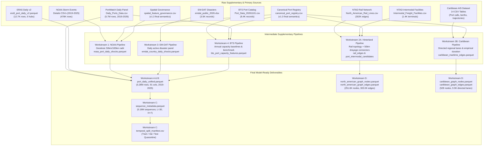

# End-to-End Dataset Lineage and Transformation Architecture

**Project:** AI-Powered Prediction of Global Supply Chain Logistics Bottlenecks  
**Phase:** Phase 2 — Final Data Engineering Stage  
**Artifact Path:** `DL/data/staging/supplementary_acquisition/final_handoff/dataset_lineage.md`  
**Date:** 2026-11-01  
**Status:** Audited & Fully Traced  

---

## 1. High-Level Data Lineage Architecture

The diagram below documents the complete transformation lineage from original raw source files through intermediate enrichment pipelines to the final model-ready datasets delivered for downstream machine learning and deep learning engineers.

---

## 2. Granular Stage-by-Stage Transformation Logic

### Stage 1: Primary Temporal Backbone Integration
* **Input:** PortWatch `Daily_Ports_Data.csv` (filtered to 2019-01-01 through 2025-12-31).
* **Sorting Operation:** Forced strict ascending sort by `(portwatch_id, date_utc)` to correct raw un-indexed ordering.
* **Balanced Grid Verification:** Exactly $2,065 \text{ ports} \times 2,557 \text{ days} = 5,280,205 \text{ rows}$.
* **Calendar Encoding:** Generated `day_of_week` (0=Mon, 6=Sun), `is_weekend` ({0,1}), and `day_of_year` (1–366).
* **Trailing Rolling Windows:** Vectorized transform over $[t-k+1, t]$ for $k \in \{7, 14, 30\}$ for total calls and container calls with `min_periods=1`.

### Stage 2: Supervised Future Target Formulation (Workstream B)
* **Lead Vector Construction:** Computed forward shifts $\text{shift}(-k)$ for $k \in \{1, \dots, 7\}$ per port.
* **Cumulative Horizon Aggregation:** 
  $$\text{target\_portcalls\_7d\_future\_sum} = \sum_{k=1}^7 \text{shift}(-k)$$
* **Leakage Quarantine:** Terminal 7 days of 2025 populated strictly as `NaN`.

### Stage 3: Supplementary Feature Merging & Governance Flags
1. **ERA5 Reanalysis v2 (`has_era5_coverage`):**
   - Left merged on `(portwatch_id, date_utc)`.
   - Populated for 5 primary US gateways (`port1170`, `port1175`, `port481`, `port664`, `port815`).
   - Wave distance classified into `NEARBY_COASTAL_PROXY` ($\le 40\text{ km}$) and `CONDITIONAL_OFFSHORE_PROXY` ($>40\text{ km}$).
   - All other 2,060 ports carry `has_era5_coverage = 0` with null environmental fields.
2. **NOAA Weather Shocks (`has_noaa_coverage`):**
   - Left merged on `(portwatch_id, date_utc)`.
   - Spatially matched severe storms within 50 km and 100 km radii for 56 US canonical ports.
   - Calm days for covered ports carry explicit integer `0` counts and flags; non-covered ports carry `NaN`.
3. **EM-DAT Macro Disaster Shocks (`has_emdat_coverage`):**
   - Left merged on `(country_iso3, date_utc)` across 150 matching sovereign nations.
   - Calm days carry 0 active events; unreported damages/deaths preserved strictly as `NaN`.
4. **BTS Structural Baselines & Capacity Pressure Ratio (`has_bts_coverage`):**
   - Left merged on `(portwatch_id, year)` for 39 US deepwater ports.
   - 2023 structural baseline carried forward across 2024–2025 per port (`is_bts_forward_filled = 1`).
   - Computed dynamic congestion metric:
     $$\text{bts\_capacity\_pressure\_ratio\_14d} = \frac{\text{pw\_calls\_rolling\_14d\_mean}}{\text{bts\_daily\_expected\_vessel\_calls}}$$

### Stage 4: Sliding-Window Indexing & Partition Quarantine (Workstream C)
* **Window Size:** $L = 30$ days lookback, $H = 7$ days forecast horizon (37 days total).
* **Partition Split Rules:**
  - **Train:** Target ends $\le 2023\text{-}12\text{-}31$ (3,696,350 sequences, 71.34%).
  - **Validation:** Target strictly in $2024\text{-}01\text{-}01$ to $2024\text{-}12\text{-}31$ (743,400 sequences, 14.35%).
  - **Test:** Target strictly in $2025\text{-}01\text{-}01$ to $2025\text{-}12\text{-}31$ (741,335 sequences, 14.31%).
* **Boundary Transitions:** 24,780 boundary crossing sequences strictly excluded.

### Stage 5: Graph Topological Packaging (Workstream D)
* **North American Hinterland Network:**
  - 250,204 rail network junctions + 1,401 freight intermodal transfer terminals + 41 canonical US seaport complexes.
  - 302,774 physical rail lines + 242 geodesic intermodal transfer connectors ($\le 50\text{ km}$).
* **Caribbean Regional Maritime Shipping Graph:**
  - 528 commercial seaports spanning 38 Caribbean and Central American territories (including 18 canonical PortWatch gateways).
  - 9,969 empirical directed maritime shipping lanes with observed voyage volumes across vessel classes.

