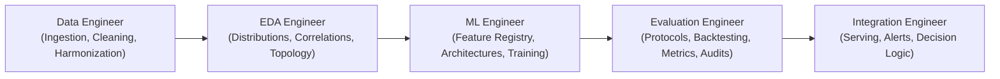

# Evaluation Engineer Workspace — Phase 2 Deep Learning

**Project:** AI-Powered Prediction of Global Supply Chain Logistics Bottlenecks  
**Phase:** Phase 2 — Model Evaluation, Backtesting & Benchmark Verification  
**Role:** Senior Evaluation Engineer  
**Status:** **`ACCEPTED WITH DISCLOSED LIMITATIONS`**  
**Date:** November 2026  

---

## 1. Role Overview & Scientific Mission

The **Evaluation Engineer** is the objective, independent scientific auditor of model behavior across the supply chain analytics lifecycle. While the ML Engineer designs and optimizes neural architectures, and the EDA Engineer investigates underlying data distributions, the Evaluation Engineer establishes immutable testing protocols, verifies mathematical contracts, measures generalizability across space and time, quantifies economic trade-offs, and audits data leakage.

### Core Questions Answered by this Workstream:
1. **Physical Utility:** Does a trained deep learning model provide genuine predictive lift over simple, cost-free physical persistence baselines?
2. **Out-of-Sample Stability:** Does model performance generalize across future temporal regimes (e.g. 2025 out-of-sample) without catastrophic concept drift?
3. **Spatial Robustness:** Are performance improvements concentrated exclusively in high-throughput mega-ports, or do they hold across diverse geographical archetypes?
4. **Failure Modes & Heterogeneity:** Where does the model fail, and what trade-offs (e.g. median error vs. mean squared error) must downstream operators manage?
5. **Cross-Phase Comparability:** Can Stage 02 continuous throughput forecasts be legitimately benchmarked against Stage 01 discrete bottleneck classifiers?

### Distinct Separation of Engineering Roles:



| Role | Core Responsibilities | Canonical Workspace Directory |
|---|---|---|
| **Data Engineer** | Acquisition, schema validation, cleaning, spatial harmonization, intermodal graph generation | `DL/data engineer/` |
| **EDA Engineer** | Statistical distributions, autocorrelation, multicollinearity decay, cross-source calibration | `DL/eda engineer/` |
| **ML Engineer** | Sequence pipelines, feature store, deep learning architectures, loss functions, training loops, checkpoint freezing | `DL/ml engineer/` |
| **Evaluation Engineer** | **Evaluation protocols, leakage audit, validation, blind testing, baseline benchmarks, error stratification, scientific handoff** | **`DL/evaluation engineer/`** |
| **Integration Engineer** | Downstream serving, API contracts, bottleneck threshold logic, operator decision-support interfaces | `DL/integration engineer/` |

---

## 2. Evaluation Scope & Physical Targets

The Stage 02 Deep Learning evaluation rigorously assessed **three distinct operational targets**:

### 1. Cumulative Container-Carrying Vessel Calls (Primary Throughput Target A)
- **Target Variable:** `target_container_calls_7d_future_sum`
- **Definition:** Cumulative sum of commercial container-carrying ship arrivals over the 7-day forecast window $[T+1, T+7]$.
- **Physical Unit:** Vessel Arrivals (integer counts of ships).
- **Domain Clarification:** Measures vessel traffic volume. It is **NOT** direct container handling volume (Twenty-Foot Equivalent Units, TEU), which requires proprietary carrier stowage manifests.

### 2. Cumulative Cargo Tonnage (Primary Throughput Target B)
- **Target Variable:** `target_cargo_tonnage_7d_future_sum`
- **Definition:** Cumulative deadweight metric tons of cargo loaded and discharged over the 7-day forecast window $[T+1, T+7]$.
- **Physical Unit:** Deadweight Metric Tons ($t$).
- **Domain Clarification:** Measures physical deadweight cargo flow derived from vessel displacement and draft changes. It is **NOT** port calls or container-yard inventory.

### 3. Mean Outer Anchorage Waiting Time (Supplementary Dwell Target C)
- **Target Variable:** `avgwaiting_time`
- **Definition:** Weekly mean time vessels spend anchored in outer harbor waters awaiting pilotage or berth clearance.
- **Physical Unit:** Hours ($h$).
- **Evaluated Horizons:** $H=1$ week ($t+1$) and $H=4$ weeks (trailing mean $[t+1, t+4]$).
- **Domain Clarification:** Measures **vessel water-side congestion** at outer anchorages. It is **NOT** land-side container-yard dwell time (container ground residency between discharge and gate-out).

---

## 3. Evaluation Datasets, Splits & Latency Policy

All throughput evaluations were conducted across the global panel of **2,065 commercial ports** from the IMF PortWatch daily monitoring dataset:

### 3.1 Temporal Partitioning Architecture

| Split Tag | Reference Date Range ($T$) | Target Forecast Window ($[T+1, T+7]$) | Sequences ($N$) | Ports | Sequences per Port | Operational Role |
|---|---|---|---:|---:|---:|---|
| **Training** | `2019-02-01` to `2023-12-22` | `2019-02-02` to `2023-12-29` | 3,696,350 | 2,065 | 1,790 | Model fitting |
| **Validation** | `2023-12-23` to `2024-12-30` | `2023-12-24` to `2025-01-06` | 743,400 | 2,065 | 360 | Model selection & hyperparameter freeze |
| **Blind-Test** | `2024-12-31` to `2025-12-24` | `2025-01-01` to `2025-12-31` | 741,335 | 2,065 | 359 | Frozen out-of-sample evaluation |
| **Global Total** | `2019-02-01` to `2025-12-24` | `2019-02-02` to `2025-12-31` | **5,181,085** | **2,065** | **2,509** | Full panel coverage |

### 3.2 The Non-Negotiable $T-2$ Observation Latency Policy
Satellite AIS receivers and terrestrial aggregation pipelines require 24 to 48 hours for global ingestion, deduplication, and anomaly scrubbing. To guarantee that evaluations reflect true operational realities:
- **Lookback Window ($L$):** Exactly 30 consecutive daily observations $[T-31, T-2]$.
- **Quarantined Latency Gap:** Timesteps $T-1$ and $T$ are strictly masked and excluded from input tensors.
- **Forecast Window ($H$):** Forward 7 daily timesteps $[T+1, T+7]$.

---

## 4. Baselines & Evaluation Metrics

### 4.1 Analytical Persistence Baselines
No deep learning model is accepted unless it demonstrates statistically significant, domain-relevant improvement over the cost-free physical persistence baseline observed at timestep $T-2$:
- **Container Vessel Calls Persistence:**
  $$\hat{y}_{\text{naive}}^{\text{container}} = 7.0 \times \left(x_{T-2, 15} \cdot \sigma_{\text{roll7}} + \mu_{\text{roll7}}\right)$$
  *(Seven times the unscaled trailing 7-day rolling mean observed at timestep $T-2$)*
- **Cargo Tonnage Persistence:**
  $$\hat{y}_{\text{naive}}^{\text{tonnage}} = 7.0 \times \left(x_{T-2, 11} \cdot \sigma_{\text{tonnage}} + \mu_{\text{tonnage}}\right)$$
  *(Seven times the unscaled daily cargo tonnage observed at timestep $T-2$)*
- **Anchorage Dwell Persistence:** Trailing 1-week observed waiting time at week $t$.

### 4.2 Mathematical Metric Suite
1. **Huber Loss:** Measures robust error penalization, transitioning from quadratic to linear error at threshold $\delta$:
   $$\mathcal{L}_{\delta}(y, \hat{y}) = \begin{cases} \frac{1}{2}(y - \hat{y})^2 & \text{if } |y - \hat{y}| \le \delta \\ \delta(|y - \hat{y}| - \frac{1}{2}\delta) & \text{otherwise} \end{cases}$$
   - Container Calls: $\delta = 1.0$ calls.
   - Cargo Tonnage: $\delta = 50,000.0$ metric tons.
   - *Note:* Because $\delta$ defines the scale of the loss surface, Huber loss values across different $\delta$ parameters are mathematically incommensurable.
2. **Mean Absolute Error (MAE):** Global linear magnitude of error.
3. **Median Absolute Error (Median AE):** Quantifies error for the median observation, providing critical robustness checks against skewed distributions.
4. **Root Mean Squared Error (RMSE):** Penalizes extreme surge prediction errors.
5. **Coefficient of Determination ($R^2$):** Variance proportion captured by the model relative to mean target variance.
6. **Mean Prediction Bias:** Directional tendency ($\frac{1}{N}\sum (\hat{y} - y)$).

---

## 5. Comprehensive Results Summary

### 5.1 Out-of-Sample Performance Comparison

```carousel
```markdown
### 2024 Full Validation ($N=743,400$, 2,065 Ports)
- **Container Calls:**
  - Naive MAE: 0.8573 calls | Model MAE: **0.8396 calls** (-2.06%)
  - Naive RMSE: 2.4786 calls | Model RMSE: **2.3215 calls** (-6.34%)
  - Naive Huber: 0.6822 | Model Huber: **0.6397** (-6.23%, $\delta=1.0$)
  - Naive Median AE: 0.0000 calls | Model Median AE: **0.0078 calls**
  - Non-Regressed Ports: **94.1%** (1,061 improved, 883 tied, 121 worsened)
- **Cargo Tonnage:**
  - Naive MAE: 42,406.8 t | Model MAE: **41,840.3 t** (-1.34%, saving 566.5 t/seq)
  - Naive RMSE: 147,966.8 t | Model RMSE: **144,398.5 t** (-2.41%)
  - Naive Huber: 1,649.7M | Model Huber: **1,606.3M** (-2.63%, $\delta=50k$)
  - Naive Median AE: 3,946.00 t | Model Median AE: **5,400.36 t** (Model +36.86% higher error)
  - Non-Regressed Ports: **83.1%** (1,245 improved, 471 tied, 349 worsened)
```
<!-- slide -->
```markdown
### 2025 Quarantined Blind-Test ($N=741,335$, 2,065 Ports)
- **Container Calls:**
  - Naive MAE: 0.8504 calls | Model MAE: **0.8323 calls** (-2.13%)
  - Naive RMSE: 2.4820 calls | Model RMSE: **2.3185 calls** (-6.59%)
  - Naive Huber: 0.6784 | Model Huber: **0.6356** (-6.31%, $\delta=1.0$)
  - Naive Median AE: **0.0000 calls** | Model Median AE: **0.0000 calls** (Zero Error Achieved)
  - Non-Regressed Ports: **93.56%** (1,032 improved, 900 tied, 133 worsened)
- **Cargo Tonnage:**
  - Naive MAE: 42,227.7 t | Model MAE: **41,577.7 t** (-1.54%, saving 649.94 t/seq)
  - Naive RMSE: 142,638.5 t | Model RMSE: **139,051.6 t** (-2.51%)
  - Naive Huber: 1,640.6M | Model Huber: **1,594.8M** (-2.79%, $\delta=50k$)
  - Naive Median AE: **3,920.00 t** | Model Median AE: **5,238.34 t** (+33.63% / +1,318.34 t higher error)
  - Non-Regressed Ports: **83.00%** (1,245 improved, 471 tied, 349 worsened)
  - Aggregate Error Reduction: **481,822,176 metric tons** across overlapping windows
```
<!-- slide -->
```markdown
### Weekly Anchorage Dwell Validation & Test (19 Mega-Ports)
- **2021 Crisis Validation ($N=1,007$):**
  - Naive MAE: 5.8669 h | Model MAE: **5.7353 h** (-2.24%)
  - Naive RMSE: 10.9689 h | Model RMSE: **10.8556 h** (-1.03%)
  - 4-Week Horizon MAE: 6.5963 h -> **5.8675 h** (-11.05%)
- **2022 Held-Out Test ($N=931$):**
  - Naive MAE: 4.3910 h | Model MAE: **4.0824 h** (-7.03%)
  - Naive RMSE: 6.8002 h | Model RMSE: **6.4028 h** (-5.84%)
  - Huber Loss: 9.6767 -> **8.7176** (-9.91%)
```
````

### 5.2 Disclosed Weaknesses & Heterogeneity (Non-Universal Improvement)
The Evaluation Engineer transparently reports that aggregate improvements are **not universal**:
1. **Median Absolute Error Trade-off:**
   Across the 2025 blind-test panel, **61.59% of sequence windows experience zero container calls** (456,588 sequences) and **32.05% experience zero cargo tonnage** (237,571 sequences).
   - For container calls: Both naive persistence and the model achieve $\text{Median AE} = 0.0000$ calls.
   - For cargo tonnage: Naive persistence achieves a **lower median absolute error** (**3,920.00 metric tons** vs. model's **5,238.34 metric tons**, +33.63% / +1,318.34 tons model regression on median).
   - *Cause:* On quiet ports, persistence predicts exact zeros or low discrete values, while the neural network outputs small non-zero continuous residuals, trading higher median error on quiet ports for substantial error reduction on volatile tail surges.
2. **Stratified Activity Bucket Regressions:**
   - *Low Container Traffic (1–7 calls/week, $N=193,338$ / 26.08%):* Model exhibits mild MAE regression (-0.0268 calls, MAE 1.1837 vs 1.1569).
   - *Low Cargo Tonnage (1–20k tons, $N=216,370$ / 29.19%):* Model exhibits mild MAE regression (-238.10 tons, MAE 8,351.69 vs 8,113.59).
   - *Medium Cargo Tonnage (20k–150k tons, $N=166,704$ / 22.49%):* Model exhibits mild MAE regression (-72.09 tons, MAE 37,049.71 vs 36,977.62).
   - *High-Activity Gateways:* Predictive gains are overwhelmingly concentrated in active gateways (>28 calls/week: $\Delta = +0.4677$ calls; >150k tons/week: $\Delta = +4,092.31$ tons).
3. **Port-Level Degradations:**
   Across the global network, 133 ports (6.44%) regressed on container calls and 349 ports (16.90%) regressed on cargo tonnage relative to persistence.
4. **Dwell Data Horizon Cutoff:**
   Public AIS waiting-time records end at December 31, 2022. No 2023–2025 public telemetry exists to evaluate modern dwell dynamics.

---

## 6. Directory Structure & Canonical Organization

```text
DL/evaluation engineer/
├── README.md                                   # Master workspace guide and scientific overview
├── protocols/
│   ├── final_blind_evaluation_protocol.md      # Frozen 2025 blind evaluation protocol
│   ├── evaluation_protocol.md                  # Canonical symlink to evaluation protocol
│   └── split_and_leakage_policy.md             # Strict T-2 latency & zero-leakage contract
├── reports/
│   ├── validation/
│   │   └── validation_report_2024.md           # Full 2024 global panel validation report
│   ├── blind_test/
│   │   └── final_blind_test_evaluation_report.md# Authoritative 2025 blind-test evaluation report
│   ├── generalization/
│   │   └── final_generalization_analysis.md    # Multi-dimensional generalization & drift report
│   ├── evidence_reconciliation/
│   │   └── final_dl_evidence_reconciliation.md # Mathematical reconciliation & audit disclosure
│   └── audit/
│       ├── final_dl_verification_audit.md      # Comprehensive forensic audit of Phase 2
│       ├── final_dl_verification_summary.md    # Executive summary of verification audit
│       ├── milestone_3_5_1_audit_report.md     # Independent audit of M3.5 architecture selection
│       └── milestone_3_6_1_final_audit_report.md# Independent audit of M3.6 models and heads
├── scripts/
│   ├── evaluation/
│   │   ├── evaluate_blind_test_throughput.py   # Full 2025 blind-test evaluation driver
│   │   ├── evaluate_full_validation_throughput.py # Full 2024 validation evaluation driver
│   │   ├── evaluate_dwell_forecaster.py        # Dwell GRU evaluation driver
│   │   ├── evaluate_throughput_forecaster.py   # Quick direct throughput validation evaluator
│   │   ├── evaluate_multi_horizon.py           # Multi-horizon (1d, 3d, 7d) evaluation driver
│   │   ├── evaluate_regional_gnn.py            # Caribbean ST-GNN spatial ablation evaluator
│   │   └── evaluate_temporal_attention.py      # Transformer attention benchmarking evaluator
│   ├── metrics/
│   │   └── metrics.py                          # Master evaluation metrics calculation library
│   └── analysis/
│       └── extract_attention_diagnostics.py    # Temporal attention extraction & interpretability
├── artifacts/
│   ├── metrics/
│   │   ├── blind_test_metrics_2025.json        # Authoritative 2025 blind-test metrics summary
│   │   ├── evaluation_metrics_full_2024.json   # Authoritative 2024 full validation metrics summary
│   │   ├── dwell_evaluation_metrics.json       # Dwell GRU validation and test metrics summary
│   │   └── multi_horizon_metrics.json          # Multi-horizon evaluation metrics summary
│   ├── predictions/
│   │   ├── README.md                           # Schema documentation and SHA-256 manifest
│   │   ├── blind_test_predictions_2025.parquet # Relative symlink to 18.94MB prediction parquet
│   │   ├── validation_predictions_full_2024.parquet # Relative symlink to 18.45MB prediction parquet
│   │   ├── dwell_validation_predictions_2021.parquet# Relative symlink to dwell validation parquet
│   │   └── dwell_test_predictions_2022.parquet # Relative symlink to dwell test parquet
│   ├── tables/
│   │   ├── table_01_blind_test_monthly_stability_2025.csv # Monthly stability audit table
│   │   ├── table_02_blind_test_activity_buckets_2025.csv  # Activity tier error breakdown
│   │   ├── table_03_blind_test_top_improved_ports_2025.csv# Top 10 improved ports
│   │   ├── table_04_blind_test_top_worsened_ports_2025.csv# Top 10 worsened ports
│   │   └── table_05_dwell_evaluation_summary.csv          # Dwell evaluation summary
│   └── figures/
│       └── README.md                           # Visual diagnostics catalog & findings
└── documentation/
    ├── evaluation_handoff.md                   # Downstream handoff to Integration Engineering
    └── ml_vs_dl_comparability_audit.md         # Forensic audit: Classical ML vs Deep Learning
```

---

## 7. Exact Step-by-Step Reproducibility Guide

All evaluation scripts are fully deterministic and run strictly in out-of-sample inference mode without training.

### Environment Requirements
- Python 3.10+
- PyTorch 2.0+ (supports CPU or Apple Silicon MPS)
- PyArrow, Pandas, NumPy, Scipy, PyYAML
- Virtual environment: `DL/.venv`

### Verified Execution Commands

#### 1. Re-run Quick Throughput Verification (30,000 Validation Sequences)
```bash
DL/.venv/bin/python "DL/evaluation engineer/scripts/evaluation/evaluate_throughput_forecaster.py"
```
*Expected Output:* Prints Huber, MAE, RMSE, and $R^2$ for Container Calls and Cargo Tonnage, verifying frozen backbone SHA256 (`ff67c307...`).

#### 2. Re-run Anchorage Dwell Forecaster Evaluation (2021 Val & 2022 Test)
```bash
DL/.venv/bin/python "DL/evaluation engineer/scripts/evaluation/evaluate_dwell_forecaster.py"
```
*Expected Output:* Prints 1-week and 4-week MAE reductions (-2.24% in 2021, -7.03% in 2022) across the 19 mega-ports.

#### 3. Re-run Full 2024 Global Validation Evaluation (743,400 Sequences)
```bash
DL/.venv/bin/python "DL/evaluation engineer/scripts/evaluation/evaluate_full_validation_throughput.py"
```
*Expected Output:* Ingests `sequence_metadata.parquet`, runs inference in ~95 seconds (~7,800 seq/s), exports `validation_predictions_full_2024.parquet`, and updates `evaluation_metrics_full_2024.json`.

#### 4. Re-run Full 2025 Quarantined Blind-Test Evaluation (741,335 Sequences)
```bash
DL/.venv/bin/python "DL/evaluation engineer/scripts/evaluation/evaluate_blind_test_throughput.py"
```
*Expected Output:* Runs complete blind-test inference, verifies zero data leakage, exports `blind_test_predictions_2025.parquet`, and mirrors `blind_test_metrics_2025.json`.

---

## 8. Summary of ML vs. DL Comparability Audit

A forensic investigation comparing Stage 01 Classical ML (XGBoost/LightGBM delay triage) and Stage 02 Deep Learning (Transformer throughput forecasting) concluded that the two workstreams are:

**`NOT CURRENTLY COMPARABLE`**

### Key Reasons:
1. **Divergent Objectives:** Stage 01 is discrete 3-class classification (`ON_TIME`, `AT_RISK`, `CRITICAL_DELAY`). Stage 02 is continuous multi-target regression ($y \in \mathbb{R}^+$).
2. **Divergent Targets:** Stage 01 predicted container dwell delay thresholds. Stage 02 predicts cumulative vessel calls, cargo metric tonnage, and outer anchorage waiting hours.
3. **Divergent Resolution:** Stage 01 evaluated individual containers at a single facility ($N \approx 14k$). Stage 02 evaluated global macro-traffic across 2,065 ports ($N \approx 741k$).
4. **Metric Space Disconnect:** Stage 01 used PR-AUC, F1, and cost matrices. Stage 02 used Huber loss, MAE, RMSE, and $R^2$.

*For complete audit details and the proposed minimum controlled benchmark, see [`documentation/ml_vs_dl_comparability_audit.md`](file:///Users/abdul/Desktop/DS/DL/evaluation%20engineer/documentation/ml_vs_dl_comparability_audit.md).*

---

## 9. Accepted Project Limitations

In strict adherence to the formal closure status **`ACCEPTED WITH DISCLOSED LIMITATIONS`**, all evaluation artifacts reflect the following immutable boundaries:
1. **Public Telemetry Temporal Boundary:** Public AIS anchorage waiting-time data ends at December 2022.
2. **Absence of Terminal Operating System (TOS) Feeds:** PortWatch data captures macro-level vessel counts and capacity at a daily scale, but lacks micro-level crane gang moves, yard slot densities, and gate queues.
3. **Daily / Weekly Resolution:** Forecasts are evaluated at a daily/weekly cadence, not real-time hourly telemetry.
4. **Volume vs. Congestion Disconnect:** High throughput does not inherently mean bottleneck; downstream integration must normalize by port design capacity.
