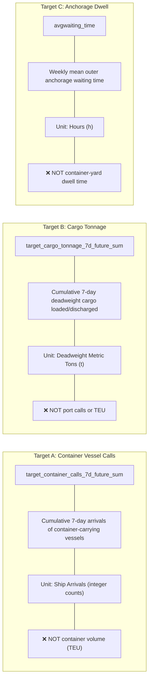

# Final Evaluation Engineer Technical Handoff Document

**Project:** AI-Powered Prediction of Global Supply Chain Logistics Bottlenecks  
**Phase:** Phase 2 — Deep Learning Engineering Closure  
**Role:** Senior Evaluation Engineer & Technical Handoff Owner  
**Audience:** Integration Engineers, Decision-Support Systems Engineers, and MLOps Architects  
**Date:** November 2026  
**Final Status:** **`ACCEPTED WITH DISCLOSED LIMITATIONS`**  

---

## 1. Executive Summary & Purpose

This document constitutes the authoritative evaluation handoff from the Evaluation Engineering workstream to downstream engineering (Integration Engineering, Decision-Support systems, and production operations).

It summarizes the empirical evidence, verification protocols, quantitative findings, operational trade-offs, and physical limitations established across both historical validation partitions (2024, $N=743,400$) and the quarantined out-of-sample blind-test dataset (2025, $N=741,335$ across 2,065 commercial ports).

The workstream was formally closed under the status **`ACCEPTED WITH DISCLOSED LIMITATIONS`**, reflecting full scientific rigor and successful persistence outperformance alongside explicit disclosure of operational telemetry boundaries.

---

## 2. Core Evaluated Targets & Domain Semantics

Downstream consumers must adhere strictly to physical domain definitions when integrating model outputs:

---

## 3. Authoritative Empirical Performance Matrix

### 3.1 2024 Full Validation Panel ($N=743,400$, 2,065 Ports)
- **Container Vessel Calls ($[T+1, T+7]$):**
  - Naive Persistence: Huber=0.6822, MAE=0.8573 calls, Median AE=0.0000 calls, RMSE=2.4786, $R^2=0.9794$
  - Residual Forecaster: Huber=**0.6397** (-6.23%), MAE=**0.8396** (-2.06%), Median AE=**0.0078**, RMSE=**2.3215** (-6.34%), $R^2$=**0.9819**
  - Spatial Performance: **94.1% of ports improved or tied** (1,061 improved, 883 tied, 121 regressed)
- **Cargo Tonnage ($[T+1, T+7]$):**
  - Naive Persistence: Huber=1,649,663,744.0, MAE=42,406.8 t, Median AE=3,946.0 t, RMSE=147,966.8 t, $R^2=0.9562$
  - Residual Forecaster: Huber=**1,606,295,552.0** (-2.63%), MAE=**41,840.3 t** (-1.34%, saving 566.5 t/seq), Median AE=**5,400.4 t** (+36.86%), RMSE=**144,398.5 t** (-2.41%), $R^2$=**0.9583**
  - Spatial Performance: **83.1% of ports improved or tied** (1,245 improved, 471 tied, 349 regressed)

### 3.2 2025 Quarantined Blind-Test Panel ($N=741,335$, 2,065 Ports)
- **Container Vessel Calls ($[T+1, T+7]$):**
  - Naive Persistence: Huber=0.6784, MAE=0.8504 calls, Median AE=**0.0000 calls**, RMSE=2.4820, $R^2=0.9799$
  - Residual Forecaster: Huber=**0.6356** (-6.31%), MAE=**0.8323** (-2.13%), Median AE=**0.0000 calls**, RMSE=**2.3185** (-6.59%), $R^2$=**0.9824**
  - Spatial Performance: **93.56% of ports improved or tied** (1,032 improved, 900 tied, 133 regressed)
- **Cargo Tonnage ($[T+1, T+7]$):**
  - Naive Persistence: Huber=1,640,635,264.0, MAE=42,227.7 t, Median AE=**3,920.0 t**, RMSE=142,638.5 t, $R^2=0.9589$
  - Residual Forecaster: Huber=**1,594,848,768.0** (-2.79%), MAE=**41,577.7 t** (-1.54%), Median AE=**5,238.3 t** (+33.63% / +1,318.34 t higher error), RMSE=**139,051.6 t** (-2.51%), $R^2$=**0.9609**
  - Spatial Performance: **83.00% of ports improved or tied** (1,245 improved, 471 tied, 349 regressed)
  - Aggregate Prediction Error Reduction: **481,822,176 metric tons** across overlapping forecast windows ($649.94$ tons per sequence).

---

## 4. Full Disclosed Limitations & Critical Caveats

Downstream engineers must incorporate the following disclosed limitations into alert rules and operational logic:

### 4.1 Median Absolute Error Trade-off on Quiet Ports
- Across the global network in 2025, **61.59% of sequence windows experience zero container vessel arrivals** (456,588 sequences), and **32.05% experience zero cargo tonnage** (237,571 sequences).
- For container calls: Both naive persistence and the residual forecaster achieve $\text{Median AE} = 0.0000$ calls.
- For cargo tonnage: Naive persistence achieves a **lower median absolute error** (**3,920.00 metric tons** vs. model's **5,238.34 metric tons**, +33.63% / +1,318.34 tons model regression on median; and 3,946.00 t vs. 5,400.36 t in 2024).
- *Operational Implication:* On quiet ports, persistence predicts exact zeros or low discrete values, while the neural network predicts small continuous non-zero outputs ($2,264.6$ tons mean on zero-freight sequences), yielding higher median absolute error while significantly reducing extreme surge errors in the upper tail.
- **Rule for Downstream:** Apply an operational deadband filter (e.g. round predictions $< 0.5$ calls to zero) when serving low-volume berths.

### 4.2 Stratified Regressions in Low-Activity Buckets
- In the low container traffic bucket (1–7 calls/week, $N=193,338$ / 26.08%), the model exhibits a mild MAE regression (-0.0268 calls, MAE 1.1837 vs 1.1569).
- In the low tonnage bucket (1–20k tons, $N=216,370$ / 29.19%), the model exhibits a mild MAE regression (-238.10 tons, MAE 8,351.69 vs 8,113.59).
- In the medium tonnage bucket (20k–150k tons, $N=166,704$ / 22.49%), the model exhibits a mild MAE regression (-72.09 tons, MAE 37,049.71 vs 36,977.62).
- **Rule for Downstream:** High-confidence alerts should prioritize the **High Activity gateways** (>28 calls/week and >150k tons/week), where the model achieves strong error reductions (+0.4677 calls and +4,092.31 tons).

### 4.3 Dwell Data Horizon Cutoff
- Public AIS anchorage waiting-time data terminates at December 31, 2022.
- The `ResidualDwellGRUForecaster` is verified on 2021 validation and 2022 test, but cannot be evaluated or served on 2023–2025 public telemetry without proprietary AIS feeds.

### 4.4 Throughput vs. Bottleneck Operational Distinction
- Continuous throughput predictions must **NEVER** be treated as raw bottleneck classifications.
- A predicted surge of 500,000 tons represents high capacity utilization at Rotterdam, but a catastrophic supply chain collapse at a regional island port.
- **Rule for Downstream:** Bottleneck severity must be calculated by dividing predicted throughput by the port's empirical 95th percentile capacity:
  $$\text{PressureRatio} = \frac{\hat{y}_{\text{tonnage}, 7d}}{\text{Capacity}_{95th, 7d}}$$

---

## 5. Master Checkpoint & Artifact Provenance Matrix

| Role | Artifact Relative Path | Size | SHA-256 Digest | Status |
|---|---|---:|---|---|
| **Representation Backbone** | `DL/ml engineer/artifacts/transformer_mean_pooling/best_model.pt` | 870,796 B | `ff67c307183a73d03ceb2d0332520ff767a54c12971eeaa6acc68027f902711e` | Frozen |
| **Throughput Forecaster** | `DL/ml engineer/artifacts/throughput_forecasting/best_model.pt` | 22,839 B | `0e9b85cefcc06a62db1e5292101d550bc62db57fa6dda72a53f6d2c7d33bd19d` | Frozen |
| **Anchorage Dwell Forecaster** | `DL/ml engineer/artifacts/dwell_forecasting/best_model.pt` | 180,469 B | `0b767ca74dfe7d43fcd2613d11ed9b5e02fdede342055ebccfdfeecd44b59371` | Frozen |
| **2025 Blind Predictions** | `DL/evaluation engineer/artifacts/predictions/blind_test_predictions_2025.parquet` | 18.94 MB | `57552e6cb469347ac9678d97bdbaef367c7c9a56d8d3343261a82201ffd05abf` | Verified |
| **2024 Val Predictions** | `DL/evaluation engineer/artifacts/predictions/validation_predictions_full_2024.parquet` | 18.45 MB | `f5aad11c457d17f88dc842189a1a14bd0d17c811e3059fea7b11ce6823e73379` | Verified |
| **2025 Metrics Manifest** | `DL/evaluation engineer/artifacts/metrics/blind_test_metrics_2025.json` | 24,396 B | Verified | Verified |
| **2024 Metrics Manifest** | `DL/evaluation engineer/artifacts/metrics/evaluation_metrics_full_2024.json` | 24,272 B | Verified | Verified |

