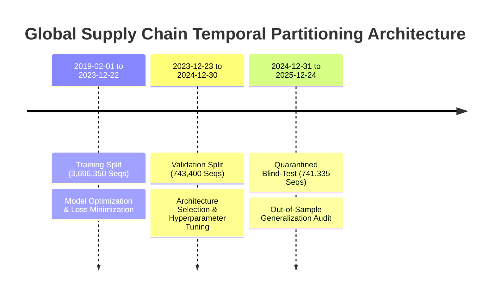

# Temporal Partitioning, Observation Latency & Zero-Leakage Policy

**Role:** Evaluation Engineer  
**Workstream:** Phase 2 Deep Learning Engineering  
**Scope:** Global Port Network (2,065 Commercial Ports)  
**Status:** Frozen & Authoritative  

---

## 1. Executive Summary & Purpose

In maritime time-series forecasting, naive evaluation setups routinely suffer from severe data leakage that invalidates production deployment. The two most common failure modes are:
1. **Contemporaneous Lookahead Bias:** Assuming telemetry from day $T$ is available at day $T$ when satellite and terrestrial AIS pipelines require 24 to 48 hours for global ingestion, deduplication, and reconciliation.
2. **Standardization Leakage:** Fitting scalers or imputers across the entire dataset, leaking future global mean and variance into historical training.

This policy defines the non-negotiable operational standards governing data partitioning, latency enforcement, and leakage prevention for all Stage 02 evaluations.

---

## 2. Temporal Partition Bounds

The global PortWatch panel covers daily telemetry from January 1, 2019 through December 31, 2025 (5.28M records across 2,065 commercial ports). Sequence windows are strictly partitioned chronologically based on their **reference date** ($T$):

| Split Tag | Reference Date Range ($T$) | Target Forecast Window ($[T+1, T+7]$) | Sequence Count ($N$) | Commercial Ports | Sequences per Port |
|---|---|---|---:|---:|---:|
| **Training** | `2019-02-01` to `2023-12-22` | `2019-02-02` to `2023-12-29` | 3,696,350 | 2,065 | 1,790 |
| **Validation** | `2023-12-23` to `2024-12-30` | `2023-12-24` to `2025-01-06` | 743,400 | 2,065 | 360 |
| **Quarantined Blind-Test** | `2024-12-31` to `2025-12-24` | `2025-01-01` to `2025-12-31` | 741,335 | 2,065 | 359 |
| **Total Global Panel** | `2019-02-01` to `2025-12-24` | `2019-02-02` to `2025-12-31` | **5,181,085** | **2,065** | **2,509** |



---

## 3. The Strict $T-2$ Operational Observation Latency Contract

### 3.1 Physical Rationale
Satellite Automatic Identification System (S-AIS) messages and terrestrial AIS receivers experience latency due to constellation orbital passes, message collision in dense waterways (e.g. Malacca Strait, English Channel), and batch processing by the IMF PortWatch aggregation engine. In operational practice, daily port calls and tonnage figures for date $t$ are not fully validated until date $t+2$.

### 3.2 Tensor Window Definition
For any prediction issued at reference date $T$:
- **Lookback Length ($L$):** Exactly 30 daily timesteps.
- **Valid Observation Window:** $[T-31, T-2]$.
- **Quarantined Latency Gap:** $[T-1, T]$ (strictly omitted from input tensors).
- **Forecast Horizon ($H$):** Exactly 7 daily timesteps $[T+1, T+7]$.

```text
Sequence Timeline Representation:
[T-31] ................... [T-2]  |  [T-1]    [T]   |  [T+1] .................. [T+7]
<------ Lookback (30 Days) ------>  <-- Masked Gap ->  <--- Forecast Horizon (7 Days) --->
         (Input Tensor)              (Latency: 48h)              (Targets)
```

Any model attempting to ingest observations from $T-1$ or $T$ violates this contract and is rejected.

---

## 4. Preprocessing & Normalization Isolation

1. **Scaler Fitting Boundary:**
   The `TrainingStandardScaler` parameters (`scaler_params.json`) are fitted exclusively on the training partition ($T \le 2023-12-22$).
   - Mean vector $\mu \in \mathbb{R}^{20}$
   - Standard deviation vector $\sigma \in \mathbb{R}^{20}$
2. **Immutability During Evaluation:**
   During validation and blind-test evaluation, the normalization parameters are frozen. No online updating, streaming variance calculation, or test-set adaptive scaling is permitted.
3. **In-Flight Denormalization:**
   Target values are predicted and evaluated in their true physical physical units:
   - Container Vessel Calls: Integer arrivals ($N$ ships).
   - Cargo Tonnage: Deadweight metric tons ($t$).
   - Anchorage Waiting Time: Hours ($h$).

---

## 5. Baselines & Benchmarking Rules

1. **Strict Non-Negative Persistence Anchor:**
   All candidate deep learning models must be evaluated against the analytical persistence baseline observed at timestep $T-2$:
   - For container calls: $\hat{y}_{\text{naive}} = 7.0 \times \text{roll7\_mean}_{T-2}$
   - For cargo tonnage: $\hat{y}_{\text{naive}} = 7.0 \times \text{daily\_tonnage}_{T-2}$
2. **Huber Loss Parameterization:**
   Huber loss metrics must declare their transition threshold $\delta$:
   - Container vessel calls: $\delta = 1.0$ calls.
   - Cargo tonnage: $\delta = 50,000.0$ metric tons.
   - Dwell waiting time: $\delta = 1.0$ hours.
   Different $\delta$ values define mathematically different loss surfaces and must never be compared directly against each other.

---

## 6. Programmatic Zero-Leakage Verification

The pipeline integrity is continuously verified through `DL/ml engineer/verify_pipeline.py`:
- **Check 1 (Lookback Shape):** Verifies that all batches yield tensors of shape `[B, 30, 20]`.
- **Check 2 (Latency Masking):** Confirms that feature index timestamps strictly terminate at $T-2$.
- **Check 3 (Target Independence):** Synthetically injects perturbations into future targets and asserts that input sequence feature matrices remain identical bit-for-bit.

