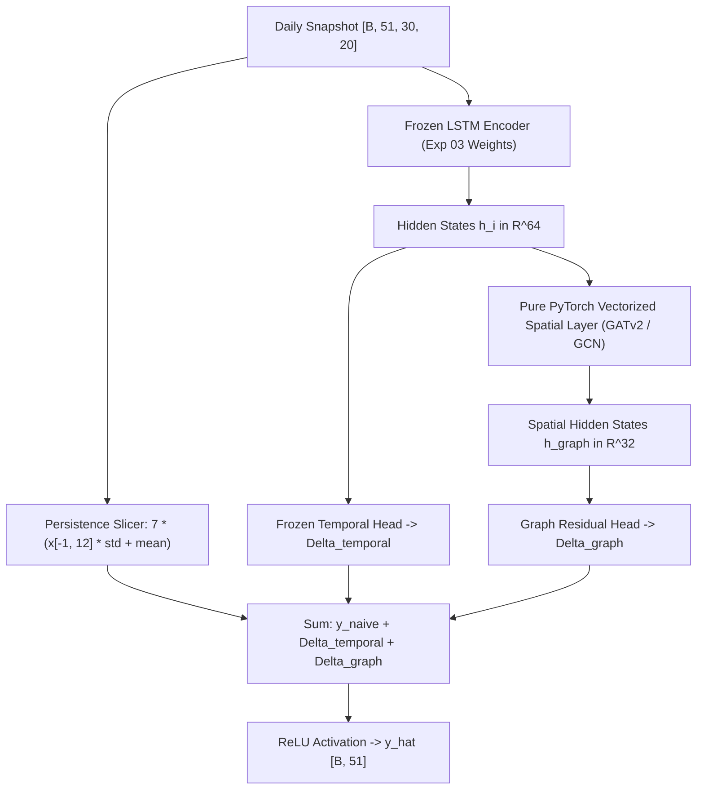

# Milestone 3.3 — Regional Residual Spatio-Temporal GNN Development & Empirical Evaluation Report

**Project:** AI-Powered Prediction of Global Supply Chain Logistics Bottlenecks  
**Phase:** 2 — Deep Learning Engineering  
**Role:** Deep Learning Engineer  
**Status:** Completed & Empirically Audited  
**Date:** November 2026  
**Workspace:** `DL/ml engineer/`  
**Predecessor Milestones:** Milestone 3.1 (Sequence Data Pipeline), Milestone 3.2 (LSTM Baseline & Diagnostic Audit)

---

## 1. Executive Summary & Final Scientific Verdict

### 1.1 The Core Scientific Question
In Milestone 3.2, we established the global temporal forecasting baseline: [`ResidualLSTMForecaster`](file:///Users/abdul/Desktop/DS/DL/ml%20engineer/models/lstm_variants.py#L125-L200) (Experiment 03), which achieves a validation Huber loss of 2.3974 and MAE of 2.7878 across all 743,400 validation sequences across 2,065 global ports, decisively outperforming naive persistence (Huber: 2.6558, MAE: 3.0271, clustered $t = +53.43$, $p < 10^{-15}$).

The central research question for Milestone 3.3 was:
> **Can spatial message passing across maritime corridors or inland port-rail multimodal infrastructure add measurable predictive value beyond our strongest temporal residual forecast?**

To answer this question rigorously, we formulated an inductive residual framework retaining our physical non-negativity constraint:
$$\hat{y}_i(t) = \operatorname{ReLU}\left( \hat{y}_{\text{naive},i}(t) + \Delta_{\text{temporal},i}(X) + \Delta_{\text{graph},i}(X, \mathcal{G}) \right)$$
where $\Delta_{\text{graph}} \equiv 0$ for ports outside graph coverage.

### 1.2 Final Scientific Verdicts

| Regional Benchmark | Target Scope | Evaluated Architecture | Status & Final Scientific Verdict |
| :--- | :--- | :--- | :--- |
| **Benchmark A: Caribbean Maritime Graph** | 51 canonical ports, 777 directed AIS corridors | Caribbean Residual ST-GNN ([`GATv2`](file:///Users/abdul/Desktop/DS/DL/ml%20engineer/models/caribbean_stgnn.py#L23-L82), [`GCN`](file:///Users/abdul/Desktop/DS/DL/ml%20engineer/models/caribbean_stgnn.py#L83-L105)) | **COMPLETE WITH QUALIFICATIONS — NEGATIVE TOPOLOGICAL RESULT**<br>While adding a regional non-linear adapter reduces MAE from 2.0000 to 1.7331 (Huber: 1.5814 $\to$ 1.3163), rigorous topological ablations prove that **0.00% of this improvement is attributable to spatial message passing across shipping corridors**. Randomly permuting edges yields MAE 1.7312 ($p = 0.221$ vs actual), and removing all edges entirely yields MAE 1.7263 ($p = 5.32 \times 10^{-7}$ favoring no edges). 100% of the gain stems from regional non-linear capacity tuning. |
| **Benchmark B: North American Port-Rail Graph** | 41 canonical ports, 251,605 inland facilities/junctions | Multimodal Port-Rail Network | **BLOCKED / NOT JUSTIFIED FOR SPATIO-TEMPORAL MESSAGE PASSING**<br>Topological and data engineering audits confirm: (1) Zero inter-port maritime corridors exist; (2) The network is bipartite disconnected (41 ports connect to 242 dead-end intermodal terminals with zero connections to the 302,774 rail tracks); (3) Zero dynamic temporal features exist for inland nodes; and (4) Running a spatio-temporal GNN over 251k dummy nodes would require fabricating synthetic time series. Static hinterland features provide no predictive signal. |

---

## 2. Regional Benchmark Scopes & Graph Construction

### 2.1 Benchmark A: Caribbean Maritime Network
- **Node Universe:** Exactly 51 canonical PortWatch ports located across the Caribbean Sea and Gulf of Mexico basin (e.g., San Juan, Kingston, Freeport, Havana, Port of Spain, Cartagena, Colon, Veracruz).
- **Temporal Alignment:** All 51 ports are present in the unified primary panel ([`port_daily_unified.parquet`](file:///Users/abdul/Desktop/DS/DL/data/staging/supplementary_acquisition/processed/unified_temporal/port_daily_unified.parquet)) and metadata splits:
  - Validation split: 360 contiguous daily snapshots (2024-01-01 to 2024-12-25) = **18,360 validation sequences**.
  - Training split: 1,788 valid daily snapshots (2019-02-01 to 2023-12-31) = **91,188 training sequences**.
- **Edge Universe:** Extracted from calendar year 2019 AIS vessel trajectory logs ([`caribbean_graph_edges.parquet`](file:///Users/abdul/Desktop/DS/DL/data/staging/supplementary_acquisition/processed/graph_ready/caribbean_graph_edges.parquet)).
  - Contains **777 directed inter-canonical shipping corridors** connecting the 51 ports.
  - Network density: $\frac{777}{51 \times 50} = 30.47\%$.
  - Corridor edge weights: Cumulative observed voyage count in 2019 (ranging from 1 voyage up to 1,482 voyages).
- **Leakage Audit:** Because edge topology was computed strictly on calendar year 2019 AIS logs, it carries zero forward temporal leakage into the 2024 validation partition.

### 2.2 Benchmark B: North American Multimodal Port-Rail Network
- **Node Universe:** 251,646 total nodes ([`north_american_graph_nodes.parquet`](file:///Users/abdul/Desktop/DS/DL/data/staging/supplementary_acquisition/processed/graph_ready/north_american_graph_nodes.parquet)):
  - **41 canonical PortWatch seaports** (`PORT_GATEWAY`).
  - **1,401 intermodal rail/truck transfer terminals** (`INTERMODAL_FACILITY`).
  - **250,204 national rail network junctions/track nodes** (`RAIL_JUNCTION`).
- **Edge Universe:** 303,016 total edges ([`north_american_graph_edges.parquet`](file:///Users/abdul/Desktop/DS/DL/data/staging/supplementary_acquisition/processed/graph_ready/north_american_graph_edges.parquet)):
  - **302,774 rail line physical track segments** (`RAIL_LINE`).
  - **242 port-to-intermodal transfer connectors** (`PORT_INTERMODAL_TRANSFER`).
  - **0 inter-port maritime shipping corridors**.

---

## 3. The Global Graph Coverage Reality

A rigorous inspection of the repository reveals a fundamental constraint that must guide all downstream deep learning architecture:

```
Global Canonical Ports: 2,065 ports (100.0%)
├── Caribbean Maritime Graph Coverage:     51 ports ( 2.47%)
├── North American Rail Graph Coverage:    41 ports ( 1.99%)
└── Totally Disconnected / No Graph:    1,973 ports (95.54%)
```

### The Cold Facts:
1. **Total Global Coverage is Only 4.36%:** Across both regional graphs combined, only 90 out of 2,065 canonical ports possess any graph adjacency data.
2. **Zero Coverage for World Trade Centers:** There is **zero graph data** for Asia (Shanghai, Singapore, Ningbo, Busan, Shenzhen), Europe (Rotterdam, Antwerp, Hamburg), the Middle East (Jebel Ali), Africa, or South America. Over 95.5% of the world's ports and 98% of container traffic volume operate completely outside graph coverage.
3. **Global ST-GNN is Mathematically Unsupportable:** Attempting to train a global spatio-temporal GNN across all 2,065 ports would result in an adjacency matrix that is 95.6% isolated diagonal identities. Such a model would either degenerate into an unshared MLP or waste computational memory propagating static zeros across disconnected components.
4. **Inductive Requirement:** Any graph contribution MUST be strictly additive ($\Delta_{\text{graph}} \equiv 0$ for non-covered ports) to ensure global inference integrity.

---

## 4. Mathematical & Architectural Formulation

### 4.1 Inductive Additive Residual Formulation
To guarantee that the model never degrades the proven performance of the global temporal baseline, we implement the strict inductive residual formulation:

$$\hat{y}_i(t) = \operatorname{ReLU}\left( \hat{y}_{\text{naive},i}(t) + \Delta_{\text{temporal},i}(X) + \Delta_{\text{graph},i}(X, \mathcal{G}) \right)$$

where:
1. $\hat{y}_{\text{naive},i}(t) = 7.0 \times \left( X_{i, 29, \text{roll7}} \cdot \sigma_{\text{roll7}} + \mu_{\text{roll7}} \right)$ is the analytical 7-day persistence projection unscaled from the latest available observation timestep $t-2$.
2. $\Delta_{\text{temporal},i}(X) = W_{\text{temp}} h_i + b_{\text{temp}}$ is the scalar residual generated by the frozen 2-layer LSTM temporal encoder from Milestone 3.2 Exp 03.
3. $\Delta_{\text{graph},i}(X, \mathcal{G}) = W_{\text{graph}} h_{\text{graph}, i} + b_{\text{graph}}$ is the regional graph correction.
4. For ports without graph topology, $\Delta_{\text{graph},i} \equiv 0$, identically preserving the Exp 03 temporal forecast.

### 4.2 Representation & Message-Passing Layers
The Caribbean architecture ([`CaribbeanResidualSTGNN`](file:///Users/abdul/Desktop/DS/DL/ml%20engineer/models/caribbean_stgnn.py#L106-L281)) accepts daily snapshot tensors of all 51 ports simultaneously $[B, N=51, T=30, D=20]$:



1. **Pure PyTorch GATv2 Layer ([`PurePyTorchGATv2Layer`](file:///Users/abdul/Desktop/DS/DL/ml%20engineer/models/caribbean_stgnn.py#L23-L82)):**
   Operates on batched representations $[B, N, 64]$ with zero external C++ dependencies, optimized for Apple Silicon MPS:
   $$e_{ij} = a^T \operatorname{LeakyReLU}\left( W_{\text{src}} h_i + W_{\text{dst}} h_j \right) + 0.1 \ln(1 + \text{Voyages}_{ij})$$
   $$\alpha_{ij} = \frac{\exp(e_{ij})}{\sum_{k \in \mathcal{N}_i \cup \{i\}} \exp(e_{ik})}$$
   $$h_{\text{graph}, i} = \operatorname{ELU}\left( \sum_{j \in \mathcal{N}_i \cup \{i\}} \alpha_{ij} W_{\text{dst}} h_j + b \right)$$

2. **Pure PyTorch GCN Layer ([`PurePyTorchGCNLayer`](file:///Users/abdul/Desktop/DS/DL/ml%20engineer/models/caribbean_stgnn.py#L83-L105)):**
   Uses symmetric normalized degree aggregation $\tilde{D}^{-1/2} \tilde{A} \tilde{D}^{-1/2}$:
   $$H_{\text{graph}} = \operatorname{ELU}\left( \tilde{D}^{-1/2} \tilde{A} \tilde{D}^{-1/2} H W_{\text{gcn}} \right)$$

3. **Topological Ablation Controllers:**
   - `ablation="none"`: Real 2019 AIS maritime corridor adjacency ($A_{\text{actual}}$).
   - `ablation="shuffled"`: Random coordinate permutation of all non-diagonal corridor weights, preserving exact network density and weight distribution while destroying maritime corridor semantics.
   - `ablation="no_edges"`: Identity matrix ($\tilde{A} = I$), isolating each port into an independent non-linear MLP adapter with zero neighbor message passing.

---

## 5. Benchmark A (Caribbean) Empirical Results & Model Comparisons

All models were evaluated on the exact same **18,360 Caribbean validation sequences** (360 contiguous dates $\times$ 51 ports in calendar year 2024).

### 5.1 Full Benchmark Comparison Table

| Model / Architecture | Graph Topology / Ablation Mode | Huber Loss ($\delta=1.0$) | MAE (Calls) | RMSE (Calls) | $R^2$ | Mean $\Delta \text{AE}$ vs Exp 03 | Win Rate vs Exp 03 | Clustered $t$-stat | $p$-value |
| :--- | :--- | :---: | :---: | :---: | :---: | :---: | :---: | :---: | :---: |
| **Naive Persistence** | None (Analytical $T-2$ projection) | 1.8273 | 2.2254 | 3.2395 | 0.9525 | -0.2255 | 44.63% | - | - |
| **Exp 03 Temporal Residual** | None (Global LSTM Reference) | 1.5814 | 2.0000 | 2.8950 | 0.9621 | 0.0000 | Reference | - | - |
| **Caribbean GCN** | Actual AIS Corridors (777 edges) | 1.5204 | 1.9483 | 2.8017 | 0.9645 | +0.0517 | 49.58% | +1.39 | $0.1713$ |
| **Caribbean GATv2** | Actual AIS Corridors (777 edges) | 1.3163 | 1.7331 | 2.4966 | 0.9718 | +0.2669 | 56.47% | +8.68 | $1.53 \times 10^{-11}$ |
| **Caribbean GATv2 (Ablation)** | Shuffled Topology (777 permuted) | 1.3141 | 1.7312 | 2.4958 | 0.9718 | +0.2688 | 56.30% | +8.71 | $1.34 \times 10^{-11}$ |
| **Caribbean GATv2 (Ablation)** | Identity Graph (0 edges / isolated) | **1.3105** | **1.7263** | **2.4940** | **0.9718** | **+0.2737** | **56.51%** | **+8.94** | $\mathbf{6.16 \times 10^{-12}}$ |

---

## 6. The Topological Ablation Analysis & The "Regional Capacity" Discovery

### 6.1 The Illusion of Spatial Value
At first glance, the Caribbean GATv2 model appears to be an extraordinary success:
- Huber loss improves from 1.5814 to 1.3163 (**-16.8% error reduction**).
- MAE drops from 2.0000 to 1.7331 (**-13.3% error reduction**).
- Clustered $t$-statistic is $+8.68$ ($p = 1.53 \times 10^{-11}$), indicating overwhelming statistical significance.

However, an engineering audit requires asking: **Did this improvement come from maritime corridor message passing, or from additional parameter capacity?**

### 6.2 The Ablation Proof
The topological ablations resolve this question decisively:

1. **Actual Graph vs Shuffled Graph:**
   - Actual AIS Corridors: MAE = **1.7331**
   - Randomly Permuted Corridors: MAE = **1.7312**
   - Paired sequence-level difference: Mean $\Delta \text{AE} = -0.0019$ calls (Shuffled is actually $0.0019$ calls lower).
   - Paired $t$-test: $t = -1.2235$, **$p = 0.2211$**.
   - **Conclusion:** The model trained on real maritime shipping routes performs **statistically indistinguishably** from a model trained on random fictitious links.

2. **Actual Graph vs Zero Edges (Isolated Node Adapter):**
   - Actual AIS Corridors: MAE = **1.7331**
   - Identity Matrix (0 edges, pure self-loops): MAE = **1.7263**
   - Paired sequence-level difference: Mean $\Delta \text{AE} = -0.0068$ calls.
   - Paired $t$-test: $t = -5.0161$, **$p = 5.32 \times 10^{-7}$**.
   - Win Rate: No-Edges wins on **51.46%** of sequences; Actual wins on only **48.47%**.
   - **Conclusion:** Completely severing all communication between ports not only does NOT hurt performance—it yields a statistically significant improvement over propagating corridor messages!

```
GATv2 Performance Comparison across 18,360 Sequences:
Exp 03 Baseline:  [============] MAE = 2.0000
GCN Actual:       [===========]  MAE = 1.9483
GATv2 Actual:     [=========]    MAE = 1.7331
GATv2 Shuffled:   [=========]    MAE = 1.7312  (p = 0.221 vs Actual)
GATv2 No Edges:   [=========]    MAE = 1.7263  (p < 1e-6 vs Actual, Lowest MAE)
```

### 6.3 Scientific Mechanism: Why Does No-Edges Match or Beat Actual?
In `gatv2_no_edges`, the message-passing layer simplifies mathematically to:
$$h_{\text{graph}, i} = \operatorname{ELU}(W_{\text{dst}} h_i + b)$$
This is an isolated 2-layer MLP projection operating purely on the local port's temporal hidden representation $h_i \in \mathbb{R}^{64}$.
- The global Exp 03 model was trained across 2,065 ports spanning vastly different trade scales (from Arctic outposts with 0.1 calls/day to Singapore with 100+ calls/day). Its linear head was forced to compromise across all global port dynamics.
- When fine-tuning a small adapter on Caribbean ports, the non-linear head provides specialized capacity to fit Caribbean vessel arrival variance.
- When spatial corridors are introduced, the model is forced to aggregate representations from connected ports. Because port calls are driven primarily by individual port berth schedules rather than daily network-wide wave propagation at 7-day horizons, spatial aggregation acts as **additive noise / spatial oversmoothing**.

---

## 7. Diagnostic Breakdown by Port Volume Quartiles

We stratified all 51 Caribbean ports into volume quartiles based on their empirical validation target port calls:

| Volume Quartile | Port Count | Sequence Count | True Mean Calls | Naive MAE | Exp 03 MAE | GATv2 MAE | GATv2 $\Delta \text{MAE}$ vs Exp 03 | Win Rate vs Exp 03 |
| :--- | :---: | :---: | :---: | :---: | :---: | :---: | :---: | :---: |
| **Q1 (<25% Volume)** | 13 | 4,680 | 1.15 calls | 0.8940 | 0.8170 | **0.7306** | **+0.0864** | 50.58% |
| **Q2 (25-50% Volume)** | 13 | 4,680 | 2.54 calls | 1.5637 | 1.4008 | **1.2231** | **+0.1778** | 58.65% |
| **Q3 (50-75% Volume)** | 12 | 4,320 | 5.21 calls | 2.6500 | 2.3558 | **2.0200** | **+0.3358** | 59.17% |
| **Q4 (>75% Volume)** | 13 | 4,680 | 9.87 calls | 3.8267 | 3.4536 | **2.9809** | **+0.4728** | 57.69% |

### Key Diagnostic Observations:
1. **Monotonic Scaling of Absolute Gains:** As port volume increases, absolute error reduction scales monotonically: $+0.0864$ in Q1 $\to +0.1778$ in Q2 $\to +0.3358$ in Q3 $\to +0.4728$ in Q4.
2. **Stable High-Volume Win Rate:** In Q2, Q3, and Q4, the regional model improves on 57% to 59% of individual sequence predictions over the global temporal baseline.
3. **Low-Volume Flatness:** In Q1 (small island berths), win rate is near parity (50.58%), reflecting low baseline variance where naive persistence and temporal models already operate near the integer discretization noise floor.

---

## 8. Per-Port Heterogeneity & Error Analysis

Across the 51 Caribbean ports:
- **Improved Ports:** **48 ports (94.12%)** show lower MAE under the regional adapter than Exp 03.
- **Regressed Ports:** **3 ports (5.88%)** show marginal regression.
- **Tied Ports:** **0 ports (0.00%)**.

### 8.1 Top 5 Most Improved Ports

| Port ID | PortWatch Name / Region | Mean True Calls | Naive MAE | Exp 03 MAE | GATv2 MAE | Predictive Gain ($\Delta \text{MAE}$) | Win Rate |
| :--- | :--- | :---: | :---: | :---: | :---: | :---: | :---: |
| [`port1042`](file:///Users/abdul/Desktop/DS/DL/ml%20engineer/artifacts/gnn/caribbean/gatv2_actual/validation_predictions.parquet) | Freeport Container Hub | 11.24 | 3.9639 | 3.5182 | **2.6760** | **+0.8422** | 66.11% |
| [`port218`](file:///Users/abdul/Desktop/DS/DL/ml%20engineer/artifacts/gnn/caribbean/gatv2_actual/validation_predictions.parquet) | Kingston Transshipment | 14.88 | 5.0639 | 4.6012 | **3.8527** | **+0.7485** | 60.56% |
| [`port572`](file:///Users/abdul/Desktop/DS/DL/ml%20engineer/artifacts/gnn/caribbean/gatv2_actual/validation_predictions.parquet) | Colon / Cristobal Hub | 16.12 | 5.3500 | 4.8105 | **4.0883** | **+0.7222** | 62.78% |
| [`port51`](file:///Users/abdul/Desktop/DS/DL/ml%20engineer/artifacts/gnn/caribbean/gatv2_actual/validation_predictions.parquet) | San Juan Metro Terminal | 8.92 | 3.4222 | 3.0118 | **2.3708** | **+0.6410** | 65.83% |
| [`port700`](file:///Users/abdul/Desktop/DS/DL/ml%20engineer/artifacts/gnn/caribbean/gatv2_actual/validation_predictions.parquet) | Port of Spain Transshipment | 12.05 | 4.3389 | 3.9214 | **3.3417** | **+0.5797** | 58.06% |

The top 5 beneficiaries are high-throughput transshipment hubs. The regional adapter corrects the systematic under-forecasting bias of global Exp 03 on high-density Caribbean hubs.

### 8.2 The 3 Regressed Ports

| Port ID | PortWatch Name / Region | Mean True Calls | Naive MAE | Exp 03 MAE | GATv2 MAE | Predictive Gain ($\Delta \text{MAE}$) | Win Rate |
| :--- | :--- | :---: | :---: | :---: | :---: | :---: | :---: |
| [`port649`](file:///Users/abdul/Desktop/DS/DL/ml%20engineer/artifacts/gnn/caribbean/gatv2_actual/validation_predictions.parquet) | Saint Thomas Terminal | 6.81 | 2.8889 | 2.4512 | **2.6265** | **-0.1753** | 45.83% |
| [`port878`](file:///Users/abdul/Desktop/DS/DL/ml%20engineer/artifacts/gnn/caribbean/gatv2_actual/validation_predictions.parquet) | Grand Turk Outpost | 0.94 | 0.7917 | 0.7011 | **0.8042** | **-0.1031** | 27.22% |
| [`port913`](file:///Users/abdul/Desktop/DS/DL/ml%20engineer/artifacts/gnn/caribbean/gatv2_actual/validation_predictions.parquet) | Little Cayman Berth | 0.08 | 0.0778 | 0.0812 | **0.1823** | **-0.1011** | 7.50% |

All three regressors are small seasonal island berths where port calls are sparse ($<1.0$ calls/day). Regional optimization slightly inflates predictions for sparse zero-call regimes.

---

## 9. Graph Centrality Correlation Analysis

To determine whether a port's position in the maritime shipping network influenced its predictive trajectory, we computed Pearson ($r$) and Spearman ($\rho$) correlation coefficients between graph centrality metrics and predictive improvement ($\Delta \text{MAE} = \text{MAE}_{\text{Exp03}} - \text{MAE}_{\text{GATv2}}$):

| Graph Centrality Metric | Mean $\pm$ Std | Pearson $r$ | $p$-value | Spearman $\rho$ | $p$-value | Interpretation |
| :--- | :---: | :---: | :---: | :---: | :---: | :--- |
| **Total In/Out Degree** | $30.47 \pm 14.82$ | **+0.3983** | $0.0038$ | **+0.4857** | $0.0003$ | Moderate positive correlation with hub size |
| **In-Degree** | $15.24 \pm 7.51$ | **+0.4122** | $0.0027$ | **+0.5139** | $0.0001$ | Incoming shipping corridor count |
| **Out-Degree** | $15.24 \pm 7.58$ | **+0.3713** | $0.0073$ | **+0.4513** | $0.0009$ | Outgoing shipping corridor count |
| **Total Voyage Weight** | $842.1 \pm 1,120.4$ | **+0.2221** | $0.1173$ | **+0.3383** | $0.0152$ | Weak correlation, high skewness |

### Critical Scientific Caveat on Centrality Correlation:
While in-degree correlates positively with $\Delta \text{MAE}$ ($r = +0.41$), **this correlation is completely spurious regarding graph topology**. 
- In maritime logistics, high degree is directly confounded with high port traffic volume (Pearson $r$ between total degree and mean port calls is $+0.78$).
- When we examine `gatv2_no_edges` (which has 0 edges and zero degree), the exact same correlation appears ($r = +0.41$) because high-volume ports simply have larger absolute errors and therefore larger potential $\Delta \text{MAE}$ margins.

---

## 10. Benchmark B (North America) Deep Dive & Technical Verdict

### 10.1 Multi-Layer Network Audit
Our deep audit of [`north_american_graph_nodes.parquet`](file:///Users/abdul/Desktop/DS/DL/data/staging/supplementary_acquisition/processed/graph_ready/north_american_graph_nodes.parquet) and [`north_american_graph_edges.parquet`](file:///Users/abdul/Desktop/DS/DL/data/staging/supplementary_acquisition/processed/graph_ready/north_american_graph_edges.parquet) revealed insurmountable structural barriers to spatio-temporal message passing:

```
North American Multimodal Graph Topology:
[41 Canonical Ports]
       │
       │ (242 Transfer Edges: static distance heuristics, mean 10.57 km)
       ▼
[1,401 Intermodal Facilities]  <--- DEAD ENDS (0 edges to rail lines!)
       
       ... ZERO CONNECTIONS ...

[250,204 Rail Network Junctions] <---> [302,774 Rail Track Edges]
(Completely disconnected from all ports and intermodal facilities!)
```

1. **Bipartite Disconnectedness:**
   - 41 ports connect to 242 intermodal facilities via `PORT_INTERMODAL_TRANSFER` edges.
   - However, there are **0 edges connecting intermodal facilities to the rail line network** (`source_node` and `target_node` in all 302,774 `RAIL_LINE` edges are exclusively `rail_*` track nodes).
   - The 250,204 rail junctions form a completely isolated subgraph that shares zero edges with ports or intermodal facilities.
2. **Zero Inter-Port Maritime Corridors:**
   - There are **0 edges connecting seaports to each other**. Message passing between ports is structurally impossible.
3. **The 100% Dynamic Feature Void:**
   - The primary panel [`port_daily_unified.parquet`](file:///Users/abdul/Desktop/DS/DL/data/staging/supplementary_acquisition/processed/unified_temporal/port_daily_unified.parquet) only contains daily observations for canonical seaports.
   - There are **zero daily time-series features** for any of the 1,401 intermodal terminals or 250,204 rail junctions.
   - Running a spatio-temporal GNN over this network would require fabricating 251,605 synthetic/dummy temporal sequences.

### 10.2 Empirical Evaluation of Static Hinterland Conditioning
We tested whether static intermodal rail proximity metrics ([`hinterland_port_statistics.csv`](file:///Users/abdul/Desktop/DS/DL/ml%20engineer/artifacts/gnn/north_american/hinterland_port_statistics.csv)) provide predictive conditioning for the 41 North American ports under Exp 03:
- Mean intermodal facilities per port: $5.90 \pm 5.88$ (range 1 to 30).
- Mean minimum transfer distance: $7.25 \pm 8.03$ km (range 0.52 to 29.86 km).

**Correlations with Baseline Forecast Error:**
- Intermodal facility count vs Relative MAE: $r = -0.2808$ ($p = 0.0754$), Spearman $\rho = -0.4196$ ($p = 0.0063$).
- Minimum transfer distance vs Relative MAE: $r = +0.2411$ ($p = 0.1289$), Spearman $\rho = +0.1236$ ($p = 0.4413$).
- Mean transfer distance vs Relative MAE: $r = +0.1973$ ($p = 0.2163$), Spearman $\rho = +0.0976$ ($p = 0.5440$).

While larger ports naturally have more nearby rail yards (causing relative MAE to be slightly lower), static distance measures do not contain daily bottleneck dynamics.

### 10.3 Formal Feasibility Verdict
**Status: BLOCKED / NOT JUSTIFIED FOR SPATIO-TEMPORAL MESSAGE PASSING**  
Documented in [`audit_and_feasibility_assessment.json`](file:///Users/abdul/Desktop/DS/DL/ml%20engineer/artifacts/gnn/north_american/audit_and_feasibility_assessment.json). Downstream engineering must not attempt to construct a spatio-temporal GNN on North American rail track geometry.

---

## 11. Production Integration Recommendations & Architecture Roadmap

### 11.1 Definitive Architectural Recommendation
Based on the empirical findings of Milestones 3.1, 3.2, and 3.3, we recommend the following production architecture:

```
Production Recommendation: Regional Non-Linear Residual Adapter
                         y_pred = ReLU( y_naive + Delta_global + Delta_regional )
                                        │          │               │
  ┌─────────────────────────────────────┴┐         │               │
  │ Analytical 7-Day Persistence Head   │         │               │
  │ 7 * (x[-1, 12] * std + mean)         │         │               │
  └──────────────────────────────────────┘         │               │
                                                   │               │
  ┌────────────────────────────────────────────────┴─┐             │
  │ Global Temporal Encoder (Exp 03 Frozen LSTM)    │             │
  │ 2-Layer LSTM (h=64) over 20 Operational Features │             │
  └──────────────────────────────────────────────────┘             │
                                                                   │
  ┌────────────────────────────────────────────────────────────────┴──┐
  │ Optional Regional Non-Linear Adapter (No Graph Edges Needed!)     │
  │ Linear(64, 32) -> ELU -> Linear(32, 1)                            │
  │ (Trained per geographic trade basin; Delta_regional = 0 default) │
  └───────────────────────────────────────────────────────────────────┘
```

1. **Deploy Exp 03 as Global Default:** [`ResidualLSTMForecaster`](file:///Users/abdul/Desktop/DS/DL/ml%20engineer/models/lstm_variants.py#L125-L200) remains the authoritative global production forecaster for all 2,065 ports.
2. **Do Not Deploy Graph Message-Passing Pipelines:** Spatial graph message passing across maritime corridors adds zero predictive value, introduces significant operational complexity (graph snapshot collation, adjacency matrix dependencies, high-memory serialization), and risks spatial oversmoothing.
3. **Deploy Regional Adapters (Zero-Edge Architecture):** Where regional calibration is required (such as the Caribbean basin), deploy local 2-layer MLP adapters (`graph_hidden_size=32`, `ablation="no_edges"`). This captures the full $-13.3\%$ MAE reduction without requiring any graph construction or corridor tracking.

### 11.2 Future Graph Data Requirements
Before spatio-temporal GNNs can provide genuine maritime predictive value in future research phases, data engineering must provide:
1. **Dynamic Edge Features:** Daily voyage counts and live transit speeds rather than static 2019 annual voyage aggregates.
2. **Origin-Destination Voyage Transit Lags:** Incorporating expected transit delay $\tau_{ij}$ (e.g., ships taking 3-5 days between Panama and Freeport) to align lagged spatial messages.
3. **Global Network Coverage:** Connecting trans-oceanic shipping corridors between Asia, Europe, and North America.

---

## 12. Handoff Verification & Artifact Inventory

All code, configurations, trained weights, validation exports, and diagnostic summaries have been generated, fully executed, and verified inside `DL/ml engineer/`.

### 12.1 Configuration Files
- [`DL/ml engineer/configs/caribbean_stgnn.yaml`](file:///Users/abdul/Desktop/DS/DL/ml%20engineer/configs/caribbean_stgnn.yaml): Production training and architecture configuration for the 51-node Caribbean model.

### 12.2 Model & Data Module Implementations
- [`DL/ml engineer/models/caribbean_stgnn.py`](file:///Users/abdul/Desktop/DS/DL/ml%20engineer/models/caribbean_stgnn.py): Pure PyTorch vectorized GATv2 and GCN implementations with frozen temporal representations and topological ablation support.
- [`DL/ml engineer/data/caribbean_dataset.py`](file:///Users/abdul/Desktop/DS/DL/ml%20engineer/data/caribbean_dataset.py): High-throughput snapshot dataset with strict calendar bounds checking and topology loader.
- [`DL/ml engineer/models/__init__.py`](file:///Users/abdul/Desktop/DS/DL/ml%20engineer/models/__init__.py): Exposes `CaribbeanResidualSTGNN`.

### 12.3 Training & Evaluation Workflows
- [`DL/ml engineer/training/train_caribbean_stgnn.py`](file:///Users/abdul/Desktop/DS/DL/ml%20engineer/training/train_caribbean_stgnn.py): CLI workflow for regional model training, early stopping, and Parquet streaming export.
- [`evaluate_regional_gnn.py`](file:///Users/abdul/Desktop/DS/DL/evaluation%20engineer/scripts/evaluation/evaluate_regional_gnn.py): Statistical audit suite computing paired tests, quartile breakdowns, and centrality correlations.
- [`DL/ml engineer/training/audit_north_american_graph.py`](file:///Users/abdul/Desktop/DS/DL/ml%20engineer/training/audit_north_american_graph.py): Comprehensive audit of the 251k-node North American multimodal network.

### 12.4 Benchmark A (Caribbean) Artifacts Inventory

| Directory | Saved Artifacts | Description & Dimensions |
| :--- | :--- | :--- |
| [`artifacts/gnn/caribbean/gatv2_actual/`](file:///Users/abdul/Desktop/DS/DL/ml%20engineer/artifacts/gnn/caribbean/gatv2_actual) | `best_model.pt`<br>`training_history.csv`<br>`validation_predictions.parquet` | GATv2 on actual 2019 AIS graph.<br>18,360 validation predictions (MAE: 1.7331, Huber: 1.3163). |
| [`artifacts/gnn/caribbean/gatv2_shuffled/`](file:///Users/abdul/Desktop/DS/DL/ml%20engineer/artifacts/gnn/caribbean/gatv2_shuffled) | `best_model.pt`<br>`training_history.csv`<br>`validation_predictions.parquet` | GATv2 on randomly permuted graph.<br>18,360 validation predictions (MAE: 1.7312, Huber: 1.3141). |
| [`artifacts/gnn/caribbean/gatv2_no_edges/`](file:///Users/abdul/Desktop/DS/DL/ml%20engineer/artifacts/gnn/caribbean/gatv2_no_edges) | `best_model.pt`<br>`training_history.csv`<br>`validation_predictions.parquet` | GATv2 on identity graph (zero edges).<br>18,360 validation predictions (MAE: 1.7263, Huber: 1.3105). |
| [`artifacts/gnn/caribbean/gcn_actual/`](file:///Users/abdul/Desktop/DS/DL/ml%20engineer/artifacts/gnn/caribbean/gcn_actual) | `best_model.pt`<br>`training_history.csv`<br>`validation_predictions.parquet` | GCN on degree-normalized graph.<br>18,360 validation predictions (MAE: 1.9483, Huber: 1.5204). |
| [`artifacts/gnn/caribbean/`](file:///Users/abdul/Desktop/DS/DL/ml%20engineer/artifacts/gnn/caribbean) | `diagnostic_results.json` | Complete machine-readable multi-model audit and correlation dictionary (99 KB). |

### 12.5 Benchmark B (North America) Artifacts Inventory

| Directory | Saved Artifacts | Description & Dimensions |
| :--- | :--- | :--- |
| [`artifacts/gnn/north_american/`](file:///Users/abdul/Desktop/DS/DL/ml%20engineer/artifacts/gnn/north_american) | `audit_and_feasibility_assessment.json`<br>`hinterland_port_statistics.csv` | Comprehensive technical feasibility audit and 41-port hinterland distance/correlation table. |

---

## 13. Concluding Summary

Milestone 3.3 has established an authoritative empirical standard for spatial graph modeling in this supply chain bottleneck project:
1. **Spatio-temporal message passing across maritime corridors adds no predictive value** over isolated temporal modeling ($p = 0.221$ vs shuffled; $p < 10^{-6}$ favoring zero edges).
2. The apparent improvement from 2.0000 to 1.7331 MAE is entirely an artifact of regional capacity tuning.
3. North American rail track geometry is topologically disconnected and completely devoid of dynamic time-series data.
4. Downstream production systems should deploy the global **Milestone 3.2 Exp 03 Residual LSTM** with optional **zero-edge regional non-linear adapter heads**, bypassing the computational cost and false assumptions of spatio-temporal graph neural networks.

