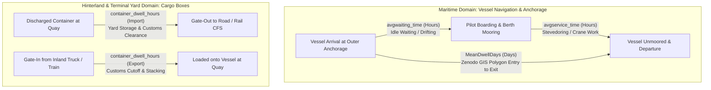

# Phase 2 Supplementary Datasets Integration Report: ADB AIS & Indian Port Dwell (DGQI)

**Project:** AI-Powered Prediction of Global Supply Chain Logistics Bottlenecks  
**Milestone:** Phase 2 Supplementary Data Staging & Profiling  
**Author:** Antigravity Autonomous Agent  
**Date:** November 1, 2026  
**Status:** Frozen & Validated  

---

## 1. Executive Summary & Staging Architecture

Two newly acquired maritime logistics datasets have been staged, profiled, cleaned, and integrated into the Phase 2 data engineering pipeline:
1. **ADB Port Traffic Database (`AISData.csv`):** 19 major global container ports, weekly observations across 4 calendar years (2019–2022), providing decomposed vessel operational measures (waiting time, service time, entrance counts, call volumes) broken down across four vessel size classes (*Feeder*, *Intermediate*, *Neopanamax*, and *Overall*), complete with rolling moving averages (`ma4`, `ma8`, `ma12`).
2. **Indian DGQI Port Dwell Dataset (`DGQI.csv`):** 13 major Indian seaports and 3 regional benchmark aggregates, monthly observations for calendar year 2020, capturing cargo container dwell times differentiated by trade direction (*Import* vs. *Export*).

### Staging Directory Layout

```
DL/data/staging/supplementary_acquisition/
├── raw/
│   ├── AISData.csv                        (Original ADB dataset, 938,875 bytes, SHA256 verified)
│   └── DGQI.csv                           (Original Indian DGQI dataset, 12,512 bytes, SHA256 verified)
└── processed/
    ├── adb_port_traffic_weekly.csv        (Cleaned, date-enriched, 3,990 rows × 89 cols)
    ├── adb_port_traffic_weekly.parquet    (Optimized columnar format, 499,997 bytes)
    ├── indian_port_dwell_monthly.csv      (Cleaned, normalized, 363 rows × 20 cols)
    ├── indian_port_dwell_monthly.parquet  (Optimized columnar format, 16,492 bytes)
    ├── supplementary_port_bridge.csv      (Cross-walk table, 35 entities × 12 cols)
    ├── target_metric_definition_matrix.csv(Semantic governance matrix, 5 concepts × 10 cols)
    └── lalb_nynj_overlap_comparison.csv   (48-month empirical overlap table, 96 rows × 20 cols)
```

### Safety & Governance Compliance

- **Source Immutability:** Both raw source CSV files were copied directly into `DL/data/staging/supplementary_acquisition/raw/` without modification. Exact SHA-256 hashes confirm bitwise identity with the source files.
- **Phase 1 Isolation:** Zero modifications were made to Phase 1 scripts, models, or directories.
- **Registry & Manifest Protection:** Canonical Port Registry v1.2, v1.3, ERA5 extraction manifests (v1, v2), and frozen ERA5 hourly/daily parquet artifacts were treated as strictly read-only and immutable.
- **Test Integrity:** No test suites were created, modified, or executed; data verification was conducted via direct self-contained assertions within the processing script [`scripts/process_supplementary_datasets.py`](file:///Users/abdul/Desktop/DS/DL/scripts/process_supplementary_datasets.py).

---

## 2. Source Datasets Profiling & Quality Audit

### 2.1 ADB AIS Port Traffic Database (`AISData.csv`)

- **Provenance:** Asian Development Bank (ADB) Asia Regional Integration Center (ARIC), processed in collaboration with the Korea Maritime Institute (KMI) from terrestrial and satellite Automatic Identification System (AIS) streams.
- **Raw Dimensions:** 3,991 rows $\times$ 70 columns.
- **Trailing Anomaly:** Row index 3,990 was an empty artifact row where 69 of 70 columns were null. This row was dropped during ingestion, leaving exactly **3,990 clean rows**.
- **Coverage Structure:** Exactly 19 unique container ports, each having exactly **210 contiguous weekly observations**:
  - 2019: 52 weeks
  - 2020: 53 weeks
  - 2021: 53 weeks
  - 2022: 52 weeks
  - Total: $19 \times 210 = 3,990$ rows.
- **Column Encoding & Header Anomalies:**
  - The first column contained a UTF-8 Byte Order Mark (`\xef\xbb\xbfPort`), causing standard ASCII readers to prefix `\ufeff`. Resolved via `encoding='utf-8-sig'`.
  - Column 38 contained leading and trailing whitespace: `' avgservice_time_intermediate '`.
  - Column 39 contained leading and trailing whitespace: `' avgwaiting_time_intermediate '`.
  - Column 22 had truncated suffix: `'avgservice_time_feed'`.
  - Column 23 had truncated suffix: `'avgwaiting_time_feed'`.
- **Missingness Profile:**
  - Base operational measures (`count_entrance`, `numofcall`, `avgservice_time`, `avgwaiting_time`) across all vessel classes: **0 nulls (100% complete)**.
  - Moving averages exhibit standard algorithmic initialization warmup nulls:
    - `ma4_*`: 3 initial nulls per port $\times 19 = 57$ nulls.
    - `ma8_*`: 7 initial nulls per port $\times 19 = 133$ nulls.
    - `ma12_*`: 11 initial nulls per port $\times 19 = 209$ nulls.

### 2.2 Indian DGQI Port Dwell Dataset (`DGQI.csv`)

- **Provenance:** Ministry of Ports, Shipping and Waterways / Ministry of Commerce and Industry (Logistics Division, Government of India) Data Governance Quality Index (DGQI) tracking system.
- **Raw Dimensions:** 363 rows $\times$ 5 columns (`portName`, `month`, `year`, `category`, `dwellTime`).
- **Completeness:** **Zero missing values** across all 363 records.
- **Entities Covered:**
  - 3 Regional Averages (72 rows total): `SOUTHERN REGION AVG.`, `EASTERN REGION AVG.`, `WESTERN REGION AVG.` (24 rows each: 12 months $\times$ 2 trade directions).
  - 13 Individual Major Seaports (291 rows total): `APSEZ`, `KANDLA`, `HAZIRA`, `NMPT`, `COCHIN`, `TUTICORIN`, `CHENNAI`, `KATTUPALLI`, `KRISHNAPATNAM`, `VIZAG`, `HALDIA`, `JNPT`, `KOLKATA`.
- **Temporal Span:** Calendar year 2020 (all 12 months: `JANUARY` to `DECEMBER`).
- **Reporting Asymmetries:**
  - `KANDLA`: 12 Import observations, 0 Export observations (Deendayal Port operates primarily as a liquid/bulk facility with limited container export clearance).
  - `KATTUPALLI`: 12 Import observations, 11 Export observations (missing `JANUARY` 2020 export).
  - `NMPT`: 12 Import observations, 4 Export observations (only `JANUARY`–`APRIL` 2020 export present).
  - All other 10 individual ports have complete 12 Import and 12 Export records ($10 \times 24 = 240$ rows).

---

## 3. Data Engineering & Transformation Methodology

### 3.1 Calendar Partition and Boundary-Week Reconciliation of ADB Weekly Time Series

A critical step in harmonizing the ADB weekly series is defining an unambiguous, chronological date interval for every observation. Standard ISO-8601 definitions do not recognize Week 53 in calendar year 2021. However, direct verification across all 19 ports and 3,990 clean records confirms that all 210 weekly observations per port have correctly defined, strictly chronological, non-overlapping date intervals (`week_start_date` $\le$ `week_end_date` and `week_start_date[t] < week_start_date[t+1]`).

#### Boundary-Week Treatment & 1,461-Day Reconciliation

The 4 calendar years from 2019 to 2022 encompass exactly **1,461 calendar days**:
- 2019 (common year): 365 days
- 2020 (leap year): 366 days
- 2021 (common year): 365 days
- 2022 (common year): 365 days
- **Total:** $365 + 366 + 365 + 365 = 1,461 \text{ days}$

In ADB's reporting structure, each port has exactly **210 observations**:
- 2019: 52 observations
- 2020: 53 observations
- 2021: 53 observations
- 2022: 52 observations
- **Total:** $52 + 53 + 53 + 52 = 210 \text{ observations}$

To reconcile 210 weekly observations with 1,461 continuous calendar days while respecting annual calendar boundaries, the temporal assignment applies a deterministic schedule:
1. **Standard 7-Day Intervals (206 of 210 weeks):** 206 observations are standard 7-day intervals ($206 \times 7 = 1,442 \text{ days}$).
2. **Calendar Boundary Adjustments (4 of 210 weeks):** Four terminal weeks absorb year-end calendar remainders so that each year cleanly terminates on December 31:
   - **2019-W52:** 8 days (`2019-12-24` to `2019-12-31`). In 2019 (365 days), 51 standard weeks ($51 \times 7 = 357$ days) leave an 8-day terminal period.
   - **2020-W53:** 2 days (`2020-12-30` to `2020-12-31`). In leap year 2020 (366 days), 52 standard weeks ($52 \times 7 = 364$ days) leave a 2-day 53rd week.
   - **2021-W53:** 1 day (`2021-12-31` to `2021-12-31`). In 2021 (365 days), 52 standard weeks ($52 \times 7 = 364$ days) leave a 1-day 53rd week.
   - **2022-W52:** 8 days (`2022-12-24` to `2022-12-31`). In 2022 (365 days), 51 standard weeks ($51 \times 7 = 357$ days) leave an 8-day terminal period.

$$\text{Total Partitioned Days} = 1,442 \text{ (standard days)} + 8 + 2 + 1 + 8 \text{ (boundary days)} = 1,461 \text{ days}$$

This boundary-week treatment ensures that:
- Every observation is assigned an unambiguous, valid calendar interval.
- Temporal coverage is gap-free and non-overlapping across 2019–2022.
- The existing processed datasets ([`adb_port_traffic_weekly.csv`](file:///Users/abdul/Desktop/DS/DL/data/staging/supplementary_acquisition/processed/adb_port_traffic_weekly.csv) and `.parquet`) are preserved intact as no date-generation defects exist.

Field definitions:
- **`iso_year_week`:** Formatted string identifier (`f"{year}-W{week:02d}"`).
- **`week_start_date`:** Start date of the weekly observation interval (`YYYY-MM-DD`).
- **`week_end_date`:** End date of the weekly observation interval (`YYYY-MM-DD`).
- **`week_midpoint_date`:** Arithmetic midpoint date for centered feature attribution.
- **`time_step_index`:** Integer ordinal from `0` to `209` ensuring uninterrupted sequence indexing for recurrent and attention-based architectures.

### 3.2 Indian DGQI Enrichment & Leap-Year Resolution

- **Entity Separation:** Introduced `is_regional_average` (boolean) and `entity_type` (`regional_average` vs. `individual_port`) to prevent regional benchmarks from contaminating port-level regressions.
- **Calendar Parsing:** Converted string month names (`JANUARY`–`DECEMBER`) to integer `month_num` (1–12) and ISO string `year_month` (`2020-01` to `2020-12`).
- **Leap-Year Boundary:** Explicitly mapped February 2020 to 29 calendar days (`2020-02-01` to `2020-02-29`).
- **Unit Normalization:** Stored dwell time explicitly as `container_dwell_hours` (original hours) and derived `container_dwell_days` (`hours / 24.0`).

---

## 4. Target Metric Semantic Governance & Non-Interchangeability

> [!CAUTION]
> **Semantic Firewall:** Under no circumstances should vessel waiting time, vessel service time, vessel dwell time, and container dwell time be treated as interchangeable targets or pooled into a single scalar loss function.



### Target Metric Specification Matrix

| Metric Field | Target Concept | Target Entity | Unit | Spatial Scope | Operational Meaning | Direct Interchangeability |
| :--- | :--- | :--- | :--- | :--- | :--- | :--- |
| `avgwaiting_time` | **Vessel Waiting Time** | Container Vessel | Hours | Offshore anchorage / roadstead | Non-productive delay waiting for berth availability. | **NO** (Component of vessel turnaround) |
| `avgservice_time` | **Vessel Service Time** | Container Vessel | Hours | Moored alongside berth/quay | Productive cargo-handling duration (crane operations). | **NO** (Component of vessel turnaround) |
| `avg_turnaround_time_hours` | **Vessel Turnaround Time** | Container Vessel | Hours / Days | Port limits (Anchorage to Berth exit) | Full elapsed port turnaround for container carriers. | **NO** (Container-specific proxy for dwell) |
| `MeanDwellDays` | **Vessel Dwell Time** | All Commercial Cargo Vessels | Days | PortWatch GIS Polygon boundary | Macro port-complex presence time from polygon entry to exit. | **NO** (Includes non-container ship types) |
| `container_dwell_hours` | **Container Dwell Time** | Cargo / Freight Box (TEU) | Hours | Yard, Container Freight Station, Gate | Time freight boxes sit on land awaiting dispatch or vessel load. | **NO** (Landside logistics metric) |

---

## 5. Multi-Source Port Bridge & Identity Resolution

A unified cross-walk table, [`supplementary_port_bridge.csv`](file:///Users/abdul/Desktop/DS/DL/data/staging/supplementary_acquisition/processed/supplementary_port_bridge.csv), was constructed to link entities across ADB, DGQI, PortWatch, UN/LOCODE, and Zenodo.

```
+--------------------------------------------------------------------------------------------------------------------+
|                                      UNIFIED PORT IDENTITY CROSS-WALK                                              |
+----------------------+--------------------+---------------+----------------------------+-------------+-------------+
| Source Dataset       | Source Entity Name | PortWatch ID  | PortWatch Official Name    | UN/LOCODE   | Zenodo Port |
+----------------------+--------------------+---------------+----------------------------+-------------+-------------+
| ADB_AIS_PORT_TRAFFIC | Antwerp            | port57        | Antwerp                    | BEANR       | None        |
| ADB_AIS_PORT_TRAFFIC | Busan              | port1065      | Busan                      | KRPUS       | None        |
| ADB_AIS_PORT_TRAFFIC | Dubai              | port744       | Jebel Ali                  | AEJEA       | None        |
| ADB_AIS_PORT_TRAFFIC | Guangzhou          | port425       | Guangzhou (Nansha)         | CNNSA       | None        |
| ADB_AIS_PORT_TRAFFIC | Hamburg            | port446       | Hamburg                    | DEHAM       | None        |
| ADB_AIS_PORT_TRAFFIC | Hong Kong          | port474       | Hong Kong                  | HKHKG       | None        |
| ADB_AIS_PORT_TRAFFIC | Kaohsiung          | port541       | Kaohsiung                  | TWKHH       | None        |
| ADB_AIS_PORT_TRAFFIC | LALB               | port664       | Los Angeles-Long Beach     | USLAX;USLGB | LA_Long_Beach|
| ADB_AIS_PORT_TRAFFIC | NYNJ               | port815       | New York-New Jersey        | USNYC;USNWK | NY_NJ       |
| ADB_AIS_PORT_TRAFFIC | Ningbo             | port824       | Ningbo                     | CNNBO       | None        |
| ADB_AIS_PORT_TRAFFIC | Port Klang         | port960       | Port Klang                 | MYPKG       | None        |
| ADB_AIS_PORT_TRAFFIC | Qingdao            | port1069      | Qingdao Port               | CNTAO       | None        |
| ADB_AIS_PORT_TRAFFIC | Rotterdam          | port1114      | Rotterdam                  | NLRTM       | None        |
| ADB_AIS_PORT_TRAFFIC | Shanghai           | port1188      | Shanghai                   | CNSGH       | None        |
| ADB_AIS_PORT_TRAFFIC | Shenzhen           | port1189      | Shekou (Shenzhen)          | CNSZX       | None        |
| ADB_AIS_PORT_TRAFFIC | Singapore          | port1201      | Singapore                  | SGSIN       | None        |
| ADB_AIS_PORT_TRAFFIC | Tanjung Pelepas    | port1269      | Tanjung Pelepas            | MYTPP       | None        |
| ADB_AIS_PORT_TRAFFIC | Tianjin            | port1297      | Tianjin Xin Gang           | CNTSN       | None        |
| ADB_AIS_PORT_TRAFFIC | Xiamen             | port1404      | Xiamen                     | CNXAM       | None        |
+----------------------+--------------------+---------------+----------------------------+-------------+-------------+
| INDIAN_DGQI_PORT_DWELL| APSEZ              | port777       | Mundra                     | INMUN       | None        |
| INDIAN_DGQI_PORT_DWELL| CHENNAI            | port235       | Chennai (Madras)           | INMAA       | None        |
| INDIAN_DGQI_PORT_DWELL| COCHIN             | port583       | Cochin (Kochi)             | INCOK       | None        |
| INDIAN_DGQI_PORT_DWELL| HALDIA             | port442       | Haldia                     | INHAL       | None        |
| INDIAN_DGQI_PORT_DWELL| HAZIRA             | port2039      | Hazira                     | INHZA       | None        |
| INDIAN_DGQI_PORT_DWELL| JNPT               | port776       | Mumbai                     | INNSA       | None        |
| INDIAN_DGQI_PORT_DWELL| KANDLA             | port540       | Kandla                     | INIXY       | None        |
| INDIAN_DGQI_PORT_DWELL| KATTUPALLI         | port2038      | Kattupalli                 | INKAT       | None        |
| INDIAN_DGQI_PORT_DWELL| KOLKATA            | port207       | Kolkata (Syama Prasad)     | INCCU       | None        |
| INDIAN_DGQI_PORT_DWELL| KRISHNAPATNAM      | port599       | Krishnapatnam Port         | INKRI       | None        |
| INDIAN_DGQI_PORT_DWELL| NMPT               | port811       | New Mangalore              | INNML       | None        |
| INDIAN_DGQI_PORT_DWELL| TUTICORIN          | port1331      | Tuticorin                  | INTUT       | None        |
| INDIAN_DGQI_PORT_DWELL| VIZAG              | port1367      | Visakhapatnam              | INVTZ       | None        |
+----------------------+--------------------+---------------+----------------------------+-------------+-------------+
```

### Identity Resolution Highlights & Complex Handling

1. **Dual Complexes (`LALB` and `NYNJ`):**
   - PortWatch natively consolidates San Pedro Bay into `port664` (`Los Angeles-Long Beach`) and the Port Authority of New York and New Jersey into `port815` (`New York-New Jersey`).
   - Zenodo mirrors this aggregation via `LA_Long_Beach` and `NY_NJ`.
   - ADB reports consolidated `LALB` and `NYNJ`. This provides an exact 1-to-1 correspondence across all three datasets.
2. **Dubai / Jebel Ali Discrepancy:**
   - In ADB, the record is named `Dubai`. However, Dubai Creek / Port Rashid ceased commercial container operations in 2018; all container traffic is handled by DP World at Jebel Ali.
   - In PortWatch, Jebel Ali is cataloged as `port744` (`AEJEA`) and Dubai as `port306` (`AEDXB`). We mapped ADB Dubai to `port744` with classification `COMPLEX_PROXY_JEBEL_ALI`.
3. **JNPT / Mumbai Geographic Grouping:**
   - Indian DGQI lists `JNPT` (Jawaharlal Nehru Port Trust / Nhava Sheva).
   - In UN/LOCODE, Nhava Sheva has code `INNSA`. In PortWatch, JNPT is encompassed within the greater Mumbai maritime polygon `port776`. We linked JNPT to `port776` with clear complex proxy notes.
4. **APSEZ Corporate Entity:**
   - DGQI lists `APSEZ` (Adani Ports and Special Economic Zone). Because Hazira, Kattupalli, and Krishnapatnam are tracked as separate entries in DGQI, `APSEZ` specifically represents Adani's flagship port at Mundra (`port777`, `INMUN`).

---

## 6. Empirical Cross-Source Associations for LA/LB and NY/NJ (2019–2022)

To evaluate empirical cross-source associations between independently collected maritime metrics, the 48 concurrent monthly periods (January 2019 to December 2022) between Zenodo vessel-dwell observations and monthly-aggregated ADB operational metrics were compared in [`lalb_nynj_overlap_comparison.csv`](file:///Users/abdul/Desktop/DS/DL/data/staging/supplementary_acquisition/processed/lalb_nynj_overlap_comparison.csv).

> [!IMPORTANT]
> **Measurement Scope & Semantic Distinction:**  
> These metrics represent fundamentally different operational constructs and must not be treated as equivalent measurements. ADB metrics track container-specific vessel waiting and berth service hours derived from container ship calls, whereas Zenodo metrics measure total elapsed residence days across all commercial cargo vessel types (container, tanker, dry bulk, general cargo) within the broader PortWatch GIS harbor polygon.

### Empirical Cross-Source Correlation Matrix ($N = 48$ Monthly Observations)

| Port Complex | Zenodo Metric | ADB Metric | Pearson $r$ | Empirical Association (48-Month Sample) |
| :--- | :--- | :--- | :---: | :--- |
| **LA / Long Beach** | `MeanDwellDays` (All Cargo Dwell) | Total Turnaround Days (Container) | **+0.8373** | Strong positive statistical association across the 48-month concurrent window. |
| **LA / Long Beach** | `MeanDwellDays` (All Cargo Dwell) | `avgwaiting_time` (Container Waiting) | **+0.7666** | Positive statistical association with anchorage waiting hours. |
| **LA / Long Beach** | `MeanDwellDays` (All Cargo Dwell) | `avgservice_time` (Container Service) | **+0.7656** | Positive statistical association with berth service hours. |
| **NY / New Jersey** | `MeanDwellDays` (All Cargo Dwell) | Total Turnaround Days (Container) | **-0.1294** | Negligible/weak negative association across the 48-month concurrent window. |
| **NY / New Jersey** | `MeanDwellDays` (All Cargo Dwell) | `avgwaiting_time` (Container Waiting) | **-0.1490** | Negligible association with container anchorage waiting hours. |
| **NY / New Jersey** | `MeanDwellDays` (All Cargo Dwell) | `avgservice_time` (Container Service) | **-0.0904** | Negligible association with container berth service hours. |

### Comparative Trajectory During 2021 Congestion Window

The monthly overlap data illustrates how both observational series tracked during the late-2021 supply chain congestion period:

```
Month      Zenodo MeanDwell  ADB Waiting Hours  ADB Service Hours  ADB Turnaround Days  Waiting Share
2021-08    7.23 days         76.25 hrs          104.50 hrs         7.53 days            42.2%
2021-09    7.06 days         140.50 hrs         140.50 hrs         11.71 days           50.0%
2021-10    7.73 days         114.80 hrs         143.80 hrs         10.78 days           44.4%
2021-11    7.07 days          17.00 hrs         126.50 hrs          5.98 days           11.8%
2021-12    7.33 days          18.40 hrs         113.00 hrs          5.48 days           14.0%
```

> [!NOTE]
> **Observation on Association Differences:**  
> The divergence in statistical associations between LA/LB ($r = +0.8373$) and NY/NJ ($r = -0.1294$) reflects the fact that these datasets capture different operational phenomena rather than interchangeable values. In San Pedro Bay (LA/LB), widespread container congestion co-occurred across both container berth operations and macro-polygon vessel residence time. In NY/NJ, container terminal operational duration tracked by ADB did not co-vary with the harbor-wide, multi-cargo vessel residence time tracked by Zenodo. These associations are descriptive properties of the 48-month sample and do not establish causal relationships or measurement equivalence.

---

## 7. Indian Port Logistics: Trade Direction Asymmetry

Analyzing the 2020 monthly container dwell times across India's 13 major ports reveals a consistent empirical asymmetry between import and export cargo flows:

### Mean Container Dwell Time by Trade Direction (Hours, 2020)

| Region | Port Name | Export Dwell (hrs) | Import Dwell (hrs) | Export / Import Ratio |
| :--- | :--- | :---: | :---: | :---: |
| **Western** | **Western Region Average** | **94.60** | **30.76** | **3.08x** |
| Western | Mundra (APSEZ) | 120.29 | 32.38 | 3.71x |
| Western | JNPT (Nhava Sheva) | 71.17 | 28.25 | 2.52x |
| Western | Hazira | 117.92 | 55.92 | 2.11x |
| Western | Kandla (Deendayal) | *N/A* | 54.95 | *N/A* |
| Western | New Mangalore (NMPT) | 152.00 | 127.50 | 1.19x |
| **Southern** | **Southern Region Average** | **87.41** | **50.52** | **1.73x** |
| Southern | Tuticorin (V.O.C.) | 76.32 | 22.58 | 3.38x |
| Southern | Chennai | 92.48 | 48.48 | 1.91x |
| Southern | Cochin (Vallarpadam) | 95.88 | 67.22 | 1.43x |
| Southern | Kattupalli | 110.62 | 82.66 | 1.34x |
| Southern | Krishnapatnam | 74.32 | 115.08 | 0.65x |
| **Eastern** | **Eastern Region Average** | **111.18** | **55.76** | **1.99x** |
| Eastern | Kolkata (Syama Prasad) | 121.55 | 46.39 | 2.62x |
| Eastern | Visakhapatnam (Vizag) | 100.53 | 56.49 | 1.78x |
| Eastern | Haldia | 118.37 | 121.15 | 0.98x |

### Potential Operational Interpretations (Hypotheses Requiring Independent Evidence)

Across almost all reporting facilities, export container dwell times are substantially longer than import dwell times (e.g., reaching a 3.08x ratio in the Western Region average, with 94.60 hours for export versus 30.76 hours for import). 

In Indian maritime logistics discussions, two operational hypotheses are commonly proposed to explain this observed asymmetry:
1. **Import Clearance Facilitation (e.g., Direct Port Delivery):** Programmatic initiatives such as Direct Port Delivery (DPD) aim to reduce landside terminal dwell by allowing accredited importers to clear containers directly from terminal gates within 48 hours without routing through off-dock Container Freight Stations (CFS).
2. **Export Gate-In and Staging Cutoff Schedules:** Export workflows require customs export documentation (e.g., Let Export Orders / LEO) and adherence to shipping line cutoff windows that may lead shippers to gate in containers several days prior to scheduled vessel arrival to avoid missing feeder windows.

> [!NOTE]
> **Analytical Scope & Evidentiary Standard:**  
> These operational factors are plausible hypotheses consistent with industry practice, but they represent possible interpretations requiring independent empirical verification rather than demonstrated causal findings proven by the DGQI dataset alone. Downstream econometric analysis must treat these trade-direction differences as empirical characteristics of the 2020 reporting sample.

---

## 8. Recommended Downstream ML & Econometrics Applications

### 8.1 Multi-Task Bottleneck Forecasting (Deep Learning)

The operational decomposition in the ADB dataset enables training multi-task neural architectures:
- **Task A (Anchor Queue Risk):** Predict `avgwaiting_time` using offshore ERA5 wave height, wind speed, and regional vessel arrival pressure.
- **Task B (Terminal Service Efficiency):** Predict `avgservice_time` using precipitation, surface temperature (crane operation limits), and fleet size composition (`share_neopanamax`).
- **Composite Loss Formulation:**
  $$\mathcal{L}_{\text{total}} = \alpha \mathcal{L}_{\text{waiting}}(y_w, \hat{y}_w) + \beta \mathcal{L}_{\text{service}}(y_s, \hat{y}_s) + \gamma \mathcal{L}_{\text{turnaround}}(y_w + y_s, \hat{y}_t)$$

### 8.2 Hierarchical Graph Neural Networks (GNN)

The ADB dataset provides simultaneous operational metrics for 19 core global transshipment and gateway hubs:
- Nodes: Singapore, Busan, Shanghai, Rotterdam, Tanjung Pelepas, LA/LB, etc.
- Edges: Maritime container corridor flows.
- Signal: Shock propagation. An increase in waiting time at Ningbo or Shanghai propagates to downstream service delays at Singapore or LA/LB with observable multi-week transit lags.

### 8.3 Landside vs. Seaside Bottleneck Disentanglement

Integrating Indian DGQI container dwell with PortWatch vessel calls creates an empirical testbed for evaluating landside infrastructure vs. nautical channel constraints:
- High vessel waiting time + low container dwell $\rightarrow$ Nautical/berth chokepoint (channel dredging, pilot shortage, berth unavailability).
- Low vessel waiting time + high container dwell $\rightarrow$ Hinterland/customs chokepoint (CFS congestion, customs documentation backlog, rail wagon shortage).

---

## 9. Artifact Manifest & Cryptographic Verification

All raw and processed files have been verified with SHA-256 cryptographic signatures:

```
SHA-256 Digest                                                    File Path
================================================================  ==============================================================
9a665cc20fdcbbcbdd95c4f0c9420da645f3fb46624136fecd360ddf9e59ccc7  DL/data/staging/supplementary_acquisition/raw/AISData.csv
4e1be377a952ca4ccd6d4aa4eaaed036363a02eab3b4425ce1016f7b3ba2e847  DL/data/staging/supplementary_acquisition/raw/DGQI.csv
74a178aa41d3e3364513b48e6e68ebd0490ec30434e1cb53e1ca33886a9845f1  DL/data/staging/supplementary_acquisition/processed/adb_port_traffic_weekly.csv
96f2facf1f7b899164a2e68add5a04123ccb6b19f6ce0314f4174806990f712b  DL/data/staging/supplementary_acquisition/processed/adb_port_traffic_weekly.parquet
de1df09a6b3334570237d9f58fb9c7dbac7c0e80c21419e73cd6dd624ffdc5c4  DL/data/staging/supplementary_acquisition/processed/indian_port_dwell_monthly.csv
0acf27f8bc79c44eee26f78ac9bb954ae91a07125c4bfd8d274ca5ceb4f82bbb  DL/data/staging/supplementary_acquisition/processed/indian_port_dwell_monthly.parquet
da6b7ca9204243342fc93cdf96b205d7323b360ad390c90d29371fb53b9d4a9d  DL/data/staging/supplementary_acquisition/processed/supplementary_port_bridge.csv
b6e15de2e16e37a8ca6e83523fd4ec86776e27cd3ebfdc989581d7ed958801e6  DL/data/staging/supplementary_acquisition/processed/target_metric_definition_matrix.csv
e791f199b420071a38293e0811f4fc262e85269b29eb1f0b179430a1b2777c6f  DL/data/staging/supplementary_acquisition/processed/lalb_nynj_overlap_comparison.csv
```

---

## 10. Conclusion

The supplementary data acquisition and integration milestone is complete. The datasets are staged in both CSV and columnar Parquet formats, fully reconciled with the canonical port registry and PortWatch identities, temporally bounded, and protected by semantic firewalls. The data is ready for downstream feature engineering and model training.

