# EDA Findings: Container Terminal Dwell & Bottleneck Triage Data

Generated by `ML/eda_engineer/eda_runner.py` from `data/processed`, `data/interim`, and `data/master`. Every number below is computed by the run; tables are in `tables/`, figures in `figures/`.

## 1. Headline findings

1. **The extract is selected by gate-out date, so call-date edges are truncated.** All 95,647 stays leave the yard between 2021-07-01 and 2021-09-30. Stays that arrived earlier appear only if they were slow; stays that arrived late in September appear only if they were quick. Only call dates 2021-07-01 to 2021-09-12 are fully observable (the 99% dwell horizon is 431.4h). That band holds 77,364 of 95,647 stays.
2. **Test is not a clean holdout.** Mean observable share is 98.0% for train, 99.7% for val and 85.4% for test; the last two call weeks are missing an estimated 17% and 50% of their stays. Only 179 test stays are fully observable.
3. **Part of the dwell drift is real.** Inside the clean band, call date and dwell are negatively correlated (Spearman rho -0.26); weekly median dwell falls from 110h in the week of 2021-07-12 to about 48h in the last five clean weeks. Val is fully inside the clean band and still has 7.4% critical stays against 15.0% in train.
4. **The data contains one congestion episode, in July.** Seven-day average departures fall to 449 per day around 2021-07-15 (typical 1064), and the share of departing stays that are AT_RISK or CRITICAL peaks at 73% around 2021-07-23 versus 34% over the last 30 days. The week of 2021-07-12 has 28% of stays above the train p85 cutoff. Most positive (AT_RISK / CRITICAL) examples a model can learn from come from this episode.
5. **p50/p85 are label choices, not natural boundaries.** Log-dwell has 1 mode at 70.3h and no natural trough; 12,200 stays sit within +/-10h of p50 (65.1h) and 2,696 stays sit within +/-10h of p85 (160.9h).
6. **Weather/disruption fields are excluded from baseline triage.** They are constant zero in this extract, the alert feed is sparse, and anonymized coordinates prevent confirming local weather.
7. **Noise floor.** The trailing 7-day delayed share moves by about +/-2.7 pp (1 sigma) with no real change, 4.9x what sampling alone would give; shifts smaller than 5.4 pp are indistinguishable from noise.
8. **Scope is terminal-specific.** This is one anonymized terminal over a short 2021 operating window; no cross-port generalization is established. `target_class` is local operational yard-turnover percentile triage, not a contractual demurrage label.

## 2. Extract window and truncation

First gate-out 2021-07-01 00:07:00, last gate-out 2021-09-30 23:51:25; discharges run from 2021-05-12 12:23:10.226000 to 2021-09-30 18:56:47.094000. The 38 'burn-in' stays (call dates before 2021-06-10) have a median dwell of 1,106.8h (46 days): they are in the file only because they were still in the yard on 2021-07-01.

| call_week | stays | median_dwell_h | p85_dwell_h | est_missing_pct | in_clean_band |
|---|---|---|---|---|---|
| 2021-05-10 | 1 | 1245.7 | 1245.7 | 100.0 | no |
| 2021-05-17 | 3 | 982.5 | 983.5 | 100.0 | no |
| 2021-05-24 | 13 | 1871.7 | 2028.4 | 99.9 | no |
| 2021-05-31 | 2 | 858.4 | 947.8 | 99.9 | no |
| 2021-06-07 | 54 | 1019.1 | 1110.4 | 99.3 | no |
| 2021-06-14 | 96 | 351.3 | 492.7 | 97.1 | no |
| 2021-06-21 | 1,144 | 115.5 | 244.4 | 60.5 | no |
| 2021-06-28 | 5,592 | 60.5 | 134.6 | 6.6 | no |
| 2021-07-05 | 6,306 | 59.9 | 187.8 | 0.0 | yes |
| 2021-07-12 | 7,848 | 110.2 | 218.0 | 0.0 | yes |
| 2021-07-19 | 8,171 | 90.6 | 186.0 | 0.0 | yes |
| 2021-07-26 | 3,778 | 60.8 | 149.5 | 0.0 | yes |
| 2021-08-02 | 8,941 | 42.8 | 109.8 | 0.0 | yes |
| 2021-08-09 | 7,476 | 61.6 | 136.0 | 0.0 | yes |
| 2021-08-16 | 7,649 | 48.7 | 115.6 | 0.0 | yes |
| 2021-08-23 | 7,423 | 47.9 | 115.2 | 0.1 | yes |
| 2021-08-30 | 8,824 | 42.1 | 108.7 | 0.2 | yes |
| 2021-09-06 | 8,503 | 40.8 | 110.8 | 0.5 | yes |
| 2021-09-13 | 6,780 | 43.6 | 108.8 | 2.4 | no |
| 2021-09-20 | 4,956 | 41.1 | 87.9 | 16.8 | no |
| 2021-09-27 | 2,087 | 26.2 | 45.4 | 50.0 | no |

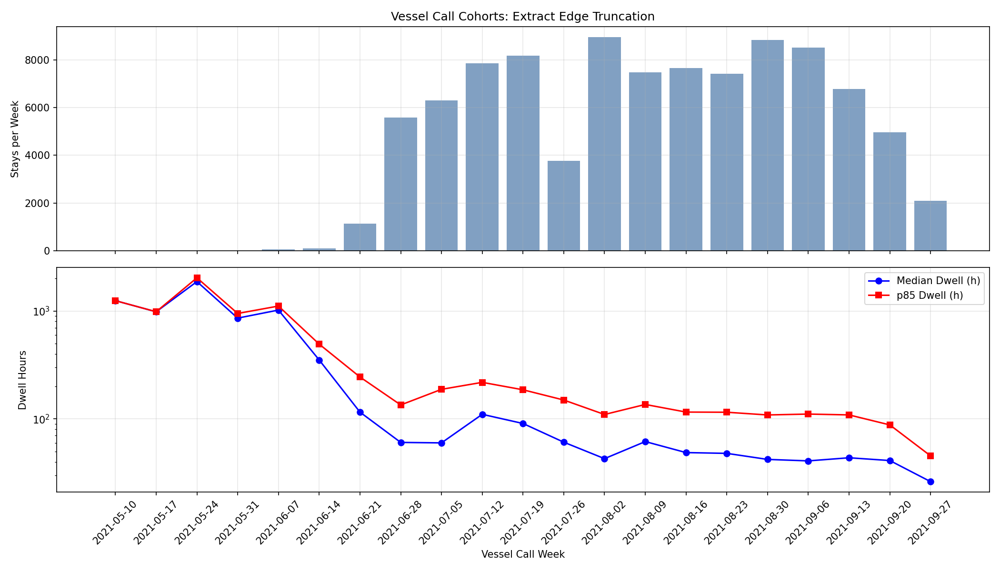

### Effect on label cutoffs

| scope | n | p50_h | p85_h | note |
|---|---|---|---|---|
| train (as built) | 60,698 | 65.11 | 160.9 | label cutoffs in use: p50=65.11h p85=160.90h |
| clean band, all splits | 77,364 | 57.97 | 146.79 | label cutoffs in use: p50=65.11h p85=160.90h |
| clean band, train only | 56,276 | 64.42 | 159.12 | label cutoffs in use: p50=65.11h p85=160.90h |

### Label mix by split

| split | scope | n | ON_TIME | AT_RISK | CRITICAL_DELAY |
|---|---|---|---|---|---|
| test | all stays | 13,959 | 0.724 | 0.2484 | 0.0276 |
| train | all stays | 60,698 | 0.5 | 0.35 | 0.15 |
| val | all stays | 20,879 | 0.6654 | 0.261 | 0.0737 |
| test | clean band | 179 | 0.7039 | 0.1676 | 0.1285 |
| train | clean band | 56,276 | 0.5047 | 0.3487 | 0.1466 |
| val | clean band | 20,879 | 0.6654 | 0.261 | 0.0737 |

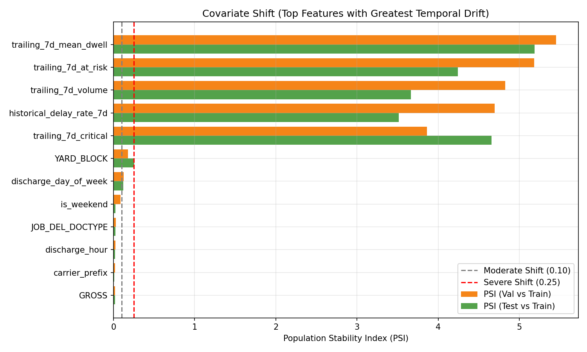

## 3. Dwell time profile

### Target-class balance and full-sample dwell quantiles

| group_by | level | n | mean | p10 | p25 | p50 | p75 | p85 | p90 | p95 | p99 |
|---|---|---|---|---|---|---|---|---|---|---|---|
| ALL | all | 95,647 | 81.29 | 14.72 | 27.55 | 54.98 | 103.89 | 140.28 | 173.0 | 236.06 | 423.02 |
| split_tag | burn_in | 38 | 1349.22 | 774.71 | 1060.61 | 1106.82 | 1817.5 | 1876.34 | 2031.7 | 2409.14 | 2591.47 |
| split_tag | repeated_eval | 73 | 67.49 | 14.9 | 32.78 | 55.26 | 95.48 | 112.67 | 123.14 | 139.14 | 197.69 |
| split_tag | test | 13,959 | 51.04 | 10.62 | 19.94 | 37.96 | 69.72 | 92.15 | 109.08 | 138.68 | 199.17 |
| split_tag | train | 60,698 | 92.94 | 17.74 | 32.62 | 65.11 | 119.51 | 160.9 | 196.84 | 257.83 | 476.26 |
| split_tag | val | 20,879 | 65.38 | 12.03 | 23.07 | 44.82 | 80.37 | 112.05 | 139.31 | 202.22 | 366.27 |
| target_class_name | AT_RISK | 30,191 | 101.67 | 70.16 | 78.72 | 97.66 | 121.12 | 133.97 | 141.53 | 150.47 | 158.66 |
| target_class_name | CRITICAL_DELAY | 11,068 | 266.74 | 169.41 | 186.45 | 223.45 | 285.35 | 353.56 | 401.45 | 509.97 | 838.88 |
| target_class_name | ON_TIME | 54,388 | 32.24 | 10.6 | 18.39 | 30.58 | 45.82 | 52.92 | 56.62 | 60.71 | 64.24 |

### Threshold density and boundary mass

| cutoff | hours | within_10h_count | within_10h_share_pct |
|---|---|---|---|
| train p50 | 65.11 | 12,200 | 12.76 |
| train p85 | 160.9 | 2,696 | 2.82 |

### Clean-band dwell quantiles by category

| group_by | level | n | mean | p10 | p25 | p50 | p75 | p85 | p90 | p95 | p99 |
|---|---|---|---|---|---|---|---|---|---|---|---|
| ALL | all | 77,364 | 83.76 | 15.68 | 29.17 | 57.97 | 108.6 | 146.79 | 181.4 | 243.51 | 410.64 |
| split_tag | repeated_eval | 30 | 76.42 | 10.07 | 33.61 | 59.58 | 118.84 | 128.09 | 136.42 | 147.26 | 246.94 |
| split_tag | test | 179 | 66.83 | 21.92 | 26.39 | 44.5 | 73.87 | 95.84 | 195.6 | 209.91 | 252.4 |
| split_tag | train | 56,276 | 90.64 | 17.57 | 32.38 | 64.42 | 118.58 | 159.12 | 193.98 | 253.02 | 435.94 |
| split_tag | val | 20,879 | 65.38 | 12.03 | 23.07 | 44.82 | 80.37 | 112.05 | 139.31 | 202.22 | 366.27 |
| CTR_TYPE | DRY | 67,991 | 87.96 | 15.84 | 31.55 | 63.08 | 114.95 | 153.83 | 188.76 | 249.22 | 414.54 |
| CTR_TYPE | FLT | 11 | 134.99 | 45.98 | 76.43 | 138.97 | 156.25 | 199.22 | 228.97 | 260.78 | 286.23 |
| CTR_TYPE | O/T | 123 | 111.3 | 18.87 | 49.1 | 84.73 | 148.76 | 195.12 | 207.12 | 233.98 | 596.56 |
| CTR_TYPE | OVD | 99 | 148.25 | 36.94 | 66.36 | 106.03 | 205.68 | 256.36 | 272.0 | 333.71 | 664.95 |
| CTR_TYPE | RFR | 8,574 | 45.71 | 14.54 | 22.1 | 31.76 | 50.82 | 64.76 | 78.1 | 116.3 | 277.13 |
| CTR_TYPE | TNK | 566 | 136.76 | 36.5 | 62.92 | 104.84 | 174.96 | 254.59 | 276.2 | 350.54 | 475.19 |
| CTR_SIZE | 20.0 | 36,419 | 92.06 | 19.75 | 37.34 | 68.06 | 118.9 | 156.97 | 192.32 | 249.79 | 417.75 |
| CTR_SIZE | 40.0 | 40,821 | 76.24 | 13.27 | 24.41 | 48.41 | 96.98 | 137.1 | 170.58 | 235.67 | 403.01 |
| CTR_SIZE | 45.0 | 124 | 120.38 | 39.44 | 76.42 | 103.1 | 145.2 | 173.76 | 200.85 | 225.66 | 413.21 |
| JOB_DEL_DOCTYPE | BC23 | 4,679 | 75.2 | 13.03 | 26.57 | 53.01 | 93.08 | 130.01 | 160.03 | 229.15 | 374.11 |
| JOB_DEL_DOCTYPE | BCF26 | 17 | 203.58 | 76.87 | 141.86 | 166.84 | 232.86 | 347.86 | 407.56 | 409.92 | 415.89 |
| JOB_DEL_DOCTYPE | LAIN2 | 343 | 140.92 | 121.96 | 129.35 | 136.62 | 146.58 | 157.07 | 170.35 | 183.23 | 244.57 |
| JOB_DEL_DOCTYPE | LELANG | 1 | 627.76 | 627.76 | 627.76 | 627.76 | 627.76 | 627.76 | 627.76 | 627.76 | 627.76 |
| JOB_DEL_DOCTYPE | NNMITA | 1 | 229.72 | 229.72 | 229.72 | 229.72 | 229.72 | 229.72 | 229.72 | 229.72 | 229.72 |
| JOB_DEL_DOCTYPE | PLP | 2 | 128.15 | 121.34 | 123.89 | 128.15 | 132.4 | 134.1 | 134.95 | 135.8 | 136.48 |
| JOB_DEL_DOCTYPE | SPPB | 71,900 | 83.85 | 15.76 | 29.09 | 57.59 | 108.15 | 148.04 | 183.36 | 245.06 | 414.54 |
| JOB_DEL_DOCTYPE | TMBLU | 2 | 139.89 | 135.32 | 137.03 | 139.89 | 142.75 | 143.89 | 144.46 | 145.03 | 145.49 |
| has_quarantine_flag | 0 | 55,476 | 78.33 | 14.04 | 28.06 | 56.88 | 103.24 | 135.02 | 164.16 | 219.03 | 376.65 |
| has_quarantine_flag | 1 | 21,888 | 97.53 | 20.03 | 31.34 | 60.69 | 129.69 | 182.65 | 229.64 | 293.09 | 470.51 |
| has_red_flag_pib | 0 | 73,198 | 80.6 | 15.18 | 28.25 | 56.11 | 104.52 | 140.63 | 172.71 | 234.78 | 397.51 |
| has_red_flag_pib | 1 | 4,166 | 139.25 | 33.61 | 55.79 | 109.61 | 185.96 | 234.21 | 273.84 | 356.76 | 575.7 |
| has_behandle_inspection | 0 | 74,060 | 80.37 | 15.26 | 28.43 | 56.27 | 104.57 | 140.59 | 172.23 | 232.69 | 390.17 |
| has_behandle_inspection | 1 | 3,304 | 159.82 | 37.58 | 64.61 | 126.98 | 212.1 | 269.71 | 321.73 | 421.65 | 603.03 |

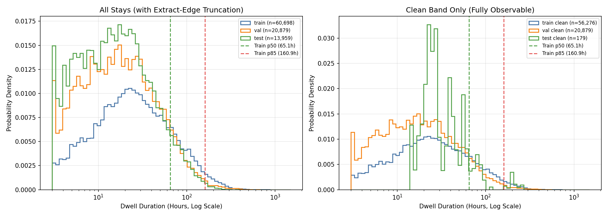

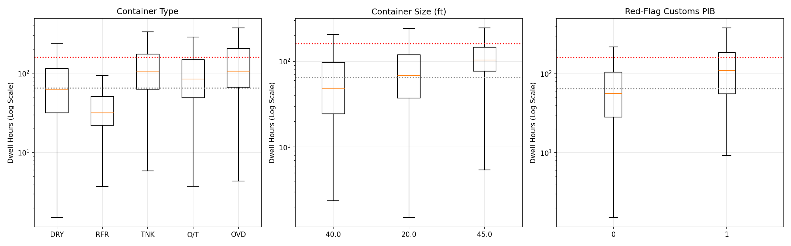

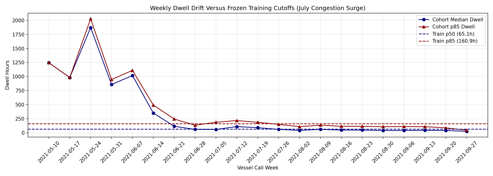

## 4. Temporal and congestion dynamics

Associations between lagged completed departures and daily dwell quantiles (clean band):

| prior_departure_metric | daily_dwell_metric | n_call_dates | spearman_rho | p_value_descriptive |
|---|---|---|---|---|
| trailing_7d_volume | dwell_p50_h | 65 | -0.4718 | 7.261792239634962e-05 |
| trailing_7d_volume | dwell_p85_h | 65 | -0.3826 | 0.0016593863877852491 |
| trailing_7d_delay_rate | dwell_p50_h | 65 | 0.3784 | 0.0018829822857349967 |
| trailing_7d_delay_rate | dwell_p85_h | 65 | 0.3346 | 0.00644868128898002 |

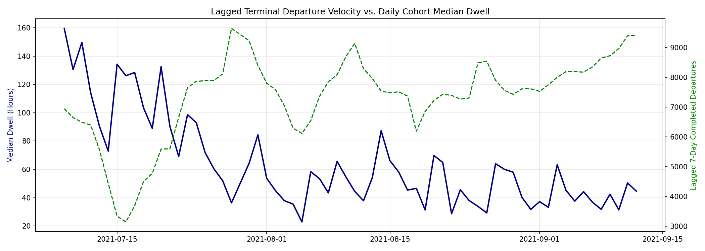

## 5. Milestone transitions and processing bottlenecks

Operational stage durations for complete, chronologically ordered trajectories (BAPLIE -> DISCHARGE -> STACK -> CUSTOMS_DEL -> UNSTACK_TO_TRUCK -> TRUCK_OUT):

| transition | paired_cases | nonnegative_pair_cases | complete_ordered_trajectories | complete_trajectory_share_pct | median_hours | p85_hours | p95_hours | cumulative_median_hours | cumulative_p85_hours |
|---|---|---|---|---|---|---|---|---|---|
| BAPLIE -> DISCHARGE | 95,644 | 95,644 | 55,645 | 58.18 | 28.06 | 43.38 | 55.59 | 28.06 | 43.38 |
| DISCHARGE -> STACK | 95,624 | 94,756 | 55,645 | 58.18 | 1.24 | 1.62 | 2.03 | 29.15 | 44.54 |
| STACK -> CUSTOMS_DEL | 95,618 | 56,541 | 55,645 | 58.18 | 36.72 | 112.13 | 213.69 | 71.55 | 145.51 |
| CUSTOMS_DEL -> UNSTACK_TO_TRUCK | 95,530 | 95,089 | 55,645 | 58.18 | 33.69 | 74.88 | 116.27 | 113.91 | 210.57 |
| UNSTACK_TO_TRUCK -> TRUCK_OUT | 95,536 | 95,536 | 55,645 | 58.18 | 1.49 | 1.58 | 1.63 | 115.35 | 211.97 |

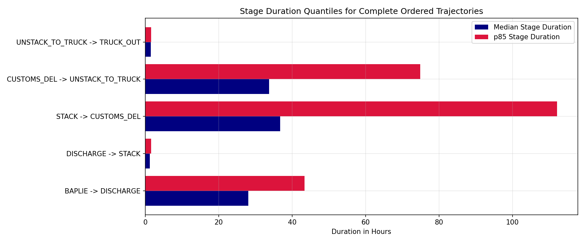

## 6. Call rhythm, gaps and cycles

| weekday | days | mean_stays | median_stays | zero_call_days |
|---|---|---|---|---|
| Monday | 16 | 830.7 | 797.0 | 1 |
| Tuesday | 16 | 928.0 | 899.0 | 2 |
| Wednesday | 16 | 1038.8 | 1234.5 | 1 |
| Thursday | 17 | 467.2 | 177.0 | 3 |
| Friday | 16 | 907.8 | 906.5 | 2 |
| Saturday | 16 | 1203.4 | 1463.5 | 0 |
| Sunday | 16 | 570.5 | 497.0 | 0 |

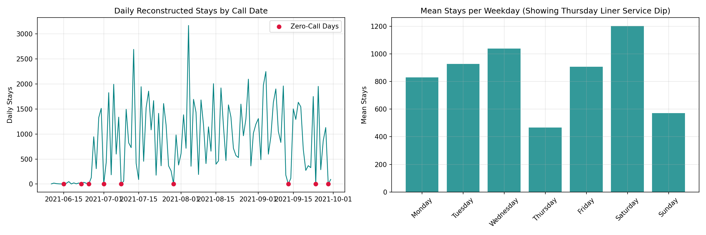

| discharge_weekday | stays | median_h | p85_h | pct_critical |
|---|---|---|---|---|
| Monday | 9,280 | 61.7 | 148.7 | 13.8 |
| Tuesday | 11,352 | 50.6 | 160.9 | 15.0 |
| Wednesday | 14,020 | 48.2 | 155.4 | 14.2 |
| Thursday | 6,764 | 37.6 | 127.6 | 8.9 |
| Friday | 10,490 | 67.9 | 138.6 | 10.0 |
| Saturday | 16,350 | 71.7 | 146.9 | 12.0 |
| Sunday | 9,078 | 63.5 | 143.1 | 13.5 |

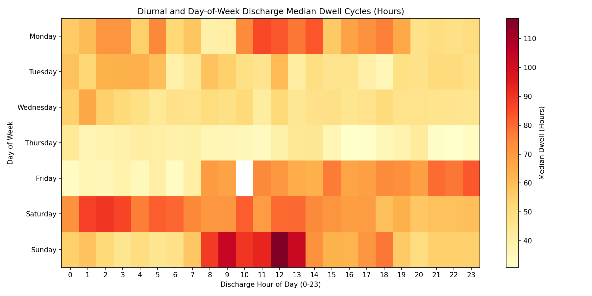

## 7. Noise floor

| metric | typical_level | observed_sigma | min_detectable_shift_2sigma | binomial_sigma | overdispersion |
|---|---|---|---|---|---|
| daily_volume | 1130.0 | 429.583 | 859.167 | – | – |
| daily_delay_share | 0.393 | 0.124 | 0.248 | 0.015 | 8.53 |
| daily_median_dwell_h | 51.99 | 16.739 | 33.477 | – | – |
| trailing_7d_delay_share | 0.396 | 0.027 | 0.054 | 0.005 | 4.92 |
| trailing_7d_volume | 7449.0 | 645.672 | 1291.345 | – | – |

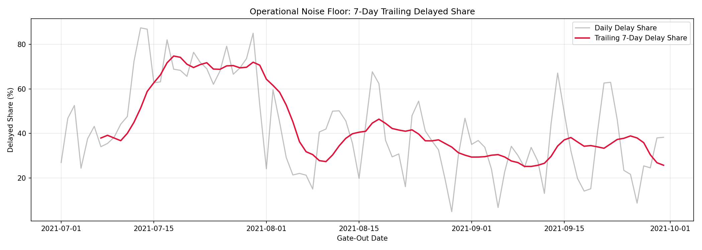

## 8. Reporting drift

| activity | mean_pct | min_pct | max_pct | observed_sd_pp | binomial_sd_pp | ratio |
|---|---|---|---|---|---|---|
| FIRST_STACK_QUARANTINE_BLK | 14.1 | 8.8 | 19.7 | 3.11 | 0.41 | 7.5 |
| HAS_QUARANTINE_FLAG | 28.0 | 21.3 | 32.1 | 3.42 | 0.54 | 6.4 |
| QUARANTINE_RELEASE | 28.0 | 21.3 | 32.1 | 3.42 | 0.54 | 6.4 |
| JOB_DEL | 99.5 | 98.0 | 100.0 | 0.54 | 0.09 | 6.1 |
| SP_RED_FLAG_PIB | 5.7 | 2.2 | 8.1 | 1.69 | 0.28 | 6.1 |
| STACK_MAIN_YARD | 4.2 | 2.8 | 5.5 | 0.94 | 0.24 | 4.0 |
| FIRST_JOB_CUSTOMS_BEHANDLE | 4.2 | 3.0 | 5.7 | 0.94 | 0.24 | 3.9 |
| FIRST_STACK_BEHANDLE | 4.4 | 3.0 | 5.7 | 0.96 | 0.24 | 3.9 |
| LAST_COMPLETE_BEHANDLE | 4.2 | 3.0 | 5.7 | 0.94 | 0.24 | 3.9 |
| STACK_TRK_BF_MAIN_YARD | 3.2 | 2.1 | 4.3 | 0.79 | 0.21 | 3.8 |
| STACK | 100.0 | 99.9 | 100.0 | 0.02 | 0.02 | 1.3 |
| UNSTACK_TO_TRUCK | 99.9 | 99.8 | 100.0 | 0.06 | 0.04 | 1.3 |
| BAPLIE | 100.0 | 100.0 | 100.0 | 0.0 | – | – |
| CUSTOMS_DEL | 100.0 | 100.0 | 100.0 | 0.0 | – | – |
| DISCHARGE | 100.0 | 100.0 | 100.0 | 0.0 | – | – |
| TRUCK_IN | 100.0 | 100.0 | 100.0 | 0.0 | – | – |
| TRUCK_OUT | 100.0 | 100.0 | 100.0 | 0.0 | – | – |
| VESSEL_ATB | 100.0 | 100.0 | 100.0 | 0.0 | – | – |

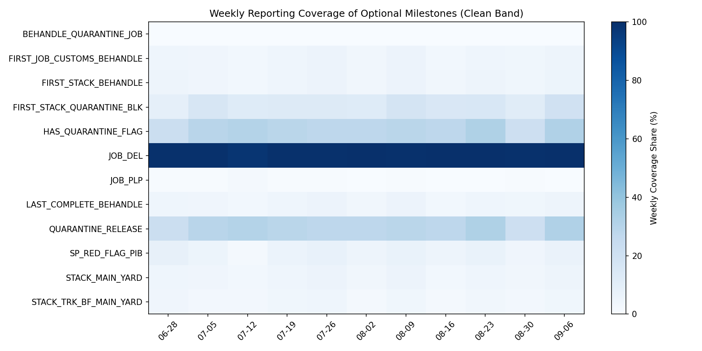

## 9. Customs and quarantine effects (clean band)

| flag | stays_with | share_pct | median_with_h | median_without_h | median_ratio | pct_critical_with | pct_critical_without | ratio_train | ratio_val | ratio_test |
|---|---|---|---|---|---|---|---|---|---|---|
| has_quarantine_flag | 21,888 | 28.29 | 60.7 | 56.9 | 1.07 | 18.4 | 10.4 | 1.09 | 1.01 | 0.51 |
| has_red_flag_pib | 4,166 | 5.38 | 109.6 | 56.1 | 1.95 | 32.2 | 11.6 | 1.92 | 2.17 | 4.69 |
| has_behandle_inspection | 3,304 | 4.27 | 127.0 | 56.3 | 2.26 | 38.7 | 11.5 | 2.23 | 2.44 | 4.5 |

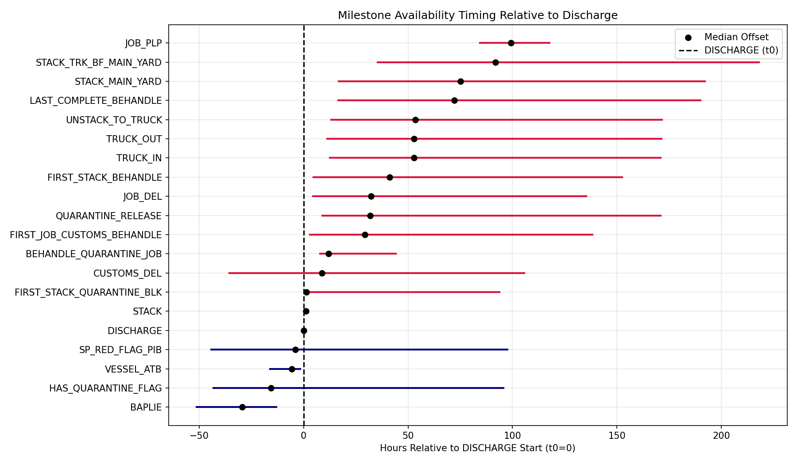

## 10. Data quality ledger

| check | count | share_pct | note |
|---|---|---|---|
| null_start_timestamp | 54 | 0.005671857817027968 | Start missing; end is still present. |
| null_end_timestamp | 0 | 0.0 | End missing. |
| implausible_start_year | 6 | 0.0006302064241142186 | Start outside 2021-01-01..2022-12-31; activities: {'CUSTOMS_DEL'} |
| implausible_end_year | 6 | 0.0006302064241142186 | End outside the plausible window. |
| end_before_start | 0 | 0.0 | Negative event duration. |
| date_only_end_timestamp:CUSTOMS_DEL | 95,648 | 10.046330675612797 | Every End is exactly 00:00:00, so the event has date precision only. |
| date_only_end_timestamp:SP_RED_FLAG_PIB | 5,155 | 0.5414523527181329 | Every End is exactly 00:00:00, so the event has date precision only. |
| tied_start_timestamps_within_case | 34 | 0.0035711697366472388 | Rows sharing a start time inside one case. |
| duration_column_null | 54 | 0.005671857817027968 | Pre-computed Duration is empty. |
| duration_column_unparseable | 13,095 | 1.375425520629282 | Not HH:MM:SS; Excel durations over 24h stored as 1900-01-0X dates. Use event_duration_minutes instead. |
| truck_out_starts_before_unstack | 60,207 | 63.01758425790245 | TRUCK_OUT start precedes UNSTACK_TO_TRUCK start; administrative gate passes pre-logged. |
| customs_release_date_before_discharge_date | 16,142 | 16.876463700234194 | Customs release dated before the discharge date; clearance legitimately precedes discharge. |

## 11. Guidance for the ML Engineer

### 11A. Strict horizon audit (Scenario: ARRIVAL_TIME at t_discharge)

| feature | status_at_t_discharge | audit_evidence |
|---|---|---|
| case_id | METADATA_ID | Join key known at arrival; exclude as a model predictor. |
| container_id | METADATA_ID | Container identity known at arrival; exclude to prevent entity memorization. |
| carrier_prefix | PASS | Derived from container identity; available before discharge. |
| call_date | METADATA_DATE_KEY | Case-id date is available but differs from the DISCHARGE calendar date for some stays; derive temporal features from discharge_start_ts. |
| CTR_SIZE | PASS | BAPLIE/stowage attribute; BAPLIE is observed before discharge. |
| CTR_TYPE | PASS | BAPLIE/stowage attribute; BAPLIE is observed before discharge. |
| GROSS | CONDITIONAL | Provenance places it at discharge, but the source has no field-level observation timestamp; obtain TOS sign-off before use. |
| YARD_BLOCK | CONDITIONAL | Provenance places assignment at discharge, but the source has no field-level observation timestamp; obtain TOS sign-off before use. |
| YARD_SLOT | CONDITIONAL | Provenance places assignment at discharge, but the source has no field-level observation timestamp; obtain TOS sign-off before use. |
| JOB_DEL_DOCTYPE | EXCLUDE_POST_DISCHARGE | Mid-stay delivery-order event; not knowable at t_discharge. |
| total_events_in_stay | EXCLUDE_POST_DISCHARGE | Full-stay event count; not knowable until the stay is complete. |
| has_quarantine_flag | CONDITIONAL | Whole-stay flag is not strictly safe; 67.4% of observed events start before discharge. Use only a timestamped as-of-discharge value. |
| has_red_flag_pib | CONDITIONAL | Whole-stay flag is not strictly safe; 54.4% of observed events start before discharge. Use only a timestamped as-of-discharge value. |
| has_behandle_inspection | EXCLUDE_POST_DISCHARGE | Physical inspection occurs in-yard after discharge. |
| dwell_hours | TARGET_ONLY | Ground truth realized at gate-out; never an input feature. |
| dwell_days | TARGET_ONLY | Ground truth duration derived from dwell_hours; never an input feature. |
| discharge_start_ts | METADATA_CUTOFF | The DISCHARGE start timestamp defines t_pred; retain as the time anchor, not an unrestricted raw predictor. |
| truck_out_end_ts | TARGET_ONLY | Gate-out completion timestamp occurs after t_discharge; never an input feature. |
| discharge_hour | PASS | Deterministic transform of the DISCHARGE timestamp. |
| discharge_day_of_week | PASS | Deterministic transform of the DISCHARGE timestamp. |
| discharge_month | PASS | Deterministic transform of the DISCHARGE timestamp. |
| is_weekend | PASS | Deterministic transform of the DISCHARGE timestamp. |
| target_class | TARGET_ONLY | Ground truth label based on local operational p50/p85 turnover tiers, not contractual demurrage. |
| target_class_name | TARGET_ONLY | String form of the local operational p50/p85 label; never an input feature. |
| trailing_7d_volume | PASS_WITH_COLD_START | Completed departures in [t-7, t-1]; pre-2021-07-01 zeros represent unobserved history. |
| trailing_7d_critical | PASS_WITH_COLD_START | Completed critical departures in [t-7, t-1]; pre-2021-07-01 zeros represent unobserved history. |
| trailing_7d_at_risk | PASS_WITH_COLD_START | Completed at-risk departures in [t-7, t-1]; pre-2021-07-01 zeros represent unobserved history. |
| historical_delay_rate_7d | PASS_WITH_COLD_START | Completed departures in [t-7, t-1]; pre-2021-07-01 zeros represent unobserved history. |
| trailing_7d_mean_dwell | PASS_WITH_COLD_START | Mean dwell of completed departures in [t-7, t-1]; pre-2021-07-01 zeros represent unobserved history. |
| weather_severity_index | EXCLUDE_UNVERIFIED_WEATHER | Sparse, constant-zero external feed with anonymized terminal coordinates; not an active baseline signal. |
| has_active_disruption | EXCLUDE_UNVERIFIED_WEATHER | Sparse, constant-zero external feed with anonymized terminal coordinates; not an active baseline signal. |
| split_tag | METADATA_SPLIT | Generated by partitioning; metadata only, never a predictor. |

### 11B. Eligible Arrival-Time Predictors (Scenario: ARRIVAL_TIME at t_discharge)

| feature | kind | association | n | note | eligibility_tier | arrival_eligible |
|---|---|---|---|---|---|---|
| CTR_SIZE | numeric | -0.1639 | 56,276 | Spearman rho vs dwell | ARRIVAL_TIME_ELIGIBLE | yes |
| trailing_7d_volume | numeric | -0.1567 | 56,276 | Spearman rho vs dwell | ARRIVAL_TIME_ELIGIBLE | yes |
| trailing_7d_critical | numeric | -0.1543 | 56,276 | Spearman rho vs dwell | ARRIVAL_TIME_ELIGIBLE | yes |
| is_weekend | numeric | 0.1533 | 56,276 | Spearman rho vs dwell | ARRIVAL_TIME_ELIGIBLE | yes |
| discharge_day_of_week | numeric | 0.0902 | 56,276 | Spearman rho vs dwell | ARRIVAL_TIME_ELIGIBLE | yes |
| historical_delay_rate_7d | numeric | 0.0823 | 56,276 | Spearman rho vs dwell | ARRIVAL_TIME_ELIGIBLE | yes |
| CTR_TYPE | categorical | 0.0499 | 56,276 | Kruskal epsilon^2 vs dwell | ARRIVAL_TIME_ELIGIBLE | yes |
| carrier_prefix | categorical | 0.0465 | 56,276 | Kruskal epsilon^2 vs dwell | ARRIVAL_TIME_ELIGIBLE | yes |
| trailing_7d_mean_dwell | numeric | 0.0445 | 56,276 | Spearman rho vs dwell | ARRIVAL_TIME_ELIGIBLE | yes |
| trailing_7d_at_risk | numeric | 0.0075 | 56,276 | Spearman rho vs dwell | ARRIVAL_TIME_ELIGIBLE | yes |
| discharge_hour | numeric | 0.0061 | 56,276 | Spearman rho vs dwell | ARRIVAL_TIME_ELIGIBLE | yes |

### 11C. Retrospective In-Yard / Post-Discharge Diagnostics (FORBIDDEN at Arrival)

| feature | kind | association | n | note | eligibility_tier | arrival_eligible |
|---|---|---|---|---|---|---|
| has_behandle_inspection | numeric | 0.1527 | 56,276 | Spearman rho vs dwell | POST_DISCHARGE_DIAGNOSTIC | no |
| has_red_flag_pib | numeric | 0.1414 | 56,276 | Spearman rho vs dwell | CONDITIONAL_PRE_ARRIVAL | no |
| total_events_in_stay | numeric | 0.1378 | 56,276 | Spearman rho vs dwell | POST_DISCHARGE_DIAGNOSTIC | no |
| has_quarantine_flag | numeric | 0.0796 | 56,276 | Spearman rho vs dwell | CONDITIONAL_PRE_ARRIVAL | no |
| YARD_BLOCK | categorical | 0.0494 | 56,267 | Kruskal epsilon^2 vs dwell | CONDITIONAL_AT_DISCHARGE | no |
| GROSS | numeric | -0.0276 | 56,276 | Spearman rho vs dwell | CONDITIONAL_AT_DISCHARGE | no |
| JOB_DEL_DOCTYPE | categorical | 0.0082 | 55,909 | Kruskal epsilon^2 vs dwell | POST_DISCHARGE_DIAGNOSTIC | no |
| weather_severity_index | numeric | – | 56,276 | Spearman rho vs dwell | EXCLUDED_UNVERIFIED_WEATHER | no |
| has_active_disruption | numeric | – | 56,276 | Spearman rho vs dwell | EXCLUDED_UNVERIFIED_WEATHER | no |

### 11D. Feature Stability and Modeling Recommendation Overview

| feature | kind | constant_in_train | psi_val | ks_val | psi_test | ks_test | max_psi | association | note | availability | recommendation |
|---|---|---|---|---|---|---|---|---|---|---|---|
| trailing_7d_mean_dwell | numeric | no | 5.4532 | 0.6473 | 5.1901 | 0.6835 | 5.4532 | 0.0445 | Spearman rho vs dwell | at arrival | KEEP with care: unstable (PSI>0.25) |
| trailing_7d_at_risk | numeric | no | 5.1842 | 0.4675 | 4.2445 | 0.4675 | 5.1842 | 0.0075 | Spearman rho vs dwell | at arrival | KEEP with care: unstable (PSI>0.25) |
| trailing_7d_volume | numeric | no | 4.8255 | 0.6798 | 3.664 | 0.3491 | 4.8255 | -0.1567 | Spearman rho vs dwell | at arrival | KEEP with care: unstable (PSI>0.25) |
| historical_delay_rate_7d | numeric | no | 4.6975 | 0.5919 | 3.5136 | 0.4733 | 4.6975 | 0.0823 | Spearman rho vs dwell | at arrival | KEEP with care: unstable (PSI>0.25) |
| trailing_7d_critical | numeric | no | 3.8605 | 0.3647 | 4.6556 | 0.4669 | 4.6556 | -0.1543 | Spearman rho vs dwell | at arrival | KEEP with care: unstable (PSI>0.25) |
| YARD_BLOCK | categorical | no | 0.1796 | – | 0.2565 | – | 0.2565 | 0.0494 | Kruskal epsilon^2 vs dwell | at discharge (TOS sign-off pending) | HOLD: confirm availability at t_discharge with TOS owner |
| discharge_day_of_week | numeric | no | 0.1238 | 0.1403 | 0.1221 | 0.1618 | 0.1238 | 0.0902 | Spearman rho vs dwell | at arrival | KEEP |
| is_weekend | numeric | no | 0.0871 | 0.1403 | 0.0225 | 0.0698 | 0.0871 | 0.1533 | Spearman rho vs dwell | at arrival | KEEP |
| JOB_DEL_DOCTYPE | categorical | no | 0.0281 | – | 0.0247 | – | 0.0281 | 0.0082 | Kruskal epsilon^2 vs dwell | post-arrival | MASK for arrival-time model |
| discharge_hour | numeric | no | 0.0231 | 0.0417 | 0.0184 | 0.0511 | 0.0231 | 0.0061 | Spearman rho vs dwell | at arrival | KEEP |
| carrier_prefix | categorical | no | 0.0195 | – | 0.0119 | – | 0.0195 | 0.0465 | Kruskal epsilon^2 vs dwell | at arrival | KEEP |
| GROSS | numeric | no | 0.0179 | 0.0473 | 0.018 | 0.048 | 0.018 | -0.0276 | Spearman rho vs dwell | at discharge (TOS sign-off pending) | HOLD: confirm availability at t_discharge with TOS owner |
| CTR_TYPE | categorical | no | 0.013 | – | 0.0008 | – | 0.013 | 0.0499 | Kruskal epsilon^2 vs dwell | at arrival | KEEP |
| has_red_flag_pib | numeric | no | 0.0002 | 0.0031 | 0.0093 | 0.0203 | 0.0093 | 0.1414 | Spearman rho vs dwell | conditional | HOLD: use timestamped as-of-discharge value only |
| CTR_SIZE | numeric | no | 0.009 | 0.0473 | 0.0015 | 0.0193 | 0.009 | -0.1639 | Spearman rho vs dwell | at arrival | KEEP |
| total_events_in_stay | numeric | no | 0.0072 | 0.0217 | 0.0047 | 0.0347 | 0.0072 | 0.1378 | Spearman rho vs dwell | post-arrival | MASK for arrival-time model |
| has_behandle_inspection | numeric | no | 0.0 | 0.0013 | 0.0052 | 0.0136 | 0.0052 | 0.1527 | Spearman rho vs dwell | post-arrival | MASK for arrival-time model |
| has_quarantine_flag | numeric | no | 0.0001 | 0.0047 | 0.0009 | 0.0138 | 0.0009 | 0.0796 | Spearman rho vs dwell | conditional | HOLD: use timestamped as-of-discharge value only |
| weather_severity_index | numeric | yes | 0.0 | 0.0 | 0.0 | 0.0 | 0.0 | – | Spearman rho vs dwell | excluded (unverified weather feed) | EXCLUDE: external weather/disruption signal is unverified |
| has_active_disruption | numeric | yes | 0.0 | 0.0 | 0.0 | 0.0 | 0.0 | – | Spearman rho vs dwell | excluded (unverified weather feed) | EXCLUDE: external weather/disruption signal is unverified |

## 12. Master Dataset Forensic Audit (Stage 03 Reassessment)

The new Master Dataset (`data/master/master_real.parquet`, N=95,647, 55 columns) incorporates exact milestone availability timestamps, standardized weights, external regulatory calendar context, and PortWatch activity indices.

### 12A. Gross Weight Scale Normalization (kg vs. tonnes anomaly)

In the source event log, 18.9% (18,038 stays) recorded container gross weight in kilograms (>100), while the remaining 81.1% recorded in metric tonnes (<=100). The normalized feature `gross_t` unifies all weights to metric tonnes:

| stratum | count | share_pct | raw_gross_min | raw_gross_median | raw_gross_p95 | raw_gross_max | gross_t_median | gross_t_max |
|---|---|---|---|---|---|---|---|---|
| All Stays | 95,647 | 100.0 | 2.0 | 28.1 | 29254.0 | 33691.0 | 27.0 | 39.5 |
| Values Recorded in Tonnes (<= 100) | 77,609 | 81.14 | 2.0 | 27.0 | 32.1 | 39.5 | 27.0 | 39.5 |
| Values Recorded in Kilograms (> 100) | 18,038 | 18.86 | 2501.0 | 27144.0 | 30472.0 | 33691.0 | 27.14 | 33.69 |

### 12B. External Macroeconomic & PortWatch Telemetry

Context features captured strictly as-of container discharge start:

| context_feature | dtype | non_null_count | null_count | mean_or_mode | median | min | max |
|---|---|---|---|---|---|---|---|
| ctx_discharge_ppkm_level | float64 | 95,630 | 17 | 3.223 | 4.0 | 1.0 | 4.0 |
| ctx_discharge_is_holiday_today | int64 | 95,647 | 0 | 0.026 | 0.0 | 0.0 | 1.0 |
| ctx_discharge_working_days_next_1d | int64 | 95,647 | 0 | 0.638 | 1.0 | 0.0 | 1.0 |
| ctx_discharge_working_days_next_2d | int64 | 95,647 | 0 | 1.363 | 1.0 | 0.0 | 2.0 |
| ctx_discharge_working_days_next_3d | int64 | 95,647 | 0 | 2.035 | 2.0 | 0.0 | 3.0 |
| ctx_discharge_days_since_ppkm_change | int64 | 95,647 | 0 | 19.049 | 15.0 | 0.0 | 51.0 |
| ctx_discharge_pw_portcalls_container_7d | float64 | 95,647 | 0 | 0.0 | 0.0 | 0.0 | 0.0 |
| ctx_discharge_pw_portcalls_container_7d_vs_28d | float64 | 0 | 95,647 | – | – | – | – |
| ctx_discharge_pw_import_container_7d | float64 | 95,647 | 0 | 0.0 | 0.0 | 0.0 | 0.0 |
| ctx_discharge_pw_import_container_7d_vs_28d | float64 | 0 | 95,647 | – | – | – | – |
| ctx_discharge_pw_portcalls_7d | float64 | 95,647 | 0 | 0.0 | 0.0 | 0.0 | 0.0 |
| ctx_discharge_pw_portcalls_7d_vs_28d | float64 | 0 | 95,647 | – | – | – | – |

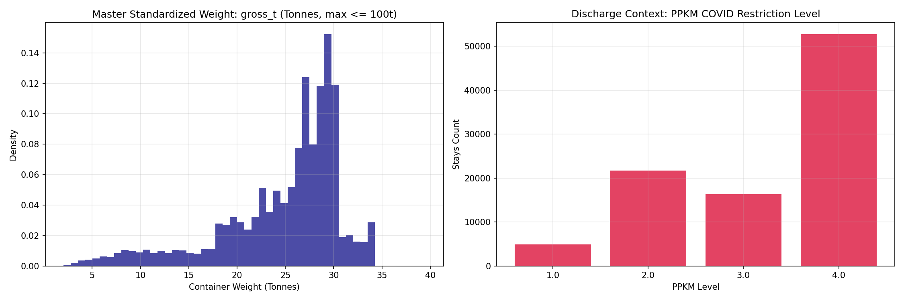

### 12C. Synthetic Process Data Fidelity (Process-Segment Recombination)

Audit of 30,000 synthetic training stays generated via process-segment recombination to balance training classes without out-of-fold label distortion:

| dimension | real_count | real_share_pct | synth_count | synth_share_pct | real_dwell_p50 | synth_dwell_p50 | real_dwell_p85 | synth_dwell_p85 |
|---|---|---|---|---|---|---|---|---|
| Class 0: ON_TIME (<=65.1h) | 37,013 | 53.29 | 11,159 | 37.2 | 32.0 | 34.0 | 53.9 | 54.0 |
| Class 1: AT_RISK (65.1-160.9h) | 23,195 | 33.4 | 9,754 | 32.51 | 98.6 | 106.9 | 135.0 | 142.8 |
| Class 2: CRITICAL_DELAY (>160.9h) | 9,245 | 13.31 | 9,087 | 30.29 | 222.6 | 238.1 | 336.6 | 371.8 |

#### Covariate Fidelity (PSI & KS Real vs. Synthetic):

| feature | kind | psi_synthetic_vs_real | ks_stat | ks_p_value | fidelity_verdict |
|---|---|---|---|---|---|
| gross_t | numeric | 0.0028 | 0.0125 | 0.0028664230378546394 | HIGH_FIDELITY |
| CTR_SIZE | numeric | 0.0051 | 0.0357 | 1.1200177403575345e-23 | HIGH_FIDELITY |
| dwell_hours | numeric | 0.2224 | 0.1993 | 0.0 | MODERATE_FIDELITY |

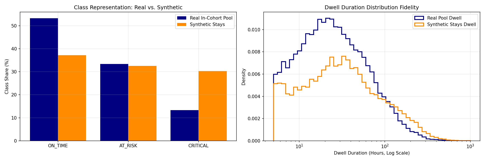

### 12D. Complete 55-Column Master Feature Horizon Audit

| column | status_at_t_discharge | category | dtype | null_count | audit_note |
|---|---|---|---|---|---|
| case_id | METADATA_ID | IDENTIFIER | object | 0 | Primary join key or entity identifier; exclude from model training. |
| container_id | METADATA_ID | IDENTIFIER | object | 0 | Primary join key or entity identifier; exclude from model training. |
| carrier_prefix | PASS_PRE_ARRIVAL | EQUIPMENT_MANIFEST | object | 0 | Manifest/BAPLIE attributes known prior to discharge. |
| call_date | METADATA_ID | IDENTIFIER | object | 0 | Primary join key or entity identifier; exclude from model training. |
| CTR_SIZE | PASS_PRE_ARRIVAL | EQUIPMENT_MANIFEST | float64 | 0 | Manifest/BAPLIE attributes known prior to discharge. |
| CTR_TYPE | PASS_PRE_ARRIVAL | EQUIPMENT_MANIFEST | object | 0 | Manifest/BAPLIE attributes known prior to discharge. |
| GROSS | CONDITIONAL | EQUIPMENT_RAW | float64 | 0 | Raw weight with mixed unit scales (kg vs tonnes); prefer gross_t. |
| YARD_BLOCK | CONDITIONAL | YARD_LOCATION | object | 24 | Discrete yard location; initial vs final slot cannot be authoritatively separated. |
| YARD_SLOT | CONDITIONAL | YARD_LOCATION | float64 | 242 | Discrete yard location; initial vs final slot cannot be authoritatively separated. |
| JOB_DEL_DOCTYPE | EXCLUDE_AT_DISCHARGE | ADMINISTRATIVE_MILESTONE | object | 500 | Delivery order issued mid-stay (+32.2h post-discharge); forbidden at discharge. |
| discharge_start_ts | METADATA_ANCHOR | ANCHOR_TIMESTAMP | datetime64[ns] | 0 | Primary prediction anchor (t_pred = t_discharge); used to calculate as-of offsets. |
| truck_out_end_ts | TARGET_ONLY | MILESTONE_EXIT | datetime64[ns] | 0 | Realized gate-out timestamp; forbidden in X. |
| dwell_hours | TARGET_ONLY | TARGET | float64 | 0 | Ground truth operational dwell outcome realized at gate-out; strictly forbidden in X. |
| target_class | TARGET_ONLY | TARGET | int64 | 0 | Ground truth operational dwell outcome realized at gate-out; strictly forbidden in X. |
| vessel_call_id | METADATA_ID | IDENTIFIER | object | 0 | Primary join key or entity identifier; exclude from model training. |
| avail_BAPLIE | AVAILABLE_AT_AS_OF_TIMESTAMP | AS_OF_AVAILABILITY_TIMESTAMP | datetime64[ns] | 0 | Defines exact observation timestamp for milestone BAPLIE; safe for as-of evaluation at t >= avail_BAPLIE. |
| avail_VESSEL_ATB | AVAILABLE_AT_AS_OF_TIMESTAMP | AS_OF_AVAILABILITY_TIMESTAMP | datetime64[ns] | 0 | Defines exact observation timestamp for milestone VESSEL_ATB; safe for as-of evaluation at t >= avail_VESSEL_ATB. |
| avail_DISCHARGE | AVAILABLE_AT_AS_OF_TIMESTAMP | AS_OF_AVAILABILITY_TIMESTAMP | datetime64[ns] | 0 | Defines exact observation timestamp for milestone DISCHARGE; safe for as-of evaluation at t >= avail_DISCHARGE. |
| avail_STACK | AVAILABLE_AT_AS_OF_TIMESTAMP | AS_OF_AVAILABILITY_TIMESTAMP | datetime64[ns] | 24 | Defines exact observation timestamp for milestone STACK; safe for as-of evaluation at t >= avail_STACK. |
| avail_HAS_QUARANTINE_FLAG | AVAILABLE_AT_AS_OF_TIMESTAMP | AS_OF_AVAILABILITY_TIMESTAMP | datetime64[ns] | 68,707 | Defines exact observation timestamp for milestone HAS_QUARANTINE_FLAG; safe for as-of evaluation at t >= avail_HAS_QUARANTINE_FLAG. |
| avail_SP_RED_FLAG_PIB | AVAILABLE_AT_AS_OF_TIMESTAMP | AS_OF_AVAILABILITY_TIMESTAMP | datetime64[ns] | 90,494 | Defines exact observation timestamp for milestone SP_RED_FLAG_PIB; safe for as-of evaluation at t >= avail_SP_RED_FLAG_PIB. |
| avail_FIRST_STACK_QUARANTINE_BLK | AVAILABLE_AT_AS_OF_TIMESTAMP | AS_OF_AVAILABILITY_TIMESTAMP | datetime64[ns] | 82,008 | Defines exact observation timestamp for milestone FIRST_STACK_QUARANTINE_BLK; safe for as-of evaluation at t >= avail_FIRST_STACK_QUARANTINE_BLK. |
| avail_CUSTOMS_DEL | AVAILABLE_AT_AS_OF_TIMESTAMP | AS_OF_AVAILABILITY_TIMESTAMP | datetime64[ns] | 6 | Defines exact observation timestamp for milestone CUSTOMS_DEL; safe for as-of evaluation at t >= avail_CUSTOMS_DEL. |
| avail_QUARANTINE_RELEASE | AVAILABLE_AT_AS_OF_TIMESTAMP | AS_OF_AVAILABILITY_TIMESTAMP | datetime64[ns] | 68,707 | Defines exact observation timestamp for milestone QUARANTINE_RELEASE; safe for as-of evaluation at t >= avail_QUARANTINE_RELEASE. |
| avail_FIRST_JOB_CUSTOMS_BEHANDLE | AVAILABLE_AT_AS_OF_TIMESTAMP | AS_OF_AVAILABILITY_TIMESTAMP | datetime64[ns] | 91,724 | Defines exact observation timestamp for milestone FIRST_JOB_CUSTOMS_BEHANDLE; safe for as-of evaluation at t >= avail_FIRST_JOB_CUSTOMS_BEHANDLE. |
| avail_FIRST_STACK_BEHANDLE | AVAILABLE_AT_AS_OF_TIMESTAMP | AS_OF_AVAILABILITY_TIMESTAMP | datetime64[ns] | 91,616 | Defines exact observation timestamp for milestone FIRST_STACK_BEHANDLE; safe for as-of evaluation at t >= avail_FIRST_STACK_BEHANDLE. |
| avail_LAST_COMPLETE_BEHANDLE | AVAILABLE_AT_AS_OF_TIMESTAMP | AS_OF_AVAILABILITY_TIMESTAMP | datetime64[ns] | 91,724 | Defines exact observation timestamp for milestone LAST_COMPLETE_BEHANDLE; safe for as-of evaluation at t >= avail_LAST_COMPLETE_BEHANDLE. |
| avail_STACK_MAIN_YARD | AVAILABLE_AT_AS_OF_TIMESTAMP | AS_OF_AVAILABILITY_TIMESTAMP | datetime64[ns] | 91,804 | Defines exact observation timestamp for milestone STACK_MAIN_YARD; safe for as-of evaluation at t >= avail_STACK_MAIN_YARD. |
| avail_STACK_TRK_BF_MAIN_YARD | AVAILABLE_AT_AS_OF_TIMESTAMP | AS_OF_AVAILABILITY_TIMESTAMP | datetime64[ns] | 92,697 | Defines exact observation timestamp for milestone STACK_TRK_BF_MAIN_YARD; safe for as-of evaluation at t >= avail_STACK_TRK_BF_MAIN_YARD. |
| avail_JOB_PLP | AVAILABLE_AT_AS_OF_TIMESTAMP | AS_OF_AVAILABILITY_TIMESTAMP | datetime64[ns] | 95,142 | Defines exact observation timestamp for milestone JOB_PLP; safe for as-of evaluation at t >= avail_JOB_PLP. |
| avail_JOB_DEL | AVAILABLE_AT_AS_OF_TIMESTAMP | AS_OF_AVAILABILITY_TIMESTAMP | datetime64[ns] | 500 | Defines exact observation timestamp for milestone JOB_DEL; safe for as-of evaluation at t >= avail_JOB_DEL. |
| avail_TRUCK_IN | AVAILABLE_AT_AS_OF_TIMESTAMP | AS_OF_AVAILABILITY_TIMESTAMP | datetime64[ns] | 0 | Defines exact observation timestamp for milestone TRUCK_IN; safe for as-of evaluation at t >= avail_TRUCK_IN. |
| avail_UNSTACK_TO_TRUCK | AVAILABLE_AT_AS_OF_TIMESTAMP | AS_OF_AVAILABILITY_TIMESTAMP | datetime64[ns] | 107 | Defines exact observation timestamp for milestone UNSTACK_TO_TRUCK; safe for as-of evaluation at t >= avail_UNSTACK_TO_TRUCK. |
| avail_TRUCK_OUT | AVAILABLE_AT_AS_OF_TIMESTAMP | AS_OF_AVAILABILITY_TIMESTAMP | datetime64[ns] | 0 | Defines exact observation timestamp for milestone TRUCK_OUT; safe for as-of evaluation at t >= avail_TRUCK_OUT. |
| in_cohort | METADATA_PARTITION | COHORT_PARTITION | bool | 0 | Defines selection-aware cohort (discharges July 1 - Sept 5, 2021) and holdout evaluation. |
| source | METADATA_ID | IDENTIFIER | object | 0 | Primary join key or entity identifier; exclude from model training. |
| is_synthetic | METADATA_PARTITION | COHORT_PARTITION | bool | 0 | Defines selection-aware cohort (discharges July 1 - Sept 5, 2021) and holdout evaluation. |
| gross_t | PASS_AT_DISCHARGE | EQUIPMENT_STANDARDIZED | float64 | 0 | Corrected weight normalized to metric tonnes (values > 100 divided by 1000). |
| gross_recorded_in_kg | PASS_AT_DISCHARGE | DATA_QUALITY_INDICATOR | bool | 0 | Indicator that original GROSS was recorded in kilograms (18.9% of stays). |
| is_holdout_window | METADATA_PARTITION | COHORT_PARTITION | bool | 0 | Defines selection-aware cohort (discharges July 1 - Sept 5, 2021) and holdout evaluation. |
| synth_template_case_id | METADATA_SYNTHETIC | SYNTHETIC_PROVENANCE | object | 95,647 | Tracks donor case IDs and latest donor discharge timestamp for causality filtering. |
| synth_donor_case_ids | METADATA_SYNTHETIC | SYNTHETIC_PROVENANCE | object | 95,647 | Tracks donor case IDs and latest donor discharge timestamp for causality filtering. |
| synth_donor_max_discharge | METADATA_SYNTHETIC | SYNTHETIC_PROVENANCE | datetime64[ns] | 95,647 | Tracks donor case IDs and latest donor discharge timestamp for causality filtering. |
| ctx_discharge_ppkm_level | PASS_AT_DISCHARGE | DISCHARGE_TIME_EXTERNAL_CONTEXT | float64 | 17 | Observed strictly on or before discharge date with publication lags enforced. |
| ctx_discharge_is_holiday_today | PASS_AT_DISCHARGE | DISCHARGE_TIME_EXTERNAL_CONTEXT | int64 | 0 | Observed strictly on or before discharge date with publication lags enforced. |
| ctx_discharge_working_days_next_1d | PASS_AT_DISCHARGE | DISCHARGE_TIME_EXTERNAL_CONTEXT | int64 | 0 | Observed strictly on or before discharge date with publication lags enforced. |
| ctx_discharge_working_days_next_2d | PASS_AT_DISCHARGE | DISCHARGE_TIME_EXTERNAL_CONTEXT | int64 | 0 | Observed strictly on or before discharge date with publication lags enforced. |
| ctx_discharge_working_days_next_3d | PASS_AT_DISCHARGE | DISCHARGE_TIME_EXTERNAL_CONTEXT | int64 | 0 | Observed strictly on or before discharge date with publication lags enforced. |
| ctx_discharge_days_since_ppkm_change | PASS_AT_DISCHARGE | DISCHARGE_TIME_EXTERNAL_CONTEXT | int64 | 0 | Observed strictly on or before discharge date with publication lags enforced. |
| ctx_discharge_pw_portcalls_container_7d | PASS_AT_DISCHARGE | DISCHARGE_TIME_EXTERNAL_CONTEXT | float64 | 0 | Observed strictly on or before discharge date with publication lags enforced. |
| ctx_discharge_pw_portcalls_container_7d_vs_28d | PASS_AT_DISCHARGE | DISCHARGE_TIME_EXTERNAL_CONTEXT | float64 | 95,647 | Observed strictly on or before discharge date with publication lags enforced. |
| ctx_discharge_pw_import_container_7d | PASS_AT_DISCHARGE | DISCHARGE_TIME_EXTERNAL_CONTEXT | float64 | 0 | Observed strictly on or before discharge date with publication lags enforced. |
| ctx_discharge_pw_import_container_7d_vs_28d | PASS_AT_DISCHARGE | DISCHARGE_TIME_EXTERNAL_CONTEXT | float64 | 95,647 | Observed strictly on or before discharge date with publication lags enforced. |
| ctx_discharge_pw_portcalls_7d | PASS_AT_DISCHARGE | DISCHARGE_TIME_EXTERNAL_CONTEXT | float64 | 0 | Observed strictly on or before discharge date with publication lags enforced. |
| ctx_discharge_pw_portcalls_7d_vs_28d | PASS_AT_DISCHARGE | DISCHARGE_TIME_EXTERNAL_CONTEXT | float64 | 95,647 | Observed strictly on or before discharge date with publication lags enforced. |
