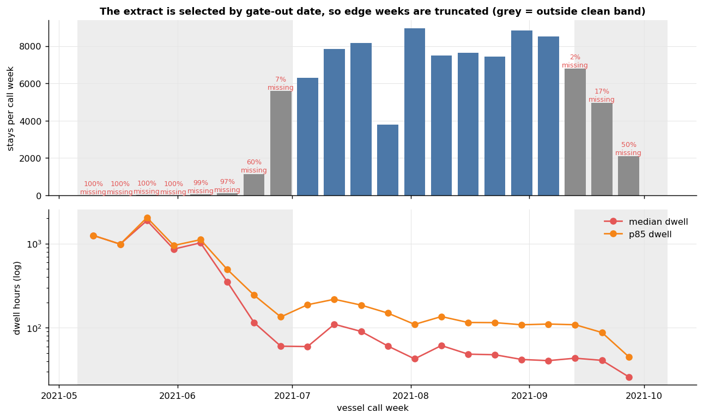
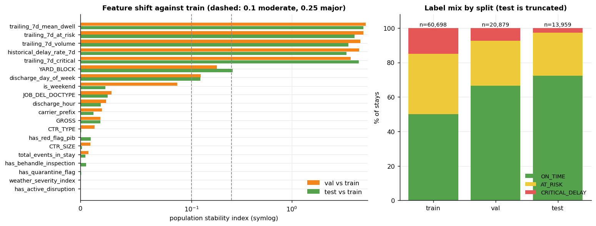
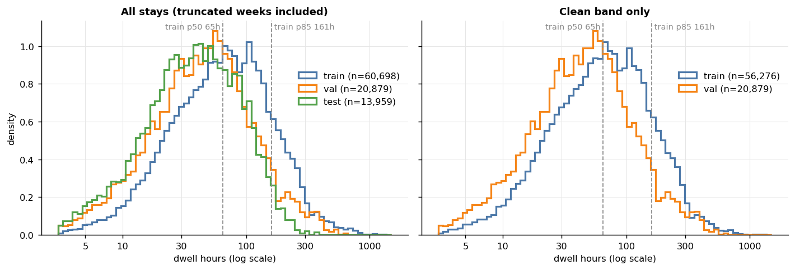
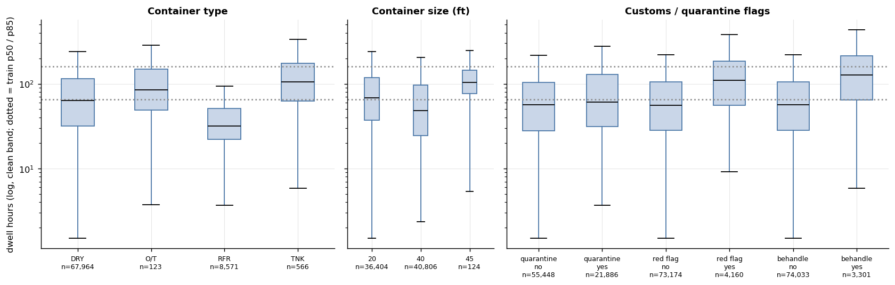
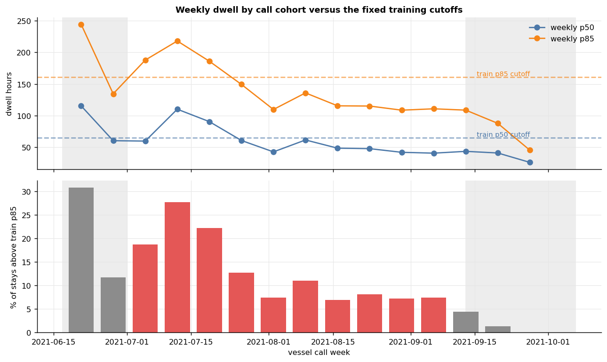
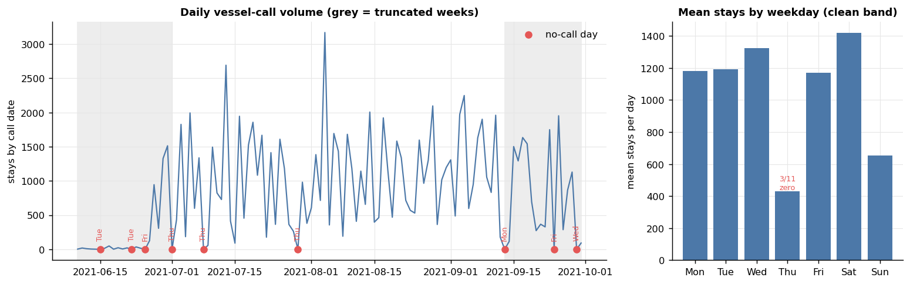
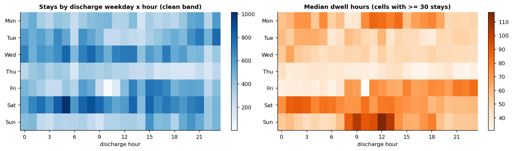
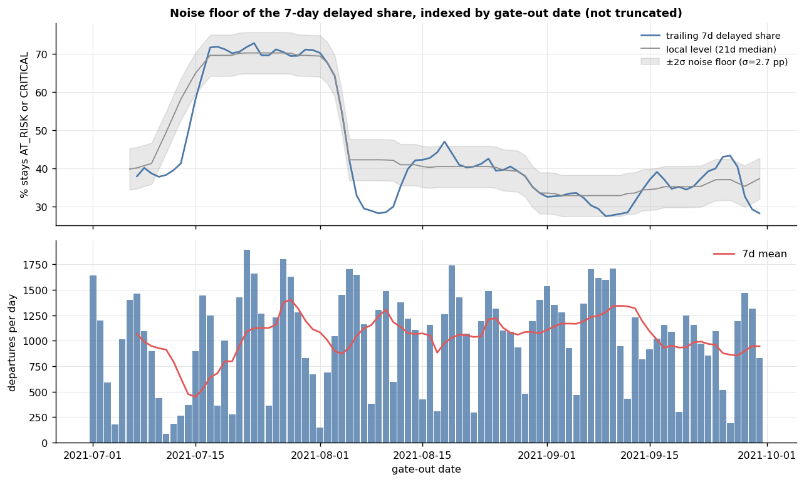
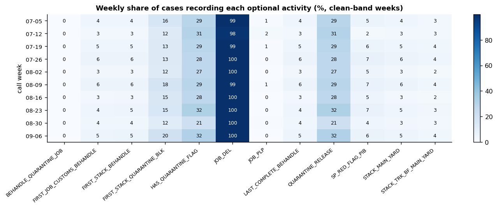
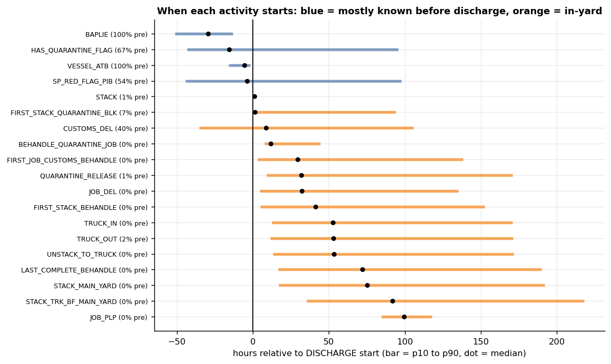

# EDA Findings: Stage 01 Container Dwell Data

Generated by `ML/eda_engineer/eda_runner.py` from `data/processed` and `data/interim`. Every number below is computed by the run; tables are in `tables/`, figures in `figures/`.

## 1. Headline findings

1. **The extract is selected by gate-out date, so call-date edges are truncated.** All 95,647 stays leave the yard between 2021-07-01 and 2021-09-30. Stays that arrived earlier appear only if they were slow; stays that arrived late in September appear only if they were quick. Only call dates 2021-07-01 to 2021-09-12 are fully observable (the 99% dwell horizon is 431h). That band holds 77,364 of 95,647 stays.
2. **Test is not a clean holdout.** Mean observable share is 98.0% for train, 99.7% for val and 85.4% for test; the last two call weeks are missing an estimated 17% and 50% of their stays. Only 179 test stays are fully observable.
3. **Part of the dwell drift is real.** Inside the clean band, call date and dwell are negatively correlated (Spearman rho -0.26); weekly median dwell falls from 110h in the week of 2021-07-12 to about 48h in the last five clean weeks. Val is fully inside the clean band and still has 7.4% critical stays against 15.0% in train.
4. **The data contains one congestion episode, in July.** Seven-day average departures fall to 449 per day around 2021-07-15 (typical 1064), and the share of departing stays that are AT_RISK or CRITICAL peaks at 73% around 2021-07-23 versus 34% over the last 30 days. The week of 2021-07-12 has 28% of stays above the train p85 cutoff. Most positive (AT_RISK / CRITICAL) examples a model can learn from come from this episode.
5. **p50/p85 are label choices, not natural boundaries.** Log-dwell has 1 mode(s) at [70.3]h and no trough; relative density at the cutoffs is 0.99 (p50) and 0.65 (p85).
6. **Weather features carry no information.** `weather_severity_index` and `has_active_disruption` are constant in train.
7. **Noise floor.** The trailing 7-day delayed share moves by about ±2.7 pp (1 sigma) with no real change, 4.9x what sampling alone would give; shifts smaller than 5.4 pp are indistinguishable from noise.

## 2. Extract window and truncation

First gate-out 2021-07-01 00:07:00, last gate-out 2021-09-30 23:51:25; discharges run from 2021-05-12 to 2021-09-30. The 38 'burn-in' stays (call dates before 2021-06-10) have a median dwell of 1,107h (46 days): they are in the file only because they were still in the yard on 2021-07-01. `est_missing_pct` uses the clean-band dwell distribution to estimate the share of each call week's stays that could not be observed.

| call_week | stays | median_dwell_h | p85_dwell_h | est_missing_pct | in_clean_band |
|---|---|---|---|---|---|
| 2021-05-10 | 1 | 1245.7 | 1245.7 | 100.0 | no |
| 2021-05-17 | 3 | 982.5 | 983.5 | 100.0 | no |
| 2021-05-24 | 13 | 1871.7 | 2028.4 | 99.9 | no |
| 2021-05-31 | 2 | 858.4 | 947.8 | 99.9 | no |
| 2021-06-07 | 54 | 1019.1 | 1110.4 | 99.3 | no |
| 2021-06-14 | 96 | 351.3 | 492.7 | 97.1 | no |
| 2021-06-21 | 1,144 | 115.5 | 244.4 | 60.5 | no |
| 2021-06-28 | 5,592 | 60.5 | 134.6 | 6.6 | no |
| 2021-07-05 | 6,306 | 59.9 | 187.8 | 0.0 | yes |
| 2021-07-12 | 7,848 | 110.2 | 218.0 | 0.0 | yes |
| 2021-07-19 | 8,171 | 90.6 | 186.0 | 0.0 | yes |
| 2021-07-26 | 3,778 | 60.8 | 149.5 | 0.0 | yes |
| 2021-08-02 | 8,941 | 42.8 | 109.8 | 0.0 | yes |
| 2021-08-09 | 7,476 | 61.6 | 136.0 | 0.0 | yes |
| 2021-08-16 | 7,649 | 48.7 | 115.6 | 0.0 | yes |
| 2021-08-23 | 7,423 | 47.9 | 115.2 | 0.1 | yes |
| 2021-08-30 | 8,824 | 42.1 | 108.7 | 0.2 | yes |
| 2021-09-06 | 8,503 | 40.8 | 110.8 | 0.5 | yes |
| 2021-09-13 | 6,780 | 43.6 | 108.8 | 2.4 | no |
| 2021-09-20 | 4,956 | 41.1 | 87.9 | 16.8 | no |
| 2021-09-27 | 2,087 | 26.2 | 45.4 | 50.0 | no |

### Effect on label cutoffs

| scope | n | p50_h | p85_h | note |
|---|---|---|---|---|
| train (as built) | 60,698 | 65.11 | 160.9 | label cutoffs in use: p50=65.11h p85=160.90h |
| clean band, all splits | 77,364 | 57.97 | 146.79 | label cutoffs in use: p50=65.11h p85=160.90h |
| clean band, train only | 56,276 | 64.42 | 159.12 | label cutoffs in use: p50=65.11h p85=160.90h |

Left truncation barely moves the train cutoffs (p50 65.1h as built versus 64.4h on the clean band only). The damage is on the right: val and test cohorts are shorter.

### Label mix by split

| split | scope | n | ON_TIME | AT_RISK | CRITICAL_DELAY |
|---|---|---|---|---|---|
| test | all stays | 13,959 | 0.724 | 0.2484 | 0.0276 |
| train | all stays | 60,698 | 0.5 | 0.35 | 0.15 |
| val | all stays | 20,879 | 0.6654 | 0.261 | 0.0737 |
| test | clean band | 179 | 0.7039 | 0.1676 | 0.1285 |
| train | clean band | 56,276 | 0.5047 | 0.3487 | 0.1466 |
| val | clean band | 20,879 | 0.6654 | 0.261 | 0.0737 |

## 3. Dwell time profile

Clean-band percentiles (hours) for model splits and the main categories:

| group_by | level | n | mean | p10 | p25 | p50 | p75 | p85 | p90 | p95 | p99 |
|---|---|---|---|---|---|---|---|---|---|---|---|
| ALL | all | 77,334 | 83.76 | 15.69 | 29.16 | 57.97 | 108.59 | 146.8 | 181.43 | 243.52 | 410.69 |
| split_tag | test | 179 | 66.83 | 21.92 | 26.39 | 44.5 | 73.87 | 95.84 | 195.6 | 209.91 | 252.4 |
| split_tag | train | 56,276 | 90.64 | 17.57 | 32.38 | 64.42 | 118.58 | 159.12 | 193.98 | 253.02 | 435.94 |
| split_tag | val | 20,879 | 65.38 | 12.03 | 23.07 | 44.82 | 80.37 | 112.05 | 139.31 | 202.22 | 366.27 |
| CTR_TYPE | DRY | 67,964 | 87.97 | 15.84 | 31.54 | 63.08 | 114.95 | 153.88 | 188.79 | 249.23 | 414.54 |
| CTR_TYPE | O/T | 123 | 111.3 | 18.87 | 49.1 | 84.73 | 148.76 | 195.12 | 207.12 | 233.98 | 596.56 |
| CTR_TYPE | OVD | 99 | 148.25 | 36.94 | 66.36 | 106.03 | 205.68 | 256.36 | 272.0 | 333.71 | 664.95 |
| CTR_TYPE | RFR | 8,571 | 45.7 | 14.55 | 22.1 | 31.76 | 50.82 | 64.75 | 78.08 | 116.24 | 277.22 |
| CTR_TYPE | TNK | 566 | 136.76 | 36.5 | 62.92 | 104.84 | 174.96 | 254.59 | 276.2 | 350.54 | 475.19 |
| CTR_SIZE | 20.0 | 36,404 | 92.07 | 19.75 | 37.34 | 68.06 | 118.9 | 157.0 | 192.36 | 249.82 | 417.76 |
| CTR_SIZE | 40.0 | 40,806 | 76.24 | 13.27 | 24.41 | 48.41 | 96.98 | 137.15 | 170.6 | 235.66 | 403.04 |
| CTR_SIZE | 45.0 | 124 | 120.38 | 39.44 | 76.42 | 103.1 | 145.2 | 173.76 | 200.85 | 225.66 | 413.21 |
| JOB_DEL_DOCTYPE | BC23 | 4,678 | 75.21 | 13.03 | 26.57 | 53.01 | 93.08 | 130.01 | 160.05 | 229.15 | 374.12 |
| JOB_DEL_DOCTYPE | LAIN2 | 343 | 140.92 | 121.96 | 129.35 | 136.62 | 146.58 | 157.07 | 170.35 | 183.23 | 244.57 |
| JOB_DEL_DOCTYPE | SPPB | 71,872 | 83.85 | 15.76 | 29.09 | 57.59 | 108.15 | 148.04 | 183.39 | 245.06 | 414.54 |
| JOB_DEL_DOCTYPE | nan | 418 | 109.99 | 90.43 | 97.45 | 106.35 | 117.88 | 124.78 | 146.24 | 149.59 | 165.21 |
| has_quarantine_flag | 0 | 55,448 | 78.33 | 14.04 | 28.05 | 56.88 | 103.24 | 135.02 | 164.19 | 219.05 | 376.68 |
| has_quarantine_flag | 1 | 21,886 | 97.53 | 20.04 | 31.34 | 60.69 | 129.69 | 182.66 | 229.64 | 293.1 | 470.55 |
| has_red_flag_pib | 0 | 73,174 | 80.61 | 15.18 | 28.25 | 56.11 | 104.53 | 140.64 | 172.73 | 234.8 | 397.53 |
| has_red_flag_pib | 1 | 4,160 | 139.25 | 33.61 | 55.76 | 109.56 | 185.99 | 234.18 | 273.78 | 356.8 | 575.72 |
| has_behandle_inspection | 0 | 74,033 | 80.37 | 15.26 | 28.43 | 56.27 | 104.58 | 140.61 | 172.26 | 232.71 | 390.23 |
| has_behandle_inspection | 1 | 3,301 | 159.79 | 37.57 | 64.48 | 126.94 | 212.08 | 269.37 | 321.91 | 421.7 | 603.04 |

Weekly dwell versus the fixed cutoffs, which shows the July episode and the later calm:

## 4. Call rhythm, gaps and cycles

9 dates have no vessel calls after 2021-06-10; 3 of them are inside the clean band (Thursday). Thursday averages 431 stays/day against 1156 on other weekdays, with 3 of 11 Thursdays empty, so these gaps look like a weekly vessel-schedule pattern, not missing reporting. Gaps outside the clean band coincide with truncated weeks.

| call_date | weekday | in_clean_band |
|---|---|---|
| 2021-06-15 | Tuesday | no |
| 2021-06-22 | Tuesday | no |
| 2021-06-25 | Friday | no |
| 2021-07-01 | Thursday | yes |
| 2021-07-08 | Thursday | yes |
| 2021-07-29 | Thursday | yes |
| 2021-09-13 | Monday | no |
| 2021-09-24 | Friday | no |
| 2021-09-29 | Wednesday | no |

| weekday | days | mean_stays | median_stays | zero_call_days |
|---|---|---|---|---|
| Monday | 10 | 1182.2 | 1098.5 | 0 |
| Tuesday | 10 | 1191.0 | 1133.0 | 0 |
| Wednesday | 10 | 1322.7 | 1322.5 | 0 |
| Thursday | 11 | 431.1 | 356.0 | 3 |
| Friday | 11 | 1169.9 | 1302.0 | 0 |
| Saturday | 11 | 1418.3 | 1494.0 | 0 |
| Sunday | 11 | 653.9 | 597.0 | 0 |

Dwell also differs by discharge weekday (clean band, train + val + test). This is not adjusted for the July episode, so part of the pattern may be period mix:

| discharge_weekday | stays | median_h | p85_h | pct_critical |
|---|---|---|---|---|
| Monday | 9,280 | 61.7 | 148.7 | 13.8 |
| Tuesday | 11,352 | 50.6 | 160.9 | 15.0 |
| Wednesday | 14,020 | 48.2 | 155.4 | 14.2 |
| Thursday | 6,764 | 37.6 | 127.6 | 8.9 |
| Friday | 10,490 | 67.9 | 138.6 | 10.0 |
| Saturday | 16,350 | 71.7 | 146.9 | 12.0 |
| Sunday | 9,078 | 63.5 | 143.1 | 13.5 |

`call_date` in `case_id` equals the discharge date for 74.1% of stays and is one day earlier for 25.6%. Calendar features built from `discharge_start_ts` and `call_date` therefore differ for about a quarter of stays.

## 5. Noise floor

Series are indexed by gate-out date, which is not truncated by the extract. Residuals are taken against a 21-day centered median; `binomial_sigma` is what pure sampling noise would give, so `overdispersion` above 1 means real operational variation.

| metric | typical_level | observed_sigma | min_detectable_shift_2sigma | binomial_sigma | overdispersion |
|---|---|---|---|---|---|
| daily_volume | 1130.0 | 429.583 | 859.167 | – | – |
| daily_delay_share | 0.393 | 0.124 | 0.248 | 0.015 | 8.53 |
| daily_median_dwell_h | 51.99 | 16.74 | 33.48 | – | – |
| trailing_7d_delay_share | 0.396 | 0.027 | 0.054 | 0.005 | 4.92 |
| trailing_7d_volume | 7449.0 | 645.672 | 1291.345 | – | – |

## 6. Reporting drift

For each optional activity, the weekly share of cases that record it (clean-band weeks) is compared with the spread that sampling noise alone would produce (`ratio` = observed sd / binomial sd). No activity appears or disappears during the window, and 5 of 18 activities with at least 1% coverage vary by more than twice the sampling spread and by at least 1 pp week to week (largest: FIRST_STACK_QUARANTINE_BLK, SP_RED_FLAG_PIB, HAS_QUARANTINE_FLAG). Coverage that moves this much can reflect a real change in cargo mix or in what gets recorded; the log cannot separate the two, so treat these shares as drifting inputs, not as fixed rates.

| activity | mean_pct | min_pct | max_pct | observed_sd_pp | binomial_sd_pp | ratio |
|---|---|---|---|---|---|---|
| JOB_DEL | 99.5 | 98.0 | 100.0 | 0.57 | 0.09 | 6.7 |
| FIRST_STACK_QUARANTINE_BLK | 14.6 | 11.6 | 19.7 | 2.71 | 0.41 | 6.6 |
| SP_RED_FLAG_PIB | 5.4 | 2.2 | 7.5 | 1.58 | 0.26 | 6.0 |
| HAS_QUARANTINE_FLAG | 28.5 | 21.3 | 32.1 | 3.05 | 0.52 | 5.9 |
| QUARANTINE_RELEASE | 28.5 | 21.3 | 32.1 | 3.05 | 0.52 | 5.9 |
| STACK_MAIN_YARD | 4.2 | 2.8 | 5.5 | 0.99 | 0.23 | 4.3 |
| FIRST_JOB_CUSTOMS_BEHANDLE | 4.2 | 3.0 | 5.7 | 0.98 | 0.23 | 4.2 |
| FIRST_STACK_BEHANDLE | 4.3 | 3.0 | 5.7 | 1.0 | 0.24 | 4.2 |
| LAST_COMPLETE_BEHANDLE | 4.2 | 3.0 | 5.7 | 0.98 | 0.23 | 4.2 |
| STACK_TRK_BF_MAIN_YARD | 3.1 | 2.1 | 4.3 | 0.78 | 0.2 | 3.9 |
| STACK | 100.0 | 99.9 | 100.0 | 0.02 | 0.02 | 1.4 |
| UNSTACK_TO_TRUCK | 99.9 | 99.8 | 100.0 | 0.06 | 0.04 | 1.4 |
| BAPLIE | 100.0 | 100.0 | 100.0 | 0.0 | 0.0 | – |
| CUSTOMS_DEL | 100.0 | 100.0 | 100.0 | 0.0 | 0.0 | – |
| DISCHARGE | 100.0 | 100.0 | 100.0 | 0.0 | 0.0 | – |
| TRUCK_IN | 100.0 | 100.0 | 100.0 | 0.0 | 0.0 | – |
| TRUCK_OUT | 100.0 | 100.0 | 100.0 | 0.0 | 0.0 | – |
| VESSEL_ATB | 100.0 | 100.0 | 100.0 | 0.0 | 0.0 | – |

## 7. Customs and quarantine effects (clean band)

| flag | stays_with | share_pct | median_with_h | median_without_h | median_ratio | pct_critical_with | pct_critical_without | ratio_train | ratio_val | ratio_test |
|---|---|---|---|---|---|---|---|---|---|---|
| has_quarantine_flag | 21,886 | 28.3 | 60.7 | 56.9 | 1.07 | 18.4 | 10.4 | 1.09 | 1.01 | 0.51 |
| has_red_flag_pib | 4,160 | 5.38 | 109.6 | 56.1 | 1.95 | 32.2 | 11.6 | 1.92 | 2.17 | 4.69 |
| has_behandle_inspection | 3,301 | 4.27 | 126.9 | 56.3 | 2.26 | 38.7 | 11.5 | 2.23 | 2.44 | 4.5 |

Red-flag and Behandle stays dwell about 1.9x and 2.3x longer than others; the quarantine flag alone shifts the median by only 1.07x. Per-split ratios for test are unreliable because test is truncated. 67% of quarantine flags and 54% of red flags are raised before discharge; Behandle inspections happen in the yard only.

## 8. Data quality ledger

| check | count | share_pct | note |
|---|---|---|---|
| null_start_timestamp | 54 | 0.0057 | Start missing; end is still present. |
| null_end_timestamp | 0 | 0.0 | End missing. |
| implausible_start_year | 6 | 0.0006 | Start outside 2021-01-01..2022-12-31; activities: {'CUSTOMS_DEL': 6} |
| implausible_end_year | 6 | 0.0006 | End outside the plausible window. |
| end_before_start | 0 | 0.0 | Negative event duration. |
| date_only_end_timestamp:CUSTOMS_DEL | 95,648 | 10.0463 | Every End is exactly 00:00:00, so the event has date precision only. |
| date_only_end_timestamp:SP_RED_FLAG_PIB | 5,155 | 0.5415 | Every End is exactly 00:00:00, so the event has date precision only. |
| tied_start_timestamps_within_case | 34 | 0.0036 | Rows sharing a start time inside one case. |
| duration_column_null | 54 | 0.0057 | Pre-computed Duration is empty. |
| duration_column_unparseable | 3,302 | 0.3468 | Not HH:MM:SS; 3302 of these are Excel durations over 24h stored as 1900-01-0X dates. Use event_duration_minutes instead. |
| truck_out_starts_before_unstack | 60,207 | 63.0202 | TRUCK_OUT start precedes UNSTACK_TO_TRUCK start; the steps overlap, so do not assume sequence (denominator is cases having both). |
| customs_release_date_before_discharge_date | 16,136 | 16.8712 | Customs release dated before the discharge date; clearance may legitimately precede discharge, so not necessarily an error. |

Container attributes missing, as percent of stays:

| column | overall | burn_in | repeated_eval | test | train | val |
|---|---|---|---|---|---|---|
| CTR_SIZE | 0.0 | 0.0 | 0.0 | 0.0 | 0.0 | 0.0 |
| CTR_TYPE | 0.0 | 0.0 | 0.0 | 0.0 | 0.0 | 0.0 |
| GROSS | 0.0 | 0.0 | 0.0 | 0.0 | 0.0 | 0.0 |
| YARD_BLOCK | 0.025 | 0.0 | 0.0 | 0.057 | 0.015 | 0.034 |
| YARD_SLOT | 0.253 | 0.0 | 0.0 | 0.186 | 0.259 | 0.283 |
| JOB_DEL_DOCTYPE | 0.523 | 0.0 | 1.37 | 0.387 | 0.649 | 0.244 |

## 9. Guidance for the ML Engineer

**CRITICAL ANTI-LEAKAGE SEPARATION:** Feature signals are strictly segregated by prediction-time eligibility. Univariate correlation rankings must NOT be interpreted as a validated feature-selection list for arrival-time models. Features such as `JOB_DEL_DOCTYPE`, `total_events_in_stay`, and `has_behandle_inspection` occur in the yard after container discharge and represent target leakage if included in arrival-time triage models.

### 9A. Eligible Arrival-Time Predictors (Scenario: ARRIVAL_TIME at t_discharge)

| feature | kind | association | n | note | eligibility_tier | arrival_eligible |
|---|---|---|---|---|---|---|
| CTR_SIZE | numeric | -0.1639 | 56,276 | Spearman rho vs dwell | ARRIVAL_TIME_ELIGIBLE | yes |
| trailing_7d_volume | numeric | -0.1567 | 56,276 | Spearman rho vs dwell | ARRIVAL_TIME_ELIGIBLE | yes |
| trailing_7d_critical | numeric | -0.1543 | 56,276 | Spearman rho vs dwell | ARRIVAL_TIME_ELIGIBLE | yes |
| is_weekend | numeric | 0.1533 | 56,276 | Spearman rho vs dwell | ARRIVAL_TIME_ELIGIBLE | yes |
| historical_delay_rate_7d | numeric | 0.0823 | 56,276 | Spearman rho vs dwell | ARRIVAL_TIME_ELIGIBLE | yes |
| CTR_TYPE | categorical | 0.0499 | 56,269 | Kruskal epsilon^2 vs dwell | ARRIVAL_TIME_ELIGIBLE | yes |
| YARD_BLOCK | categorical | 0.0491 | 56,198 | Kruskal epsilon^2 vs dwell | ARRIVAL_TIME_ELIGIBLE | yes |
| trailing_7d_mean_dwell | numeric | 0.0445 | 56,276 | Spearman rho vs dwell | ARRIVAL_TIME_ELIGIBLE | yes |
| carrier_prefix | categorical | 0.0419 | 54,938 | Kruskal epsilon^2 vs dwell | ARRIVAL_TIME_ELIGIBLE | yes |
| discharge_day_of_week | categorical | 0.0351 | 56,276 | Kruskal epsilon^2 vs dwell | ARRIVAL_TIME_ELIGIBLE | yes |
| GROSS | numeric | -0.0276 | 56,276 | Spearman rho vs dwell | ARRIVAL_TIME_ELIGIBLE | yes |
| trailing_7d_at_risk | numeric | 0.0075 | 56,276 | Spearman rho vs dwell | ARRIVAL_TIME_ELIGIBLE | yes |
| discharge_hour | categorical | 0.0032 | 56,276 | Kruskal epsilon^2 vs dwell | ARRIVAL_TIME_ELIGIBLE | yes |
| weather_severity_index | numeric | – | 56,276 | constant in train | ARRIVAL_TIME_ELIGIBLE | yes |
| has_active_disruption | numeric | – | 56,276 | constant in train | ARRIVAL_TIME_ELIGIBLE | yes |

### 9B. Retrospective In-Yard / Post-Discharge Diagnostics (FORBIDDEN at Arrival)

| feature | kind | association | n | note | eligibility_tier | arrival_eligible |
|---|---|---|---|---|---|---|
| has_behandle_inspection | numeric | 0.1527 | 56,276 | Spearman rho vs dwell | POST_DISCHARGE_DIAGNOSTIC | no |
| total_events_in_stay | numeric | 0.1378 | 56,276 | Spearman rho vs dwell | POST_DISCHARGE_DIAGNOSTIC | no |
| JOB_DEL_DOCTYPE | categorical | 0.008 | 55,894 | Kruskal epsilon^2 vs dwell | POST_DISCHARGE_DIAGNOSTIC | no |

### 9C. Feature Stability and Modeling Recommendation Overview

| feature | availability | signal | signal_type | psi_val | psi_test | recommendation |
|---|---|---|---|---|---|---|
| trailing_7d_mean_dwell | at arrival | 0.0445 | Spearman rho vs dwell | 5.4532 | 5.1901 | KEEP with care: unstable (PSI>0.25) |
| trailing_7d_at_risk | at arrival | 0.0075 | Spearman rho vs dwell | 5.1842 | 4.2445 | KEEP with care: unstable (PSI>0.25) |
| trailing_7d_volume | at arrival | -0.1567 | Spearman rho vs dwell | 4.8255 | 3.664 | KEEP with care: unstable (PSI>0.25) |
| historical_delay_rate_7d | at arrival | 0.0823 | Spearman rho vs dwell | 4.6975 | 3.5136 | KEEP with care: unstable (PSI>0.25) |
| trailing_7d_critical | at arrival | -0.1543 | Spearman rho vs dwell | 3.8605 | 4.6556 | KEEP with care: unstable (PSI>0.25) |
| YARD_BLOCK | at arrival | 0.0491 | Kruskal epsilon^2 vs dwell | 0.1796 | 0.2565 | KEEP with care: unstable (PSI>0.25) |
| discharge_day_of_week | at arrival | 0.0351 | Kruskal epsilon^2 vs dwell | 0.1238 | 0.1221 | KEEP |
| is_weekend | at arrival | 0.1533 | Spearman rho vs dwell | 0.0871 | 0.0225 | KEEP |
| JOB_DEL_DOCTYPE | post-arrival | 0.008 | Kruskal epsilon^2 vs dwell | 0.0281 | 0.0247 | MASK for arrival-time model |
| discharge_hour | at arrival | 0.0032 | Kruskal epsilon^2 vs dwell | 0.0231 | 0.0184 | KEEP |
| carrier_prefix | at arrival | 0.0419 | Kruskal epsilon^2 vs dwell | 0.0195 | 0.0119 | KEEP |
| GROSS | at arrival | -0.0276 | Spearman rho vs dwell | 0.0179 | 0.018 | KEEP |
| CTR_TYPE | at arrival | 0.0499 | Kruskal epsilon^2 vs dwell | 0.013 | 0.0008 | KEEP |
| has_red_flag_pib | conditional | 0.1414 | Spearman rho vs dwell | 0.0002 | 0.0093 | KEEP only if pre-arrival notice is guaranteed |
| CTR_SIZE | at arrival | -0.1639 | Spearman rho vs dwell | 0.009 | 0.0015 | KEEP |
| total_events_in_stay | post-arrival | 0.1378 | Spearman rho vs dwell | 0.0072 | 0.0047 | MASK for arrival-time model |
| has_behandle_inspection | post-arrival | 0.1527 | Spearman rho vs dwell | 0.0 | 0.0052 | MASK for arrival-time model |
| has_quarantine_flag | conditional | 0.0796 | Spearman rho vs dwell | 0.0001 | 0.0009 | KEEP only if pre-arrival notice is guaranteed |
| weather_severity_index | at arrival | – | constant in train | 0.0 | 0.0 | DROP: constant in train |
| has_active_disruption | at arrival | – | constant in train | 0.0 | 0.0 | DROP: constant in train |

- Single features explain modest variance in dwell; report classification skill against prevalence baselines.
- Trailing 7-day features have PSI above 3 between train and val/test because the congestion level changed; they also start at zero for the first 4,422 train rows (call dates 2021-06-10 to 2021-06-30), where departure history is unobserved (< 2021-07-01).
- Strictly exclude `JOB_DEL_DOCTYPE`, `total_events_in_stay`, and `has_behandle_inspection` from arrival-time prediction.
- Anomaly baselines (Isolation Forest, One-Class SVM) should focus on July operational disruptions.

## 10. Guidance for the Evaluation Engineer

- Prevalence differs by split (CRITICAL_DELAY 15.0% train, 7.4% val, 2.8% test), so compare precision-recall results with the per-split base rate, not raw accuracy.
- **Right-Censoring and Survivorship Bias in Test:** The test split (call dates 2021-09-12 to 2021-09-30) has a mean observable share of 85.4% (dropping to 50.0% in the final call week of Sept 27) because the extract ends on 2021-09-30 before slow-clearing containers can exit. Evaluating only completed stays in test produces survivorship bias (artificially deflating dwell time and over-stating on-time metrics).
- **Validation Role and Selection Bias:** While the validation split (call dates 2021-08-27 to 2021-09-11) is 99.7% observable, treating validation as an un-tainted final benchmark is flawed: repeated model selection and hyperparameter tuning on validation will introduce optimistic validation bias.
- **Evaluation Recommendations:** Downstream evaluation should report metrics stratified by censoring risk, utilize survival analysis / inverse probability of censoring weighting (IPCW), or evaluate primarily on cohorts with sufficient follow-up horizon.
- Alert thresholds on trailing delayed share should exceed about 5.4 pp to clear the noise floor.
- Label maturity: stays labeled with outcomes that were unknowable at the split boundary:

| split | next_split_starts | stays | outcome_known_after_boundary | pct_of_split | pct_critical_among_late | pct_critical_overall |
|---|---|---|---|---|---|---|
| train | 2021-08-27 | 60,698 | 2,529 | 4.17 | 32.7 | 15.0 |
| val | 2021-09-12 | 20,879 | 3,759 | 18.0 | 25.9 | 7.4 |

## 11. Recommendations for the Data Engineer (not changed by EDA)

1. Document the cold-start window (call dates before 2021-07-01, 4,422 train stays): trailing metrics are zero due to unobserved departure history prior to July 1 in the source extract, rather than a proven zero-activity port.
2. Retain train/val/test splits or add a per-stay `observable_share` column so evaluation can down-weight truncated test cohorts.
3. Ensure trailing metric missingness semantics are documented for modelers to mask cold-start records during training.
4. Clarify that `weather_severity_index` and `has_active_disruption` are constant 0 due to IMF PortWatch catalog coverage limitations (zero Indonesian alerts during June–Sept 2021) and unknown terminal UN/LOCODE, rather than confirmed absence of local adverse weather.
5. Note date-only midnight timestamps (00:00:00) for customs events, where negative hourly offsets reflect discharge hour-of-day rather than true pre-discharge completion.
6. Ingest terminal-level meteorological data if localized storm impact modeling is required.

## Caveats

- One terminal and about three months; weekly and monthly cycles are the longest that can be studied, so seasonality is out of scope.
- The clean-band horizon uses the 99th percentile of observed dwell (431.4 hours); longer stays (about 1%) remain partly hidden at the right edge.
- Delayed shares use train-fitted cutoffs (65.11h median, 160.90h 85th percentile), reflecting the empirical labeling rule rather than an external regulatory standard.
