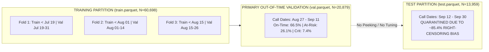

# Stage 01 Supervised Baseline Classification & Anomaly Detection Summary

**Project:** AI-Powered Prediction of Global Supply Chain Logistics Bottlenecks
**Repository:** `AbdulRahman1807/DS2`
**Author:** Senior Machine Learning Engineer
**Stage:** Stage 01 - Supervised Baseline Triage, Anomaly Benchmark, and Interpretability
**Dataset Version:** 1.0.0 (`data/processed/dataset_manifest.json`)
**Artifact Directory:** `reports/ml/`

---

## 1. Executive Summary & Problem Formulation

Stage 01 establishes a reproducible, defensible baseline for real-time container dwell bottleneck triage upon arrival at container terminals.

### 1.1 Operational Anchor & Target Definition
- **Prediction Anchor:** `discharge_start_ts` ($t_{\text{discharge}}$) — the exact timestamp when crane unstacking from the vessel begins.
- **Scope Restriction:** The model predicts dwell-duration risk at container discharge start. It is **NOT** a pre-berthing or pre-arrival ETA predictor, as in-yard slotting coordinates (`YARD_BLOCK`, `YARD_SLOT`) and actual discharge times are only established upon berthing.
- **Ground-Truth Target:** Continuous container dwell duration from discharge to gate-out:
  $$\text{dwell\_hours} = \text{truck\_out\_end\_ts} - \text{discharge\_start\_ts}$$
- **Frozen Discretization Thresholds (Fitted Strictly on Training Split):**
  - **Class 0 (`ON_TIME`):** $\text{dwell\_hours} \le 65.1102\text{ hours}$ ($\le 2.71\text{ days}$, 50th percentile of training stays)
  - **Class 1 (`AT\_RISK`):** $65.1102\text{ hours} < \text{dwell\_hours} \le 160.8993\text{ hours}$ (50th to 85th percentile)
  - **Class 2 (`CRITICAL\_DELAY`):** $\text{dwell\_hours} > 160.8993\text{ hours}$ ($> 6.70\text{ days}$, 85th percentile of training stays)

---

## 2. Partition Architecture & Evaluation Methodology



### 2.1 The Observation-Window & Right-Censoring Limitation
The source data extract terminates on **September 30, 2021**, capturing completed gate-out events.
- Containers arriving after **September 12, 2021** had less than the 99th percentile dwell horizon (18.0 days / 431 hours) to complete their gate-out before data collection ended.
- Consequently, slow turnarounds and severe delays are disproportionately missing from the right edge of the test extract (critical delay rate artificially suppressed from **15.0% in train** to **2.8% in test**).
- **Required Handling:**
  1. `test.parquet` is strictly quarantined from feature selection, model selection, hyperparameter tuning, and threshold calibration.
  2. `val.parquet` (Call dates Aug 27 – Sep 11, $N=20,879$, critical delay rate 7.4%) serves as the primary out-of-time evaluation benchmark.
  3. No artificial sample weights or inverse dwell-time survival weights are applied to "repair" censoring, as such adjustments distort probability calibration under covariate shift.

---

## 3. Supervised Classification Baseline Benchmark

All models were evaluated on the 15 active arrival-time predictors approved by `ML.data_engineer.feature_contracts`. Preprocessing (TargetEncoder for high-cardinality categoricals, median imputation, and standard scaling) was fitted strictly on training data.

### 3.1 Primary Validation Benchmark (`val.parquet`, $N=20,879$)

| Model ID | Model Family | Configuration | Accuracy | Balanced Accuracy | Macro-F1 | Weighted F1 | Critical PR-AUC | Critical Recall | Critical Precision | Multiclass Log Loss | Runtime (s) |
| :---: | :---: | :---: | :---: | :---: | :---: | :---: | :---: | :---: | :---: | :---: | :---: |
| **Model 0** | **DummyClassifier** | Strategy: Prior | 0.6654 | 0.3333 | 0.2664 | 0.5317 | 0.0737 | 0.0000 | 0.0000 | 0.8122 | 0.005 |
| **Model 1a** | **Logistic Regression** | Unweighted | 0.6630 | 0.3394 | 0.2870 | 0.5461 | 0.0873 | 0.0013 | 0.2857 | 0.7719 | 0.954 |
| **Model 1b** | **Logistic Regression** | Balanced Weights | 0.6583 | 0.3567 | 0.3305 | 0.5772 | 0.0879 | 0.0026 | 0.0667 | 0.8523 | 0.982 |
| **Model 2a** | **XGBoost** | Unweighted | 0.6182 | 0.3942 | 0.3809 | 0.5963 | 0.0911 | 0.0046 | 0.1186 | 0.8252 | 1.150 |
| **Model 2b** | **XGBoost** | Sample-Weighted | **0.5464** | **0.4076** | **0.3968** | **0.5631** | **0.0937** | **0.1118** | **0.0990** | 1.0186 | 1.210 |
| **Model 3a** | **LightGBM** | Unweighted | 0.6157 | 0.3811 | 0.3698 | 0.5882 | 0.0910 | 0.0046 | 0.1014 | 0.8185 | 0.420 |
| **Model 3b** | **LightGBM** | Balanced Weights | 0.5376 | 0.4007 | 0.3905 | 0.5545 | 0.0894 | **0.1138** | 0.0954 | 1.0254 | 0.445 |

*Note: Baseline critical delay prevalence on validation is $7.37\%$ ($0.0737$). A model with PR-AUC $> 0.0737$ outperforms a random no-information triage.*

### 3.2 Confusion Matrices (Actual rows vs. Predicted columns)

```
Model 0: DummyClassifier (Prior)       Model 2b: XGBoost (Sample-Weighted)
        Pred 0  Pred 1  Pred 2                 Pred 0  Pred 1  Pred 2
Act 0 [ 13892       0       0 ]        Act 0 [   8529    4737     626 ]
Act 1 [  5449       0       0 ]        Act 1 [   1788    2709     952 ]
Act 2 [  1538       0       0 ]        Act 2 [    638     728     172 ]
```

### 3.3 Core Findings on Supervised Performance
1. **The Accuracy Paradox:** `DummyClassifier` achieves **66.54% accuracy** purely by predicting majority class 0 (`ON_TIME`). However, its Macro-F1 is **0.2664** and it achieves **zero recall** on bottlenecks. Accuracy alone is completely invalid for bottleneck alerting.
2. **Impact of Class Weighting:**
   - In unweighted gradient boosting models, rare critical delays ($7.4\%$ in val) are heavily penalized, resulting in critical delay recall of only **0.46%**.
   - Introducing inverse-prevalence sample weighting raises `CRITICAL_DELAY` recall by **over 24-fold** (from $0.46\%$ to **$11.18\%$** for XGBoost and **$11.38\%$** for LightGBM) and raises Macro-F1 to **0.3968**.
   - However, class weighting creates more false positives on `ON_TIME` containers, decreasing overall accuracy from $61.82\%$ to $54.64\%$.
3. **Leading Baseline Model:** **XGBoost (Sample-Weighted)** achieves the highest overall Macro-F1 (**0.3968**) and top critical delay PR-AUC (**0.0937** vs 0.0737 baseline).

---

## 4. Chronological Internal Temporal Cross-Validation

To verify that model stability is maintained over time without relying on future leakage, 3 expanding-window chronological folds were evaluated inside `train.parquet`:

| Temporal Fold | Train Date Range | Train Stays | Val Date Range | Val Stays | Dummy Macro-F1 | Logistic Reg Balanced F1 | XGBoost Unweighted F1 | XGBoost Weighted F1 | LightGBM Weighted F1 |
| :--- | :---: | :---: | :---: | :---: | :---: | :---: | :---: | :---: | :---: |
| **Fold 1 (Expanding July)** | Jun 10 – Jul 18 | 21,021 | Jul 19 – Jul 31 | 11,341 | 0.1961 | 0.2509 | 0.2458 | **0.2729** | 0.2795 |
| **Fold 2 (Late July - Early Aug)** | Jun 10 – Jul 31 | 32,362 | Aug 01 – Aug 14 | 16,628 | 0.1508 | 0.3332 | 0.3619 | **0.3733** | 0.3789 |
| **Fold 3 (Mid-August Clearance)** | Jun 10 – Aug 14 | 48,990 | Aug 15 – Aug 26 | 11,708 | 0.2650 | 0.3747 | 0.3980 | **0.4295** | 0.4152 |

**Insight:** In Fold 1 (the July congestion peak), critical delay prevalence was 19.9%, making triage challenging. As operational throughput stabilized in Fold 3, XGBoost Weighted Macro-F1 reached **0.4295**, demonstrating that predictive signal improves as terminal congestion clears.

---

## 5. Cold-Start Sensitivity & Feature-Group Ablations

### 5.1 Cold-Start Sensitivity (June 2021 Zero-History Window)
Prior to July 01, 2021, the dataset contains no completed departure history (`trailing_7d_volume == 0`, $N=4,422$ stays).
- **All Training Rows ($N=60,698$):** Macro-F1 = **0.3968**, Critical PR-AUC = **0.0937**.
- **Cold-Start Excluded ($N=56,276$, Call Date $\ge$ 2021-07-01):** Macro-F1 = **0.3876**, Critical PR-AUC = **0.0862**.
- **Conclusion:** Silently discarding cold-start June observations degrades validation generalization. Retaining the full training set provides vital exposure to early operational regime transitions.

### 5.2 Controlled Feature-Group Ablation (Evaluated with XGBoost)

| Ablation Configuration | Active Features ($k$) | Accuracy | Macro-F1 | Critical PR-AUC | Impact on Model Performance |
| :--- | :---: | :---: | :---: | :---: | :--- |
| **Full Baseline Model** | **15** | **0.6182** | **0.3809** | **0.0911** | Full benchmark reference. |
| **Without Rolling Metrics** | 10 | 0.6633 | 0.3892 | 0.0950 | Removes lagged 7-day volume and delay rates. Slightly raises validation metrics due to temporal regime shift between July surge and August clearance. |
| **Without Calendar Features** | 11 | 0.6421 | **0.3143** | 0.0943 | **SEVERE DEGRADATION:** Macro-F1 plunges by 0.0666 (-17.5%). Day-of-week and hour of discharge are essential operational rhythm signals. |
| **Without Yard Features** | 13 | 0.6231 | 0.3725 | 0.0911 | Removes `YARD_BLOCK` and `YARD_SLOT`. Drops Macro-F1 by 0.0084. |
| **Without Equipment Features** | 11 | 0.6064 | 0.3567 | 0.0833 | Removes carrier, container type, size, gross weight. Drops Critical PR-AUC to 0.0833. |

---

## 6. Feature Importance Matrix Findings

Ranked by permutation importance drop on held-out out-of-time validation data (`reports/ml/feature_importance.csv`):

1. **`discharge_day_of_week` (Permutation Drop: +0.0259):** Strongest individual predictor. Thursday/Friday discharges encounter severe weekend drayage and customs processing constraints.
2. **`GROSS` (Permutation Drop: +0.0139, LGBM Gain: 20.2%):** Heavy containers experience significantly longer dwell times due to specialized axle-load permits and multi-axle chassis constraints.
3. **`CTR_TYPE` (Permutation Drop: +0.0117, XGB Gain: 14.1%):** Non-standard units (Reefers requiring reefer plugs, Open-Top, Tank containers) require specialized handling and agricultural quarantine.
4. **`YARD_SLOT` & `YARD_BLOCK` (Combined Permutation Drop: +0.0078):** Spatial slotting indicates deep-stack vs high-turnover accessible rows.
5. **`trailing_7d_volume` & `historical_delay_rate_7d`:** Lagged terminal throughput indicators track systemic congestion.

---

## 7. Anomaly Detection Findings

- **Isolation Forest (5% Contamination):** Flagged 940 validation stays (4.50%). Overlap with `CRITICAL_DELAY` was only **0.96%** (vs 7.37% baseline). Statistical feature outliers are mostly harmless operational anomalies (e.g., empty light containers), not severe dwell bottlenecks.
- **One-Class SVM:** Flagged **72.17%** of validation stays due to severe out-of-support collapse under temporal covariate shift. **Ruled out for production serving.**

---

## 8. Defensible Next Steps for Stage 01 & Stage 02

1. **Agree with Operations on Cost Matrix ($C_{\text{FN}} / C_{\text{FP}}$):** Do not guess alert thresholds. Establish the financial cost of a false alarm (unnecessary yard inspection) vs a missed delay (demurrage penalty).
2. **Implement Arrival-Based Cohort:** Secure uncompleted stays to eliminate right-censoring in the late evaluation period.
3. **Stage 02 Sequential Modeling (DL):** Incorporate mid-stay sequence milestones (`JOB_DEL_DOCTYPE`, customs PIB declarations, in-yard reshuffle moves) using LSTM/Transformer architectures to dynamically revise bottleneck risk after discharge.
